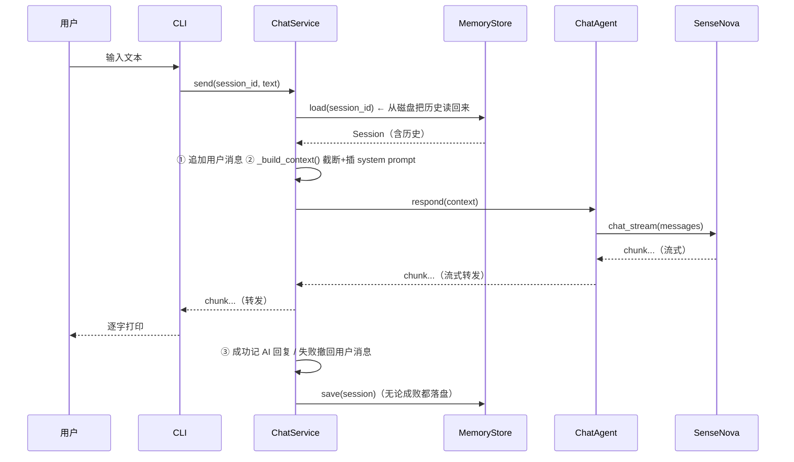

# 03 记忆系统（M2）

> **目标**：让模型在一次会话中记住多轮对话（上下文），并把历史持久化到磁盘，重启程序后仍可继续对话。
>
> **本文档定位**：帮你**快速吃透 M2 这段代码、看懂项目进度**——不仅知道"做了什么"，还能落到"哪一行代码怎么写的"。建议阅读顺序：
> **1 全景图 → 2 数据流 → 3 代码变更地图（M2 比 M1 加了啥）→ 4 逐个模块 → 5 关键代码块逐行解读 → 6 实测发现 → 7 动手实验**。
> 前 4 节建立"地图"，第 5 节带你钻进代码；只想快速了解进度，看 3、6、8 三节即可。

---

## 1. 全景图：记忆系统在哪一层？

M2 在 M1 的基础上**加了一层"档案室"**。M1 是"一问一答、答完就忘"；M2 变成了"有人帮你把每一句话记到本子上，随时能翻出来"。

```
                    用户输入
                       │
                       ▼
┌─────────────────────────────────────────────┐
│  CLI  (src/cli.py)                          │  ← 界面层：读输入、打印、处理 /命令
└──────────────────────┬──────────────────────┘
                       │ service.send(session_id, text)
                       ▼
┌─────────────────────────────────────────────┐
│  ChatService  (src/core/service.py)         │  ← 编排层（记忆系统的"管家"）
│  职责：加载历史 → 组装上下文 → 调模型 →      │
│        记回复 → 落盘；失败还要撤回           │
└───────┬────────────────────┬────────────────┘
        │                    │
        ▼                    ▼
┌────────────────┐  ┌──────────────────────────┐
│  ChatAgent     │  │  MemoryStore (memory.py) │  ← 档案室：只负责读写 JSON
│  (agent.py)    │  │  Session 数据模型         │     文件，不掺对话逻辑
│  无记忆，只管   │  └──────────────────────────┘
│  "把消息丢给模型" │
└───────┬────────┘
        ▼
┌────────────────┐
│  BaseProvider  │  ← LLM 接口（SenseNova / OpenAI 兼容）
└────────────────┘
```

**一句话记住分工**（对照 02 的"界面问大脑、大脑找翻译"）：

> **管家(ChatService) 记笔记(MemoryStore) → 管家 把历史交给 翻译员(ChatAgent) → 翻译员 找 模型 要回答 → 管家 把回答也记下来**。

三条刻意设计的分工原则：

| 角色            | 知道什么              | 不知道什么                             |
| --------------- | --------------------- | -------------------------------------- |
| `ChatAgent`   | 消息列表 → 流式回复  | 不碰磁盘，不知道"会话"为何物           |
| `MemoryStore` | 读/写/列/删 JSON 文件 | 不懂对话，不会调模型                   |
| `ChatService` | 全部编排逻辑          | 不直接联网，不直接写文件（都委托出去） |

这样分的好处和 02 一模一样：**将来要改任何一处，其它层都不用动**。比如做"上下文压缩"只改 ChatService，换存储（改存 SQLite）只改 MemoryStore。

---

## 2. 数据流：一条消息的完整旅程



**关键在于最后两步**：每轮对话结束，不管成功还是失败，管家都会把会话**写回磁盘**。所以哪怕程序中途崩溃（已写完的部分），历史也不会全丢。

---

## 3. 代码变更地图：M2 相比 M1 加了/改了哪些文件？

这是看懂"项目进度"最快的一节。M1（02 文档）到 M2 的代码变化，一张表说清：

| 文件                           | 状态               | 改了什么                                                                                                                |
| ------------------------------ | ------------------ | ----------------------------------------------------------------------------------------------------------------------- |
| `src/core/memory.py`         | 🆕**新增**   | `Session` 数据模型 + `MemoryStore` 文件存储（整个档案室）                                                           |
| `src/core/service.py`        | 🆕**新增**   | `ChatService` 编排层：历史组装 / 截断 / 回滚 / 落盘                                                                   |
| `tests/test_memory.py`       | 🆕**新增**   | 20+ 个测试，覆盖 token 估算、存储、截断、重启续接                                                                       |
| `src/core/models.py`         | ✏️**改动** | `Message` 加 `created_at`/`token_count`/`estimate_tokens()`；`Conversation` 加 `add()`/`to_openai_list()` |
| `src/core/agent.py`          | ✏️**改动** | `respond()` 参数从单条 `str` → 整段 `list[Message]`；加 `provider` 属性                                        |
| `src/config.py`              | ✏️**改动** | 加`session_dir`/`system_prompt`/`max_history_turns`/`max_history_chars`                                         |
| `src/cli.py`                 | ✏️**改动** | `build_agent()` → `build_service()`；加命令循环 `/new /sessions /use /clear`                                     |
| `src/core/provider.py`       | ➖**不变**   |                                                                                                                         |
| `src/providers/sensenova.py` | ➖**不变**   |                                                                                                                         |
| `src/core/utils.py`          | ➖**不变**   |                                                                                                                         |

**最值得记住的一条**：M2 **完全没动** `provider.py` 和 `sensenova.py`。因为"记忆"是**上层组装历史**的事，底层模型只负责"收到一串消息就答"——它根本不关心这串消息是 1 条还是 20 条、要不要截断。这就是 02 里"分层架构"的红利第一次兑现：**加一个全新的大功能，最底层的联网代码一行没改**。

改动最微妙的是 `agent.py`：`respond()` 的**签名变了**（`str` → `list[Message]`），但"职责"没变（还是"把消息交给 provider"）。这体现了 02 里说的一句话——"接口 `respond()` 不变，上层不用改"，只不过 M2 是把"接口内部承载的内容"升级了（从一句话变成一段历史）。

---

## 4. 逐个模块讲解

### 4.1 `Message`（src/core/models.py）—— 消息模型，加了两个"备忘字段"

M1 的 `Message` 只有 `role + content`。M2 加了两个**可选字段**和一个**估算方法**：

```python
@dataclass
class Message:
    role: Role            # system / user / assistant
    content: str
    created_at: str | None = None   # 时间戳（见下方 ⚠️）
    token_count: int = 0            # token 估算缓存，0 = 未缓存

    def estimate_tokens(self) -> int: ...
    def to_openai_dict(self) -> dict: ...  # 只输出 role + content
```

- **`to_openai_dict()` 只输出 `role + content`**：内部字段（`created_at` / `token_count`）不下发给模型，避免 API 报"多余字段"的错。

> ⚠️ **两个"看似有用、目前其实没被用"的字段，务必看清楚**：
>
> - **`created_at` 永远为 `None`**。业务代码里没有任何地方给它赋值（`Conversation.add()` 和 `Session.from_dict()` 都不填），也不参与持久化（磁盘 JSON 里消息只有 `role + content`）。它只是"预留位"，等将来要做按时间排序/调试时才启用。
> - **`estimate_tokens()` / `token_count` 目前是"死代码"**——只有 `tests/test_memory.py` 里的测试在调它，**截断逻辑完全没用它**（见 4.3 的截断策略）。它是为 M4「按 token 数精确截断」预留的，现在只是把算法写好、测好放在那里。
>
> 所以别误会：**当前"上下文超限"是按"字符数"算的，不是按"token 数"算的。**

### 4.2 `Session` & `MemoryStore`（src/core/memory.py）—— 档案室

**每个会话 = 一个独立 JSON 文件**，存在 `data/sessions/` 下：

```
data/sessions/
├── 20260913-150646-730900.json
├── 20260913-150707-784666.json
└── ...
```

一个文件长这样（真实内容）：

```json
{
  "id": "20260913-150646-730900",
  "created_at": "2026-09-13 15:06:46.730900",
  "updated_at": "2026-09-13 15:07:07.784666",
  "messages": [
    { "role": "user", "content": "请记住：我叫小明" },
    { "role": "assistant", "content": "好的，小明！" }
  ]
}
```

| 字段           | 含义                                     | 谁改它                                     |
| -------------- | ---------------------------------------- | ------------------------------------------ |
| `id`         | 会话唯一编号，形如`年月日-时分秒-微秒` | 创建时定死，永不变                         |
| `created_at` | 创建时间                                 | 创建时定死，永不变                         |
| `updated_at` | **最近更新时间**                   | **每次 `save()` 都会刷新成"现在"** |
| `messages`   | 消息数组，每个元素只有`role + content` | 每轮对话追加                               |

> 💡 **`id` 的两个妙处**：既"可读"（一眼看出创建时间），又"可排序"（按时间自然递增）。末尾的微秒段是为了**同一秒内连点两次 `/new` 也不会撞号**。

**关键 API**：

| 方法              | 说明                                                    |
| ----------------- | ------------------------------------------------------- |
| `create()`      | 新建会话并立即落盘                                      |
| `load(id)`      | 读指定会话；不存在返回`None`                          |
| `save(session)` | **刷新 `updated_at`** 并写盘                    |
| `list()`        | 按`updated_at` **倒序**（最新在前）返回所有会话 |
| `latest()`      | 返回最新会话；无则`None`                              |
| `delete(id)`    | 删除对应 JSON 文件                                      |

两个容易忽略的细节：

1. **`list()` 会跳过损坏的 JSON 文件**（`try/except` 兜底）。哪怕某天你手抖改坏了一个文件，程序启动也不会崩，只是那个会话"隐身"了。
2. **`delete(id)` 目前没有任何 CLI 命令调它**——功能上"能删"，但界面上还没给入口（未来可加 `/delete` 命令）。

### 4.3 `ChatService`（src/core/service.py）—— 管家（记忆系统的核心）

M2 里 90% 的新逻辑都在这里。

#### send() 核心流程（六步）

```python
def send(self, session_id, text):
    session = self._memory.load(session_id)      # 1. 从磁盘加载历史
    conv.add(Role.USER, text)                    # 2. 先记下用户这句话
    context = self._build_context(session)       # 3. 截断 + 插入 system prompt
    try:
        for chunk in self._agent.respond(context):
            yield chunk                          # 4. 流式转发给界面
    except (GeneratorExit, Exception):
        conv.messages.pop()                      # 5. 失败/打断 → 撤回用户消息
        raise
    else:
        conv.add(Role.ASSISTANT, reply)          # 5'. 成功 → 记下 AI 回复
    finally:
        self._memory.save(session)               # 6. 无论如何都落盘
```

> [!IMPORTANT]
> **失败回滚**：请求失败或用户 Ctrl+C 打断时，把刚加的"用户消息" `pop()` 掉，保证磁盘上永远是**"有问有答"的完整对话**。这靠 `try/except/else/finally` 四段结构实现——`finally` 保证无论成败都写盘。

#### _build_context() / _trim() 截断策略

发给模型的消息 = `system prompt + 截断后的历史`。截断有**双上限**，从最旧开始丢：

1. **轮数上限** `max_turns`（默认 20）：只保留**最近 N 个"用户问题"及其之后的所有内容**（即最近 N 组问答）。
2. **字符上限** `max_chars`（默认 10000）：总字符数超限时，**成对丢弃最旧的"问题+回答"**，直到不超或只剩最后 2 条。

用实测数据看最直观（`max_turns=2`，输入 6 组问答）：

```
输入: Q0 A0 Q1 A1 Q2 A2 Q3 A3 Q4 A4 Q5 A5   (12 条)
     ──────────── 丢弃 ──────────── 保留 ─────
输出:                           Q4 A4 Q5 A5   (4 条 = 2 组问答)
```

> [!TIP]
> **扩展点**：将来做「上下文压缩」（Summary Memory），只替换 `_trim`，接口不变——把"硬截断丢弃"换成"先让 LLM 总结最旧对话，再保留摘要 + 最近原始消息"。
>
> **另一个隐藏扩展点**：`_trim` 目前用 `len(m.content)` 数字符，很粗。将来接上 `Message.estimate_tokens()`（4.1 里那个"死代码"），就能改成按 token 精确截断。

#### 其它方法

| 方法                   | 作用                                                   |
| ---------------------- | ------------------------------------------------------ |
| `new_session()`      | 新建会话（转交 MemoryStore）                           |
| `get_session(id)`    | 查会话                                                 |
| `list_sessions()`    | 列全部                                                 |
| `clear_session(id)`  | 清空消息，但**保留 id / created_at**             |
| `resume_or_create()` | **启动用**：优先续"最新一个非空会话"；没有则新建 |

> 💡 **`resume_or_create()` 的细微行为**：它是"优先续**非空**会话"。因为空会话可能是你 `/new` 之后啥也没说就退出的，直接续它会让你对着空界面发愣。所以它跳过空会话，找最近一个"真正聊过天"的。

---

## 5. 关键代码块逐行解读

这一节把 M2 最核心的几段代码**逐行拆开讲**，是"从看懂到会写"的关键。建议配合源码一起看（都在 `src/core/` 下）。

### 5.1 序列化/反序列化：对象 ↔ JSON 的翻译器

```python
# src/core/memory.py —— Session 的两个方法
def to_dict(self) -> dict:
    """对象 → 字典（准备写盘）"""
    return {
        "id": self.id,
        "created_at": self.created_at,
        "updated_at": self.updated_at,
        "messages": self.conversation.to_openai_list(),   # 借 Conversation 转成 role+content 列表
    }

@classmethod
def from_dict(cls, data: dict) -> "Session":
    """字典 → 对象（刚从磁盘读回来）"""
    messages = [
        Message(role=Role(m["role"]), content=m["content"])   # 把 "user" 字符串转回枚举 Role.USER
        for m in data["messages"]
    ]
    return cls(
        id=data["id"],
        conversation=Conversation(messages=messages),
        created_at=data.get("created_at", ""),
        updated_at=data.get("updated_at", ""),
    )
```

**解读**：

- 这对方法是**内存对象**和**磁盘 JSON** 之间的"翻译器"。写盘前 `to_dict`，读盘后 `from_dict`，只有 `MemoryStore` 会调它们。
- `from_dict` 里 `Role(m["role"])` 是关键一行：JSON 里存的是字符串 `"user"`，但代码里要用枚举 `Role.USER` 才能比较，所以要转回来。
- 注意 `from_dict` **不重建 `created_at`/`token_count`** 到每条消息上（`Message` 只传了 `role`、`content`）——这就是 4.1 里说"`Message.created_at` 永远是 `None`、不持久化"的根源。

### 5.2 MemoryStore 的读写：真正碰磁盘的三段代码

```python
# src/core/memory.py
def save(self, session: Session) -> None:
    session.updated_at = _now()                          # ① 每次写盘都刷新更新时间
    with self._path(session.id).open("w", encoding="utf-8") as f:
        json.dump(session.to_dict(), f, ensure_ascii=False, indent=2)  # ②

def load(self, session_id: str) -> Session | None:
    path = self._path(session_id)
    if not path.exists():
        return None                                      # ③ 查无此会话是"正常情况"，返回 None 不抛异常
    with path.open("r", encoding="utf-8") as f:
        return Session.from_dict(json.load(f))

def list(self) -> list[Session]:
    sessions = []
    for path in self._dir.glob("*.json"):                # ④ 扫描目录里所有 json
        try:
            with path.open("r", encoding="utf-8") as f:
                sessions.append(Session.from_dict(json.load(f)))
        except (json.JSONDecodeError, KeyError, ValueError, OSError):
            continue                                     # ⑤ 损坏文件直接跳过，不拖垮整个列表
    sessions.sort(key=lambda s: s.updated_at, reverse=True)  # ⑥ 最新在前
    return sessions
```

**逐行解读**：

- **①** `save()` 每次都会把 `updated_at` 刷新成"现在"。所以"更新时间"其实反映的是"最后一次写盘时间"，这也是 `/clear` 之后该会话会排到最前面的原因（清空也要写盘）。
- **②** `json.dump(..., ensure_ascii=False, indent=2)` 两个参数很重要：`ensure_ascii=False` 让中文直接以汉字写入（否则会变成 `你好` 这种转义）；`indent=2` 缩进 2 格，方便你直接打开文件读。
- **③** `load` 返回 `None` 而不是抛异常——"会话不存在"是常规状态，交给调用方（`ChatService.send`）决定怎么处理（它会抛 `ValueError`）。
- **⑤** 这个 `try/except` 是健壮性关键：只要有一个文件坏了，其余会话照常列出，程序照常启动。
- **⑥** `sort` 直接拿 `updated_at` 字符串比大小，为什么可行？因为时间格式 `%Y-%m-%d %H:%M:%S.%f` 是"位数对齐、大单位在前"的，**字符串的字典序恰好等于时间先后序**。这是用字符串存时间的隐性好处（但也是坑——如果哪天格式改乱，排序就错了）。

### 5.3 `_trim()`：截断算法的真实代码

```python
# src/core/service.py
def _trim(self, msgs: list[Message]) -> list[Message]:
    # 1) 轮数上限：定位所有 user 消息的下标
    user_positions = [i for i, m in enumerate(msgs) if m.role is Role.USER]
    if len(user_positions) > self._max_turns:
        msgs = msgs[user_positions[-self._max_turns]:]   # 只保留"倒数第 N 个 user"及其之后

    # 2) 字符上限：成对丢弃最旧的一组"问题+回答"
    while len(msgs) > 2 and sum(len(m.content) for m in msgs) > self._max_chars:
        msgs = msgs[2:]
    return msgs
```

**逐行解读**：

- **第一段**：`enumerate` 给每条消息编号，筛出 user 消息的下标。假设 12 条消息（6 问 6 答），user 下标是 `[0,2,4,6,8,10]`，`max_turns=2` 时 `user_positions[-2:]` 取 `[8,10]`，`msgs[8:]` 就是从第 8 条切到末尾 = 保留最后 2 组问答。**"轮数"的数学本质是"从倒数第 N 个 user 消息那里下刀"**。
- **第二段**：`while len(msgs) > 2` 是**保底**——哪怕删到只剩 2 条还在超限，也不再删，至少保留最近一组问答。`msgs[2:]` 之所以能"每次砍 2 条"，是因为它**假设消息是 (user, assistant) 成对出现的**。
- **为什么这个假设安全？** 因为 `send()` 的失败回滚（4.3）保证了磁盘上的历史永远是"有问有答"的成对结构，不会出现孤立的 user 消息。这是两个函数之间的**隐性约定**——改一个，另一个的假设可能就破了。
- **注意它是纯函数**：`_trim` 只对传入的 `msgs` 动手。而 `_build_context` 在调用前会先 `list(session.conversation.messages)` **拷贝一份**，所以截断不会污染磁盘上保存的完整历史。这也是"内存里截断，磁盘上完整"的实现方式。

### 5.4 `ChatAgent.respond()`：M2 改动了什么

```python
# src/core/agent.py
# M1 旧签名：def respond(self, message: str)      —— 只收一句话
# M2 新签名：
def respond(self, messages: list[Message]) -> Iterator[str]:
    cleaned = [Message(m.role, scrub_text(m.content)) for m in messages]  # ① 逐条清洗
    yield from self._provider.chat_stream(cleaned)                        # ② 整段交给 provider
```

**解读**：

- **签名从 `str` 变 `list[Message]`**，是 M2 对 agent 唯一的改动。但它依然"无记忆"——它不知道这串消息是 1 条还是 20 条、有没有被截断、要不要加 system prompt，那些都是 `ChatService` 在调用它**之前**做好的。
- **①** `scrub_text` 逐条清洗，防 Windows 编码坏字符（孤立代理项）导致请求序列化崩溃。注意它是**重新构造** `Message(m.role, ...)`，而不是原地改，避免了意外改动上游对象。
- **②** `yield from` 是"流式转发"的写法——把 provider 吐出的每一段原样转交给调用方，自己不留存。

### 5.5 CLI 的命令循环：所有命令本质都是"调 service 一个方法"

```python
# src/cli.py —— main() 里的命令分派
if text == "/new":
    session = service.new_session()          # 换个新会话，并把"当前会话"指针指向它
elif text == "/sessions":
    _print_sessions(service)                 # 调 list_sessions() 打印
elif text.startswith("/use "):
    session = service.get_session(sid)       # 切换到指定会话
elif text == "/clear":
    service.clear_session(session.id)        # 清空当前会话
```

**解读**：

- 注意 `session` 是 CLI 里一个**局部变量**，代表"当前正在聊的会话"。`/new` 和 `/use` 都只是**改这个变量指向谁**；真正把数据写进磁盘的是 service 内部调用的 `MemoryStore.save()`。
- CLI **完全不知道** JSON 存哪、怎么截断、怎么回滚——它只认识"发消息"和"切会话"这两个动作。这就是分层：**界面只管交互，编排全在 service**。将来加 Web 界面时，同样只调 service 这几个方法，包一层 HTTP 就行。

---

## 6. 配置项（src/config.py）

| 环境变量              | 默认值                           | 说明                                       |
| --------------------- | -------------------------------- | ------------------------------------------ |
| `SESSION_DIR`       | `data/sessions`                | JSON 会话文件存放目录                      |
| `SYSTEM_PROMPT`     | 你是由商汤日日新驱动的 AI 助手… | 每轮头部插入的系统提示词（已含记忆认知 + 禁工具调用，见第 8 节） |
| `MAX_HISTORY_TURNS` | `20`                           | 上下文保留的最大**轮数**（组问答）   |
| `MAX_HISTORY_CHARS` | `10000`                        | 上下文最大**字符数**（不是 token！） |

> ⚠️ **命名不一致的小坑**：模型相关的环境变量都带 `SENSENOVA_` 前缀（如 `SENSENOVA_API_KEY`），但记忆相关的这几个**没有前缀**。实测 `SENSENOVA_SESSION_DIR` 这种写法是**不生效**的，正确写法就是 `SESSION_DIR`。

---

## 7. CLI 命令

| 命令          | 说明                                          |
| ------------- | --------------------------------------------- |
| `/new`      | 新建会话（旧会话留在磁盘，可随时切回）        |
| `/sessions` | 列出所有会话（id + 时间 + 消息数 + 首条预览） |
| `/use <id>` | 切换到指定会话                                |
| `/clear`    | 清空当前会话历史                              |
| `/help`     | 显示帮助                                      |
| `/exit`     | 退出                                          |

---

## 8. 实测发现（2026-09-13 真实调用验证）

我真实跑通了整个流程（新建 → 多轮 → 重启 → 续接），发现两个**和直觉相反、但很重要**的现象。**这两个现象都已通过修改 `SYSTEM_PROMPT`（src/config.py）修复**——现在的系统提示词由三段组成：

> ① 角色设定 → ② **「关于记忆」**：告诉模型它有跨重启的持久记忆 → ③ **「关于输出」**：要求只输出纯文本、禁止工具调用标签。

下面先讲现象本身（理解问题），再看怎么修的。

### 现象一：模型"不知道自己有记忆"

你告诉它"我叫小明"，重启后它**确实**记得（因为历史从磁盘读回来了）。但如果你问它"重启之后你还记得我吗？"，它会回答：

> "抱歉，我没有长期记忆，重启对话后就会忘了……"

**这不是 bug**。原因是：记忆是**我们代码层面**在做（读历史文件、拼进上下文），但 `SYSTEM_PROMPT` 里没有告诉模型"你是有持久记忆的"。模型基于自己的常识，以为每次对话都是全新的。

> **已修复**：`SYSTEM_PROMPT` 现在明确告诉模型「系统会在每轮对话后把会话历史存盘、重启后自动重载，你对当前会话拥有连续完整的记忆——这是既定能力，不是你的推测」，并要求它被问到时**直接肯定回答"记得"**、主动说出记得的内容。
>
> ⚠️ **提示词方法的固有局限**：语言模型对"自己有没有记忆"的自我认知本就不稳，措辞再权威也可能偶发回退到"LLM 无长期记忆"的常识。若要 100% 稳定，需在代码层兜底（属于 M4 之后的事）。

### 现象二：模型会吐出"假的工具调用"

真实对话里，模型有时会输出这种文本（我实测遇到过）：

```
让我先检查一下现有的记忆。

<tool_call>
<parameter=memories>["用户代号", "北极星"]</parameter>
</function>
```

这是**商汤服务端自己内置了记忆工具**，模型"以为"能调工具，于是把工具调用**当成普通文本吐了出来**，而我们的 CLI 会原样打印出来。**这也是服务端行为，不是我们代码的 bug**——我们只是把流式文本如实转发。

> **已修复**：`SYSTEM_PROMPT` 现在明确要求「你是纯文本助手，本系统没有工具调用功能，不要输出任何工具调用标签 / XML / JSON 结构」。
>
> ⚠️ **提示词不是 100% 保险**：工具调用是商汤服务端模型的内置行为，靠提示词只能"压低概率"、不能"根除"。彻底解决要靠 M3 在代码里**真正实现工具调用**（把模型想调的 `memory_search` 变成真能力），或对输出做后处理过滤。目前先用提示词压住，足够 MVP 用。

---

## 9. 动手对照小实验

按顺序跑，感受记忆系统各模块协作：

```bash
# 1. 造一个会话，看磁盘 JSON 长什么样
python -c "from src.core.memory import MemoryStore; from src.core.models import Role; s=MemoryStore('data/tmp').create(); s.conversation.add(Role.USER,'你好'); MemoryStore('data/tmp').save(s); import glob; print(open(glob.glob('data/tmp/*.json')[0],encoding='utf-8').read())"

# 2. 看 Message 的 token 估算与 openai 字典（体会"内部字段不下发"）
python -c "from src.core.models import Message,Role; m=Message(Role.USER,'你好world'); print('tokens≈',m.estimate_tokens()); print('下发:',m.to_openai_dict())"

# 3. 真实端到端：新建会话→记名字→查名字→模拟重启→再查（会真实调模型，耗额度）
python scripts/e2e_check.py

# 4. 正常跑 CLI
python -m src.cli
#   输入「我叫小明」→「我叫什么名字」→ 应回答小明
#   Ctrl+C 退出 → 再次启动 → 输入「我叫什么名字」→ 仍记得（历史从磁盘恢复）
```

> 跑完记得清掉 `data/tmp`：`rm -rf data/tmp`。

---

## 10. 测试验证了什么（怎么看懂进度）

`tests/test_memory.py` 是 M2 的"验收单"，20+ 个测试对应 5 类行为，读一遍就知道"哪些功能被保证了"：

| 测试分组                          | 测什么                                      | 对应代码                      |
| --------------------------------- | ------------------------------------------- | ----------------------------- |
| `estimate_tokens_*`             | token 估算（中文/英文/混合/缓存/空）        | `Message.estimate_tokens()` |
| `store_*`                       | 会话增删改查、磁盘 JSON、损坏文件跳过、排序 | `MemoryStore`               |
| `service_send_*`                | 单轮/多轮上下文、重启续接                   | `ChatService.send()`        |
| `service_trim_*`                | 轮数截断、字符截断                          | `ChatService._trim()`       |
| `service_clear/new/list/resume` | 清空、新建、列举、启动续接                  | `ChatService` 各方法        |

**关键技巧**：测试用了一个 `FakeProvider`（假 provider，见 `test_memory.py` 顶部），**每次调用都记录"模型收到了什么消息"**。所以能断言"第二轮对话时，模型收到的上下文是 `[system, user1, assistant1, user2]`"——**不花一分钱额度，就验证了上下文组装是否正确**。这就是 02 里"依赖注入"的回报：把假 provider 传进去，就能测核心逻辑。

---

## 11. 小结：和 02 对照，M2 到底加了什么？

|                | M1（02 文档）                      | M2（本文档）                                                        |
| -------------- | ---------------------------------- | ------------------------------------------------------------------- |
| 核心文件       | agent / provider / sensenova / cli | **新增 memory / service，改造 cli / models / agent / config** |
| 模型记性       | 一问一答，答完就忘                 | 多轮上下文，重启不丢                                                |
| 谁在编排       | cli 直接调 agent                   | **ChatService 居中编排**                                      |
| 数据存哪       | 不存                               | `data/sessions/*.json`                                            |
| 上限           | 无                                 | 轮数 + 字符 双上限截断                                              |
| 出错处理       | 无                                 | 失败回滚，保证"有问有答"                                            |
| 最底层联网代码 | —                                 | **一行没改**（provider/sensenova 原样）                       |

一句话总结：**M1 造了"会说话的大脑"，M2 给大脑配了"笔记本和管家"——管家负责把每次对话记进本子、翻出来、整理好再交给大脑，而大脑（以及它背后联网的"嘴"）本身不用做任何改动。**
