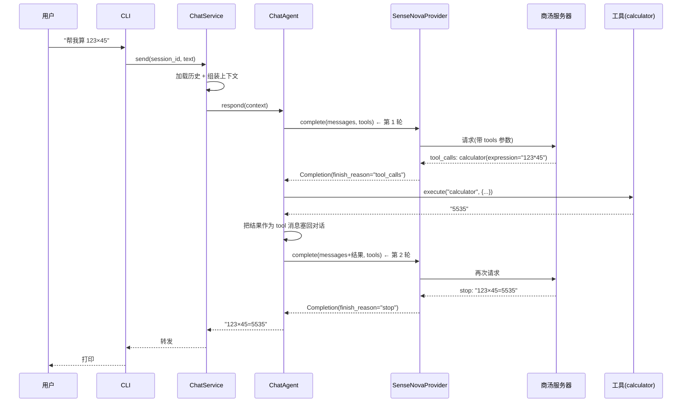
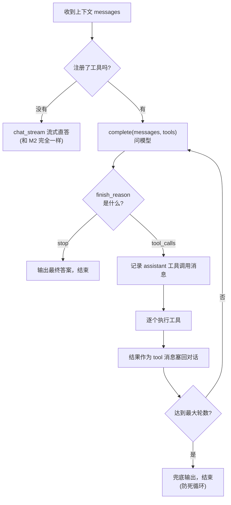

# 04 工具调用（M3）

> **目标**：让 Agent 从「只会说话」进化到「会办事」——当问题需要计算、查时间等具体操作时，模型能主动调用工具，拿到真实结果后再组织最终回答。
>
> **本文档定位**：帮你**快速吃透 M3 这段代码、看懂项目进度**，落到「哪一行代码怎么写的」。建议阅读顺序：
> **1 全景图 → 2 数据流（时序图）→ 3 代码变更地图 → 4 逐个模块 → 5 关键代码块逐行解读 → 6 流程图 → 7 实测发现 → 8 动手实验**。
> 只想快速了解进度，看 3、6、7 三节即可。

---

## 1. 全景图：M3 给 Agent 装了什么？

M2 的 Agent 是「一问一答的翻译员」——只会把话传给模型再传回来。M3 把它升级成**「会打电话求助手的翻译员」**：遇到算不清、查不到的事，先打给工具，拿到结果再回答。

先回顾 M1/M2 的直答流程（一句话 → 一次模型调用 → 回复）：

```
  你问一句  ──►  模型  ──►  直接回答
```

M3 变成了「循环」，中间可以**反复调工具**：

```
  你问一句 ──► 模型 ──► 想调工具? ──是──► 执行工具 ──► 结果塞回 ──► 再问模型
                    │                                        ▲
                    └────── 否（想好答案了） ──► 直接回答 ─────┘
```

这套「**问模型 → 行动 → 再问**」的循环，学名叫 **ReAct**（Reasoning + Acting，边想边做）。

**落在架构上，M3 只动了两个地方，其余全不变：**

```
┌─────────────────────────────────────────────────────────┐
│  ChatService（记忆编排，M2 做好，M3 一行没改）            │
└──────────────────────────┬──────────────────────────────┘
                           │ agent.respond(完整上下文)
                           ▼
┌─────────────────────────────────────────────────────────┐
│  ChatAgent —— ReAct 循环（M3 的核心改动）                 │
│   问模型(带 tools) → 要调工具? → 执行 → 结果塞回 → 再问    │
└────────────┬───────────────────────┬────────────────────┘
             ▼                       ▼
      ┌──────────────┐       ┌──────────────────┐
      │ BaseProvider │       │  ToolRegistry    │   ← M3 新增
      │  complete()  │       │  (core/tools.py) │
      └──────────────┘       └──────────────────┘
```

**一句话记住分工**（对照 M2 的「管家 / 翻译员」）：

> **管家(ChatService) 还是管家，负责记笔记；翻译员(ChatAgent) 这次学会了打电话——遇到要算数、查时间，就打给「工具」这个助手，拿到答案再翻译给用户。**

三块「新东西」各自负责什么：

| 角色                        | 知道什么                                      | 不知道什么         |
| --------------------------- | --------------------------------------------- | ------------------ |
| `ToolRegistry`            | 有哪些工具、怎么执行它们                      | 不碰模型、不管对话 |
| `BaseProvider.complete()` | 把「带 tools 的请求」发给模型，返回结构化结果 | 不知道工具怎么执行 |
| `ChatAgent`（循环）       | 两者怎么配合：调工具 → 塞结果 → 再问        | 不知道工具内部实现 |

---

## 2. 数据流：带工具的一次完整对话（时序图）

以「帮我算 123×45」为例，看一次工具调用从头到尾经过了谁：



**三个关键点**：

1. **工具执行发生在 Agent 内部**（`AGT->>TOOL` 是本地的 Python 函数调用，不是又发一次网络请求）。真正联网的只有「问模型」那两段。
2. **模型至少要问两轮**：第一轮模型不直接回答，而是"要求"调工具；第二轮拿到工具结果后才给出最终答案。所以带工具的请求会比纯对话**多一次（或几次）模型调用**。
3. **中间的工具调用对用户透明**——用户在 CLI 里只看到最终的 "123×45=5535"，看不到模型和工具之间的往返（代码里这些中间消息没有 yield 出去）。

---

## 3. 代码变更地图：M3 相比 M2 加了/改了哪些文件？

这是看懂「项目进度」最快的一节：

| 文件                           | 状态                       | 改了什么                                                                       |
| ------------------------------ | -------------------------- | ------------------------------------------------------------------------------ |
| `src/core/tools.py`          | 🆕**新增**           | `Tool` 数据模型 + `ToolRegistry` 注册表 + 计算器/查时间两个工具            |
| `tests/test_tools.py`        | 🆕**新增**           | 工具本身 + ReAct 循环测试（全 mock，不花额度）                                 |
| `src/core/models.py`         | ✏️**改动**         | `Role` 加 `TOOL`；`Message` 加 `tool_calls/tool_call_id/name` 三个字段 |
| `src/core/provider.py`       | ✏️**改动**         | 新增`Completion`/`ToolCall` 结构体 + `complete()` 抽象方法               |
| `src/providers/sensenova.py` | ✏️**改动**         | 实现`complete()`：透传 `tools` 参数 + 解析返回的 `tool_calls`            |
| `src/core/agent.py`          | ✏️**改动（核心）** | `respond()` 从「直答」换成「ReAct 循环」，注入 `ToolRegistry`              |
| `src/cli.py`                 | ✏️**改动**         | 构建 Agent 时注入`build_default_tools()`                                     |
| `src/config.py`              | ✏️**改动**         | 系统提示词从「禁止工具调用」改为「可以调用工具」                               |
| `src/core/service.py`        | ➖**不变**           | 记忆编排、回滚、截断、落盘，一行没改                                           |
| `src/core/memory.py`         | ➖**不变**           | 持久化仍只存 user + 最终 assistant                                             |

**和 M2 对比**：

- M2 加「记忆」时，最底层的联网代码（provider/sensenova）**一行没改**，因为"记忆"是上层拼历史的事。
- M3 加「行动」时，**这次要动 provider/sensenova**——因为要把 `tools` 参数传给模型、还要解析模型返回的 `tool_calls`。但仍是"薄改动"：`BaseProvider` 只是**加了方法**，原来的 `chat`/`chat_stream` 原样保留。
- 唯一完全没动的还是 `service.py` 和 `memory.py`——因为 M3 的循环在 `ChatAgent` 内部完成，外层"记忆编排"根本感知不到「这一轮模型中间调了几次工具」。

---

## 4. 逐个模块讲解

### 4.1 消息模型（src/core/models.py）—— 学会「说工具的话」

M1/M2 的 `Message` 只会说两种话：`role`（谁说的）和 `content`（说了啥）。M3 要表达两类**新的话**——「模型要调工具」和「工具执行的结果」：

```python
class Role(str, Enum):
    SYSTEM = "system"
    USER = "user"
    ASSISTANT = "assistant"
    TOOL = "tool"              # 新增：工具执行结果的角色

@dataclass
class Message:
    role: Role
    content: str
    created_at: str | None = None
    token_count: int = 0
    tool_calls: list[dict] | None = None   # 新增：模型发出的工具调用
    tool_call_id: str | None = None        # 新增：结果对应哪次调用
    name: str | None = None                # 新增：函数名
```

- **`tool_calls`**：挂在 `assistant` 消息上，表示"模型要求调这些工具"。存的是 OpenAI 协议的原生格式（`id` + `function.name` + `function.arguments`）。
- **`tool_call_id` + `name`**：挂在 `tool` 消息上，表示"这是某次调用的结果"。OpenAI 协议要求**结果必须带上原调用的 id**，模型才知道这条结果是回答哪次调用的。
- 三个字段都有默认值 `None`，所以旧代码（记忆系统里那些"只传 role+content"的地方）**完全不受影响**。

### 4.2 Provider 接口（src/core/provider.py）—— 从「返回文本」到「返回结构化结果」

M1/M2 的 provider 只会「返回一段文本」。但工具循环需要知道**「模型这轮是给了最终答案，还是要调工具」**——这是两种完全不同的返回，得用结构体表达：

```python
@dataclass
class ToolCall:
    id: str          # 调用 id（回填 tool 消息用）
    name: str        # 函数名
    arguments: str   # 参数 JSON 字符串

@dataclass
class Completion:
    finish_reason: str               # "stop"（最终答案）/ "tool_calls"（要调工具）
    content: str = ""                # 最终文本
    tool_calls: list[ToolCall] = field(default_factory=list)
```

```python
class BaseProvider(ABC):
    @abstractmethod
    def chat(self, messages) -> str: ...
    @abstractmethod
    def chat_stream(self, messages) -> Iterator[str]: ...
    @abstractmethod
    def complete(self, messages, tools=None) -> Completion:
        """非流式：一次调用，结构化返回（文本 或 工具调用）。"""
```

- **`complete()` 是新增的、也是 M3 的主角**；`chat`/`chat_stream` 原样保留，纯对话场景以后仍走流式。
- **为什么用非流式？** 工具调用必须先拿到模型的"完整决定"（到底调不调、调哪个、参数是什么），这本质上是一次"完整返回"，流式（一段段吐）反而不合适。

  > 🔁 **docs/16 把这句话拆成了两半**：「工具决定必须等整轮流完」仍然成立（工具参数是
  > 分段的 JSON 片段，必须攒齐才解析得出），但「正文因此也要等」已经不成立了——
  > `complete_stream()` 让正文在每一轮里逐 token 往外吐，只有工具决定在收尾时读出。

### 4.3 工具系统（src/core/tools.py）—— 新增的「工具间」

一个「工具」由两部分组成，**一份给模型看、一份给电脑跑**：

```python
@dataclass
class Tool:
    name: str
    description: str
    parameters: dict          # JSON Schema：告诉模型"这工具长什么样"
    func: Callable[..., str]  # 真正执行的函数：电脑怎么跑
```

| 字段                                        | 给谁看 | 作用                                                      |
| ------------------------------------------- | ------ | --------------------------------------------------------- |
| `name` / `description` / `parameters` | 模型   | 拼成 API 的`tools` 参数，让模型知道"有哪些工具、怎么用" |
| `func`                                    | 电脑   | 模型决定要调时，真正执行的 Python 函数                    |

M3 先做两个玩具工具（跑通闭环就够）：

| 工具                 | 参数           | 作用               |
| -------------------- | -------------- | ------------------ |
| `get_current_time` | 无             | 返回当前日期时间   |
| `calculator`       | `expression` | 安全计算数学表达式 |

> ⚠️ **calculator 为什么强调"安全"**：如果直接 `eval(expression)`，而模型的参数又被恶意构造（比如 `__import__('os').system('rm -rf /')`），就会执行任意代码。所以用 `ast` 模块把表达式解析成语法树，只放行「数字、四则运算、括号、正负号」这些白名单节点——具体见 5.2。

### 4.4 Agent 核心（src/core/agent.py）—— ReAct 循环（核心改动）

M2 的 `respond()` 就一句「把消息交给 provider」。M3 把它换成了循环。核心代码（完整逐行解读见 5.1）：

```python
class ChatAgent:
    def __init__(self, provider, tools=None, max_tool_rounds=5):
        self._provider = provider
        self._tools = tools if tools is not None else ToolRegistry()  # 不传工具=纯聊天
        self._max_tool_rounds = max_tool_rounds                       # 防死循环上限

    def respond(self, messages):
        schemas = self._tools.schemas()
        if not schemas:                     # 没工具 → 退回 M2 的流式直答
            yield from self._provider.chat_stream(cleaned)
            return
        for _ in range(self._max_tool_rounds):
            result = self._provider.complete(cleaned, tools=schemas)
            if result.finish_reason != "tool_calls":
                yield result.content          # 最终答案，结束
                return
            # 模型要调工具：记录调用 → 执行 → 结果塞回 → 下一轮再问
            ...
```

- **依赖注入**：`tools` 由外部传进来（cli.py 传的 `build_default_tools()`），测试时能传"假工具/空工具"，不花额度。
- **无工具退回流式**：`ChatAgent(provider)` 不传 tools 时，`schemas()` 为空，走原来的 `chat_stream`——这就是为什么 M2 的记忆测试（用 `ChatAgent(provider)`）**一行没改仍然全绿**。

### 4.5 接线（cli.py / config.py）

- **cli.py**：`build_service()` 里把 `ChatAgent(provider)` 改成 `ChatAgent(provider, tools=build_default_tools())`——只是多传一个工具。
- **config.py**：系统提示词里"关于输出：你是纯文本助手、禁止工具调用"（M2 为压住"假工具调用"现象加的）改成"**关于工具**：你可以调用系统提供的工具……"，因为现在真的有工具可调了。

---

## 5. 关键代码块逐行解读

这一节把 M3 最核心的几段代码拆开讲，配合源码看（都在 `src/core/` 下）。

### 5.1 ReAct 循环（src/core/agent.py）

```python
def respond(self, messages: list[Message]) -> Iterator[str]:
    cleaned = [Message(m.role, scrub_text(m.content)) for m in messages]  # ①
    schemas = self._tools.schemas()                                       # ②
    if not schemas:
        yield from self._provider.chat_stream(cleaned)                    # ③
        return

    last_content = ""
    for _ in range(self._max_tool_rounds):                                # ④
        result = self._provider.complete(cleaned, tools=schemas)          # ⑤
        last_content = result.content
        if result.finish_reason != "tool_calls":                          # ⑥
            yield result.content
            return
        cleaned.append(self._assistant_tool_call_msg(result.tool_calls))  # ⑦
        for tc in result.tool_calls:
            args = self._parse_args(tc.arguments)                         # ⑧
            output = self._tools.execute(tc.name, args)                   # ⑨
            cleaned.append(Message(role=Role.TOOL, content=output,        # ⑩
                                   tool_call_id=tc.id, name=tc.name))
    yield last_content                                                    # ⑪
```

**逐行解读**：

- **①** 和 M2 一样，逐条清洗输入，防 Windows 编码坏字符。注意这里**重建**了 `Message`（没动上游对象），和 M2 一个习惯。
- **②③** 拿到工具 schema；如果**一个工具都没有**，直接走原来的流式直答——这是"兼容旧行为"的关键分支，也是 M2 测试不破的原因。
- **④** `range(self._max_tool_rounds)` 是**防死循环的保险丝**：万一某个工具异常、模型一直要求调工具，最多跑 5 轮就强制收尾。
- **⑤** 核心调用：把当前对话 + 工具列表一起交给 provider。返回的 `Completion` 要么是 `stop`（最终答案），要么是 `tool_calls`（要调工具）。
- **⑥** `finish_reason != "tool_calls"` 就表示模型给出最终答案了 → `yield` 出去、结束。这是循环的**出口**。
- **⑦** 模型要调工具，先把这次"调用动作"作为一条 `assistant` 消息记进对话（模型下轮要看到"自己上轮要求调了什么"）。
- **⑧** 参数是 JSON 字符串，先 `json.loads` 转成 dict；空/坏 JSON 都给 `{}`（模型偶尔会写坏参数，不能让它崩）。
- **⑨** 真正执行工具，拿字符串结果。
- **⑩** 把结果作为一条 `tool` 消息塞回，**`tool_call_id` 必须等于⑦里的调用 id**——OpenAI 协议靠这个 id 把"结果"和"调用"对应起来。
- **⑪** 跑到轮数上限还没拿到答案时的兜底（返回最后一轮的内容，通常是空字符串），宁可空也不死循环。

### 5.2 安全计算器（src/core/tools.py）

```python
_BIN_OPS = {ast.Add: operator.add, ast.Sub: operator.sub, ...}  # ① 运算节点 → 真实函数

def _eval_node(node: ast.AST):
    if isinstance(node, ast.Constant) and isinstance(node.value, (int, float)):
        return node.value                                  # ② 数字直接返回
    if isinstance(node, ast.BinOp) and type(node.op) in _BIN_OPS:
        return _BIN_OPS[type(node.op)](                   # ③ 四则运算递归求值
            _eval_node(node.left), _eval_node(node.right))
    if isinstance(node, ast.UnaryOp) and type(node.op) in _UNARY_OPS:
        return _UNARY_OPS[type(node.op)](_eval_node(node.operand))  # ④ 正负号
    raise ValueError(f"不支持的表达式节点: {type(node).__name__}")  # ⑤ 其它一律拒绝

def calculate(expression: str) -> str:
    try:
        result = _eval_node(ast.parse(expression.strip(), mode="eval"))
        if isinstance(result, float) and result.is_integer():   # ⑥ 4.0 → 4
            result = int(result)
        return str(result)
    except Exception as exc:
        return f"计算失败：{exc}"                              # ⑦ 任何异常转成可读错误
```

**逐行解读**：

- **核心思想**：不 `eval` 字符串，而是先 `ast.parse` 把表达式变成语法树，再**只遍历自己认识的那几种节点**。
- **⑤** 是关键的安全防线——`__import__('os')` 这种表达式会解析成 `Call`/`Attribute` 节点，**不在白名单里，直接抛异常拒绝**。所以恶意表达式不会被执行，只会得到一句"计算失败"。
- **⑦** `calculate` 从不抛异常——任何非法输入都转成可读的错误字符串，让模型看到"算错了"并据实回答，而不是让程序崩溃。

### 5.3 ToolRegistry（src/core/tools.py）

```python
class ToolRegistry:
    def schemas(self) -> list[dict]:          # ① 给模型看的"工具菜单"
        return [
            {"type": "function",
             "function": {"name": t.name, "description": t.description,
                          "parameters": t.parameters}}
            for t in self._tools.values()
        ]

    def execute(self, name: str, args: dict) -> str:   # ② 给电脑跑的"执行"
        tool = self._tools.get(name)
        if tool is None:
            return f"未知工具：{name}"         # 模型编造了不存在的工具名
        try:
            return str(tool.func(**args))      # 把 JSON 参数展开成关键字实参
        except Exception as exc:
            return f"工具 {name} 执行失败：{exc}"
```

- **① `schemas()`** 是"翻译"——把内部 `Tool` 列表翻成 openai SDK 要求的 `tools` 参数格式。模型就是靠这份"菜单"知道有哪些工具、各自要什么参数。
- **② `execute()`** 做两重防御：工具名不存在、或执行报错，都不抛异常，而是返回可读错误。这样模型能拿到错误信息、下一轮自己纠正（比如换个参数）。

### 5.4 `complete()` 实现（src/providers/sensenova.py）

```python
def complete(self, messages, tools=None):
    kwargs = self._build_kwargs(messages, stream=False)   # ① 复用原有参数组装
    if tools:
        kwargs["tools"] = tools                           # ② 有工具才传
        kwargs["tool_choice"] = "auto"                    # 让模型自己决定要不要调
    attempt = 0
    while True:
        try:
            resp = self._client.chat.completions.create(**kwargs)
            choice = resp.choices[0]
            if choice.message.tool_calls:                 # ③ 模型要求调工具
                return Completion(
                    finish_reason="tool_calls",
                    tool_calls=[ToolCall(tc.id, tc.function.name, tc.function.arguments)
                                for tc in choice.message.tool_calls],
                )
            return Completion(                            # ④ 模型给了最终答案
                finish_reason=choice.finish_reason,
                content=choice.message.content or "",
            )
        except Exception as exc:
            if not _is_retryable(exc) or attempt >= self._max_retries - 1:
                raise
            attempt += 1
            time.sleep(2**attempt)                        # ⑤ 复用 M1 的重试逻辑
```

- **② `tool_choice="auto"`** 让模型自己判断"这问题需不需要工具"——不需要时它照样正常纯文本回答。
- **③** 把 SDK 返回的原始 `tool_calls`（结构很啰嗦）**精简**成我们自己的 `ToolCall`（只要 id/name/arguments 三个字段），上层循环只用这三样。
- **④** 把 `finish_reason`（stop 等）和最终文本一起返回，上层据此决定"结束还是继续循环"。
- **⑤** 重试逻辑和 `chat()` 完全一致（限流/断网自动退避），不重复造轮子。

### 5.5 Message 序列化（src/core/models.py）

```python
def to_openai_dict(self) -> dict:
    data = {"role": self.role.value, "content": self.content}
    if self.tool_calls is not None:      # 只在有工具字段时才下发
        data["tool_calls"] = self.tool_calls
    if self.tool_call_id is not None:
        data["tool_call_id"] = self.tool_call_id
    if self.name is not None:
        data["name"] = self.name
    return data
```

- 和 M2 一个精神：**按需下发**。普通消息（无工具）输出还是 `role + content`，完全兼容旧逻辑；只有工具相关的消息才多带字段。
- 这也保证了**持久化不受影响**——`MemoryStore` 落盘用的是同一个 `to_openai_dict`，但历史里只有 user/assistant 普通消息，所以 JSON 仍是干净的 `role + content`，不会混进工具调用的临时数据。

---

## 6. 流程图：ReAct 循环是怎么转起来的

把 5.1 的代码画成流程图，一次看懂循环的走向：



- **正常路径**是 `D → E → G → H → I → J(否) → D`，通常转 1~2 圈就从 `E` 走到 `F` 结束。
- **两个"保险"出口**：`B → C`（没工具就不折腾，退回流式）和 `J → K`（转太多圈就强制收尾）。

---

## 7. 实测发现（2026-09-14 真实调用验证）

### 发现一：flash-lite 支持原生 function calling（关键 Spike）

动手前唯一的疑问是「商汤这个模型到底支不支持原生工具调用」——**实测支持**。给它传 `tools` 参数后，它会返回标准的 `tool_calls` 结构（`id` + `function.name` + `function.arguments`），不用手写文本解析。脚本见 `scripts/spike_tools.py`。

### 发现二：工具和记忆能共存，重启后连"算过什么"都记得

真实端到端（`scripts/e2e_tools.py`）跑了四问：

| 输入                       | 结果                                                               |
| -------------------------- | ------------------------------------------------------------------ |
| 「帮我算 123×45」         | 触发`calculator`，答 **5535** ✓                           |
| 「现在几点」               | 触发`get_current_time`，返回真实时间 ✓                          |
| 「我叫小码」→「我叫什么」 | 记住 ✓                                                            |
| 模拟重启 →「我叫什么」    | 仍记得，**甚至主动复述"你算过 123×45=5535、还问过时间"** ✓ |

最后一条很有意思：因为工具结果虽然**不落盘**，但最终那句 "123×45=5535" 是作为**正常的 assistant 回复落盘**的，所以重启后历史里自然有它。

---

## 8. 动手对照小实验

按顺序跑，感受工具调用各模块协作：

```bash
# 1. 看工具"菜单"长什么样（模型就是看这个决定调不调工具）
python -c "from src.core.tools import build_default_tools; import json; print(json.dumps(build_default_tools().schemas(), ensure_ascii=False, indent=2))"

# 2. 直接调安全计算器（体会 ast 白名单：合法的算、非法的拒绝）
python -c "from src.core.tools import calculate; print(calculate('123*45')); print(calculate('__import__(\"os\")'))"

# 3. 真实端到端：计算 + 时间 + 记忆 + 重启（真实调模型，耗少量额度）
python scripts/e2e_tools.py

# 4. 正常跑 CLI，问一道计算题
python -m src.cli
#   输入「帮我算 123 × 45 等于多少」→ 应触发工具并回答 5535
```

---

## 9. 测试验证了什么（怎么看懂进度）

`tests/test_tools.py` + 现有测试的扩展，是 M3 的"验收单"：

| 测试分组                  | 测什么                                           | 对应代码                     |
| ------------------------- | ------------------------------------------------ | ---------------------------- |
| `test_calculator_*`     | 计算正确、整数值归一、**拒绝危险输入**     | `tools.calculate()`        |
| `test_registry_*`       | schema 形状、未知工具兜底                        | `ToolRegistry`             |
| `test_react_loop_*`     | 调工具→拿结果→最终答案、无工具退流式、轮数上限 | `agent.respond()`          |
| `test_message_*_tool_*` | 工具字段的序列化、普通消息不带工具字段           | `Message.to_openai_dict()` |

**关键技巧**（和 M2 一脉相承）：用 `ScriptedProvider` 按脚本**预先排好**模型每次该返回什么（第一次 `tool_calls`、第二次 `stop`），就能**不花一分钱额度**验证循环：断言 provider 被调了 2 次、第二次的对话里包含 `tool` 消息且 `tool_call_id` 回填正确。

---

## 10. 小结：M2 → M3 对照

|              | M2 记忆系统（03 文档） | M3 工具调用（本文档）                                  |
| ------------ | ---------------------- | ------------------------------------------------------ |
| Agent 能力   | 会"记住"（多轮上下文） | 会"办事"（调工具拿真实结果）                           |
| 核心文件     | 新增 memory / service  | 新增 tools；改造 agent / provider / sensenova / models |
| 谁在循环     | 无循环（一次调用）     | **ChatAgent 里的 ReAct 循环**                    |
| 底层联网代码 | 一行没改               | **要动**（透传 tools + 解析 tool_calls）         |
| 谁没动       | —                     | service / memory（记忆编排完全无感）                   |
| 持久化       | 存 user + assistant    | **仍然只存 user + assistant**（工具消息不落盘）  |
| 测试         | FakeProvider           | ScriptedProvider（按脚本返回 tool_calls/stop）         |

一句话总结：**M1 造了"会说话的大脑"，M2 配了"笔记本和管家"，M3 给大脑装了一部电话——遇到算不清、查不到的事，先打电话给工具，拿到结果再好好回答。而管家（记忆）和大脑的"嘴"（联网底层）几乎不用改，这就是分层架构第二次兑现红利。**
