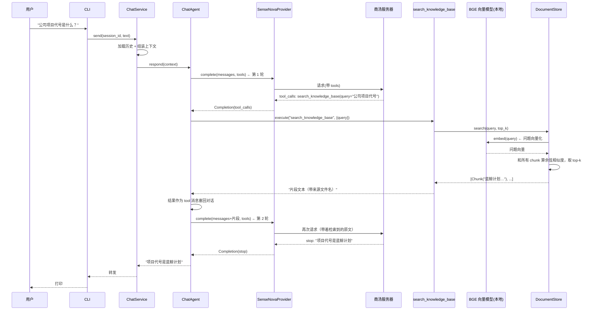
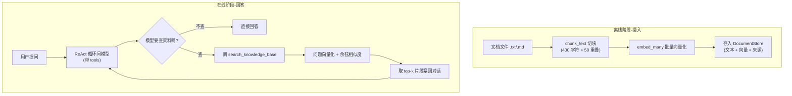

# 05 RAG 知识库（M4）

> **目标**：让 Agent 能「基于你的文档回答问题」——把资料（txt/md 等）喂给它，它先检索到相关片段，再据此回答，而不是凭空编造。
>
> **本文档定位**：帮你**快速吃透 M4 这段代码、看懂项目进度**，落到「哪一行代码怎么写的」。建议阅读顺序：
> **1 全景图 → 2 数据流（时序图）→ 3 代码变更地图 → 4 逐个模块 → 5 关键代码块逐行解读 → 6 流程图 → 7 实测发现 → 8 动手实验**。
> 只想快速了解进度，看 3、6、7 三节即可。

---

## 1. 全景图：M4 给 Agent 装了什么？

前三个里程碑的递进：M1「会说话的大脑」→ M2「配了笔记本和管家」→ M3「装了一部电话（工具）」。M4 给 Agent 添的是**一个私人的资料室，外加一个会查资料的秘书**。

大模型有两个天生的短板，RAG 解决其中最关键的一个——**它不知道你的私有资料**。你问它"我们公司的项目代号是什么"，它只能瞎编；但如果你先把公司资料"喂"给它，它就能从资料里找到答案再回答。

RAG 全称 **Retrieval-Augmented Generation（检索增强生成）**，核心是「**先检索、再生成**」：

```
  ① 离线：把文档切成小块 → 每块转成向量 → 存进"资料室"
  ② 在线：你提问 → 找到最相关的几块原文 → 塞给模型 → 模型基于原文回答
```

**落在架构上，M4 只新增了两个文件，其余全不变：**

```
                    ┌─────────────────────────────┐
                    │  你的文档（data/knowledge/）  │
                    │  *.txt / *.md / ...          │
                    └──────────────┬──────────────┘
                                   │ ① 摄入 ingest：读文件 → 切块 → 向量化
                                   ▼
                    ┌─────────────────────────────┐
                    │  DocumentStore（rag.py 新增） │
                    │  每块 = 文本 + 向量           │
                    └──────────────┬──────────────┘
                                   │ ② 检索：问题向量 → 余弦相似度 top-k
                                   ▼
                    ┌─────────────────────────────┐
                    │  search_knowledge_base 工具  │   ← 注册进 ToolRegistry（M3 已有）
                    └──────────────┬──────────────┘
                                   │ 模型调用
                                   ▼
        ┌──────────────────────────────────────────────┐
        │  ChatAgent ReAct 循环（M3 已有，一行没改）     │
        │  问模型 → 要查资料? → 调检索工具 → 塞结果 → 再问 │
        └──────────────────────────────────────────────┘
```

**一句话记住分工**（对照 M3 的「翻译员打电话求助手」）：

> **管家(ChatService) 还是管家、翻译员(ChatAgent) 还是那个会打电话的翻译员——这次只是电话那头多了一个"资料室秘书"（检索工具），翻译员拿不准的事，就打电话去资料室查一段原文回来。**

**最重要的一个洞察**（这就是为什么 M4 "很轻"）：

> RAG 的「检索」在代码里**只是一个普通的工具**，和 M3 的"计算器""查时间"地位完全一样。所以 `agent.py` 的 ReAct 循环、`service.py` 的记忆编排、`provider.py` 的联网，**一行都不用改**——这是分层架构**第三次兑现红利**：M2 加记忆不动底层、M3 加工具只动一处、M4 加 RAG 只再挂一个工具。

---

## 2. 数据流：一次文档问答的完整旅程（时序图）

以「我们公司的项目代号是什么」为例（文档里写着"蓝鲸计划"）：



**三个关键点**：

1. **向量化和检索都发生在"本地"**（`STORE`/`EMB` 是本地的 Python 对象，不联网）。真正联网的只有"问模型"那两段——因为 embedding 用的是本地 BGE 模型，不是商汤的 API（见第 7 节，商汤没有 embedding 接口）。
2. **和 M3 一样，模型至少要问两轮**：第一轮要求调检索工具，第二轮拿到检索到的原文后才给出最终答案。
3. **检索到的原文是"原文"**——模型是基于你文档里真实的句子在回答，这就是 RAG 和"瞎编"的本质区别。

---

## 3. 代码变更地图：M4 相比 M3 加了/改了哪些文件？

| 文件                                        | 状态               | 改了什么                                                              |
| ------------------------------------------- | ------------------ | --------------------------------------------------------------------- |
| `src/core/embeddings.py`                  | 🆕**新增**   | `Embedder` 接口 + `FastembedEmbedder`（本地 BGE 向量化）          |
| `src/core/rag.py`                         | 🆕**新增**   | `chunk_text` 切块 + `cosine` 相似度 + `DocumentStore` 摄入/检索 |
| `tests/test_rag.py`                       | 🆕**新增**   | 切块、检索、工具接入，共 11 个测试                                    |
| `src/core/tools.py`                       | ✏️**改动** | `build_default_tools(retriever)` 按需注册 `search_knowledge_base` |
| `src/config.py`                           | ✏️**改动** | 知识库目录 / 切块大小 / top-k / embedding 模型                        |
| `src/cli.py`                              | ✏️**改动** | `build_retriever()`（失败降级）+ `/ingest` 命令                   |
| `requirements.txt`                        | ✏️**改动** | 加`fastembed` 依赖                                                  |
| `src/core/agent.py`                       | ➖**不变**   | ReAct 循环照旧                                                        |
| `src/core/service.py`                     | ➖**不变**   | 记忆编排照旧                                                          |
| `src/core/memory.py`                      | ➖**不变**   | 持久化照旧                                                            |
| `src/core/provider.py` / `sensenova.py` | ➖**不变**   | 聊天接口照旧（embedding 是独立的新接口）                              |

**和 M3 对比**：

- M3 改的是"让模型能调工具"（动 agent + provider）；M4 改的是"造一个新工具 + 背后存资料的地方"（动 rag + embeddings + tools 注册一行）。
- **循环、记忆、联网一个都不碰**——这是和 M2 一样"加功能最底层不动"的第二次体现（M2 是加记忆，M4 是加检索）。

---

## 4. 逐个模块讲解

### 4.1 `Embedder`（src/core/embeddings.py）—— 文本变向量

RAG 的地基。要把"语义相似"变成"数学上可比较"，就得把文字变成**向量**（一串数字）：语义越近，向量越"指向同一个方向"。

```python
class Embedder(ABC):
    @abstractmethod
    def embed(self, text: str) -> list[float]: ...
    @abstractmethod
    def embed_many(self, texts: list[str]) -> list[list[float]]: ...


class FastembedEmbedder(Embedder):
    """本地 BGE 中文模型（fastembed，ONNX 运行时）。"""
    def __init__(self, model_name: str = "BAAI/bge-small-zh-v1.5") -> None:
        from fastembed import TextEmbedding   # 延迟导入：不装 fastembed 也能跑其它功能
        self._model = TextEmbedding(model_name=model_name)
```

- **接口先行**：和 M1 的 `BaseProvider` 一个道理。`Embedder` 只有两个方法（单句 / 批量），将来商汤若上线 embedding，再写个 `SenseNovaEmbedder` 即可，上层零改动。
- **延迟导入 `fastembed`**：`from fastembed import ...` 放在 `__init__` 里而不是文件顶部——这样没装 fastembed 的机器，**照样能跑对话**，只有真正要用 RAG 时才会 import 失败（由 cli.py 捕获降级，见 5.5）。
- **`embed_many` 批量**：摄入文档时有几百块，一次批量向量化比逐句调用快得多。

### 4.2 `DocumentStore`（src/core/rag.py）—— 资料室

整个 RAG 的核心。它干三件事：**切块、摄入、检索**。

```python
@dataclass
class Chunk:
    text: str      # 片段原文
    source: str    # 来源文件名
    index: int     # 在该文档中的块序号

class DocumentStore:
    def ingest_file(self, path) -> int: ...   # 读文件 → 切块 → 向量化 → 存入
    def ingest_dir(self, dir_path) -> int: ... # 扫描目录，摄入所有 .txt/.md
    def search(self, query, top_k=4) -> list[Chunk]: ...  # 问题向量 → 余弦相似度 → top-k
    def clear(self) -> None: ...              # 清空（重新摄入前用）
```

- **摄入（ingest）**是"离线"的：文档放进去，切成小块，每块转成向量存起来。只在启动时（或 `/ingest` 时）做。
- **检索（search）**是"在线"的：你每问一句，就把问题向量化，和所有 chunk 向量比相似度，挑最像的几块。
- 之所以要保存 `source`（文件名）和 `index`（块号），是为了回答时能**标注出处**，方便你核对"它是不是真从文档里读的"。

### 4.3 检索工具接入（src/core/tools.py）—— 复用 M3 的循环

M4 对 M3 唯一的"侵入"，就是在注册工具的函数里多注册一个：

```python
def build_default_tools(retriever=None, top_k: int = 4) -> ToolRegistry:
    registry = ToolRegistry()
    registry.register(Tool(name="get_current_time", ...))
    registry.register(Tool(name="calculator", ...))
    if retriever is not None:                # 只有传了检索器，才注册检索工具
        registry.register(Tool(
            name="search_knowledge_base",
            description="在本地知识库中检索与问题相关的文档片段。"
                        "当用户询问的问题可能在你掌握的资料/文档/知识库里有答案时调用。",
            parameters={"type": "object",
                        "properties": {"query": {"type": "string", "description": "要检索的问题或关键词"}},
                        "required": ["query"]},
            func=lambda query: _search_knowledge_base(retriever, query, top_k),
        ))
    return registry
```

- **`retriever=None` 默认不注册检索工具**——这保证了"没知识库"时，agent 还是纯 M3（只有计算器/查时间）。所以 M2/M3 的测试、老代码，**完全不受影响**。
- **`description` 是关键**：模型就是读这段描述，判断"这个问题该不该查资料"。写清楚"当用户问的问题可能在资料/文档里有答案时调用"，模型才会在合适的时候主动调它。

### 4.4 接线（src/cli.py / src/config.py）

- **config.py**：加了 5 个 RAG 配置（知识库目录、切块大小、重叠、top-k、embedding 模型名），都能用 `.env` 覆盖。
- **cli.py**：启动时调 `build_retriever()` 构建检索器，注入 `build_default_tools(retriever, top_k=...)`；新增 `/ingest` 命令用于"改了文档后重新摄入"。

---

## 5. 关键代码块逐行解读

### 5.1 `chunk_text()` —— 切块（src/core/rag.py）

```python
def chunk_text(text: str, size: int = 400, overlap: int = 50) -> list[str]:
    if not text or not text.strip():          # ① 空文档直接返回 []
        return []
    step = max(1, size - overlap)             # ② 步长 = 块长 - 重叠
    chunks = []
    for start in range(0, len(text), step):   # ③ 每次往后跳 step 个字符
        piece = text[start:start + size]      # ④ 取 [start, start+size) 一段
        if piece.strip():
            chunks.append(piece)
    return chunks
```

- **② 步长 = `size - overlap`** 是"重叠"的实现关键：块长 400、重叠 50，步长就是 350。所以下一块从 350 开始，和上一块**重叠了 [350, 400) 这 50 个字符**。
- **为什么要有重叠？** 切块是机械的，可能正好把「小明的狗叫黄豆」切成「小明的狗」+「叫黄豆」两半。重叠让关键信息大概率**完整落在某一块里**，检索时不会漏。
- **中文友好**：按**字符数**切即可（中文没有英文的空格分词），MVP 不用上复杂 tokenizer。

### 5.2 `cosine()` —— 余弦相似度（src/core/rag.py）

```python
def cosine(a: list[float], b: list[float]) -> float:
    dot = sum(x * y for x, y in zip(a, b))           # ① 点积
    na = math.sqrt(sum(x * x for x in a))            # ② a 的长度（模）
    nb = math.sqrt(sum(x * x for x in b))            # ③ b 的长度（模）
    return dot / (na * nb) if na and nb else 0.0     # ④ 归一化后的夹角余弦
```

- **为什么要归一化？** 直接比"点积"会受向量长度影响（长文本向量天然更长、点积更大）。除以各自的模后，比的就是**方向**而非长度——"两个向量夹角的余弦"，值域 [-1, 1]，越接近 1 越相似。
- **④ 的 `if na and nb`** 是防御：万一某块是空向量（模为 0），除零会崩，直接返回 0（不相似）。

### 5.3 `DocumentStore.search()` —— 检索（src/core/rag.py）

```python
def search(self, query: str, top_k: int = 4) -> list[Chunk]:
    if not self._chunks:                          # ① 空库直接返回 []
        return []
    qvec = self._embedder.embed(query)            # ② 问题向量化
    scores = [cosine(qvec, v) for v in self._vectors]   # ③ 和每块算相似度
    ranked = sorted(range(len(scores)),           # ④ 按下标排序（相似度降序）
                    key=lambda i: scores[i], reverse=True)
    return [self._chunks[i] for i in ranked[:top_k]]    # ⑤ 取 top-k 块
```

- **③ 是暴力搜索**：问题和**每一块**都算一遍相似度。文档量 < 千级时毫秒级，**零依赖、最好懂**——这正是 MVP 想要的。将来规模大了换 FAISS，`search` 的接口（给我问题，还你 top-k）不变。
- **④⑤ `ranked` 存的是下标**，不是块本身。因为 `scores` 和 `_chunks` 是一一对应的，用下标排序后再取块，才能把"最相似的 chunk"完整拿出来。

### 5.4 `FastembedEmbedder` —— 本地向量化（src/core/embeddings.py）

```python
os.environ.setdefault("HF_ENDPOINT", "https://hf-mirror.com")  # ① 国内镜像
os.environ.setdefault("HF_HUB_DISABLE_XET", "1")               # ② 关 Xet 下载协议

class FastembedEmbedder(Embedder):
    def __init__(self, model_name="BAAI/bge-small-zh-v1.5"):
        from fastembed import TextEmbedding
        self._model = TextEmbedding(model_name=model_name)     # ③ 首次会下载模型

    def embed_many(self, texts):
        return [list(vec) for vec in self._model.embed(texts)] # ④ numpy 向量转 list
```

- **①② 是本机实测踩坑后的产物**：直连 `huggingface.co` 会 SSL 证书校验失败，Xet 下载协议会 401。这两行必须在 `import fastembed` **之前**设置（`setdefault` 意思是"环境变量已设过就不覆盖"，方便需要的人自定义）。
- **③ 首次下载约 100MB**，之后缓存在本地，启动秒级加载。
- **④ `list(vec)`**：fastembed 返回的是 numpy 数组，转成普通 Python list，让 rag.py 的 `cosine`（纯 Python）能直接算，也方便持久化/调试。

### 5.5 `build_retriever()` —— 优雅降级（src/cli.py）

```python
def build_retriever():
    """构建知识库检索器；fastembed 缺失/模型下载失败时返回 None（降级为无 RAG）。"""
    try:
        from src.core.embeddings import FastembedEmbedder   # ① 可能 ImportError
        from src.core.rag import DocumentStore
        embedder = FastembedEmbedder(model_name=settings.embedding_model)  # ② 可能下载失败
        store = DocumentStore(embedder, settings.chunk_size, settings.chunk_overlap)
        kdir = Path(settings.knowledge_dir)
        if kdir.exists():
            n = store.ingest_dir(kdir)                      # ③ 摄入文档
            if n:
                print(f"已从知识库摄入 {n} 个片段（{kdir}）")
        return store
    except Exception as exc:  # noqa: BLE001
        print(f"[提示] 知识库不可用（{exc}），本次会话不含检索工具", file=sys.stderr)
        return None                                          # ④ 降级：没有 RAG 也能聊天
```

- **①-④ 是 M4 最关键的健壮性设计**：RAG 是"锦上添花"的功能，绝不该因为它出问题就拖垮整个对话。fastembed 没装、模型下载失败、文档损坏——任何一环出错，都只是**打印一句提示、返回 None**，CLI 照常能聊天（只是没有检索工具）。
- 这就是 4.3 里 `build_default_tools(retriever=None)` 不注册检索工具的由来：retriever 是 None，工具列表里就没有检索项。

### 5.6 `_search_knowledge_base()` —— 工具本体（src/core/tools.py）

```python
def _search_knowledge_base(retriever, query: str, top_k: int) -> str:
    chunks = retriever.search(query, top_k=top_k)   # ① 交给 DocumentStore 检索
    if not chunks:                                   # ② 空库/没搜到 → 可读提示
        return "（知识库为空或没有检索到相关内容）"
    return "\n\n---\n\n".join(                       # ③ 拼成一段给模型看
        f"[{c.source}#{c.index}] {c.text}" for c in chunks
    )
```

- **③ 拼格式有讲究**：用 `[文件名#块号]` 前缀 + `---` 分隔，让模型能区分"这是来自文档 A 第 3 块的原文"，从而据实回答（甚至能反问你"根据 x.md 里的记录…"）。
- **② 返回可读提示而不是抛异常**：工具执行永远返回字符串，即使没搜到，模型也能拿到"没搜到"这个信息继续回答，而不是让程序崩。

---

## 6. 流程图：RAG 的两个阶段



- **两个阶段完全解耦**：摄入（离线）只在启动/`/ingest` 时做一次；回答（在线）每问一次就跑一次检索。
- **在线阶段的循环就是 M3 的 ReAct**，唯一区别是工具从"计算器"换成了"检索"。

---

## 7. 实测发现（2026-09-14 ~ 16 真实调用验证）

### 发现一：商汤没有 embedding 接口（关键 Spike）

动手前先验证"商汤能不能直接向量化"——**不能**。`models.list()` 返回 8 个模型全是聊天模型，调 `/embeddings` 全部 404。所以 M4 的向量化用**本地 BGE 模型**（`fastembed` + `bge-small-zh-v1.5`），免费离线。脚本见 `scripts/spike_embedding.py`。

### 发现二：模型下载要"镜像 + 关 Xet"（本机踩坑）

直连 `huggingface.co` 报 `CERTIFICATE_VERIFY_FAILED`，默认的 Xet 下载协议报 401。解决办法是设两个环境变量（已内置进 `embeddings.py`）：`HF_ENDPOINT=https://hf-mirror.com` + `HF_HUB_DISABLE_XET=1`。验证脚本 `scripts/spike_fastembed.py`：中文同义句相似度 0.72、无关句 0.35，效果达标。

### 发现三：RAG + 工具 + 记忆三者共存，互不干扰

真实端到端（`scripts/e2e_rag.py`）在同一个会话里连问：

| 输入                       | 结果                                       |
| -------------------------- | ------------------------------------------ |
| 「公司项目代号是什么？」   | 调检索 → 基于文档答"蓝鲸计划 / 王小锤" ✓ |
| 「算 123×45」             | 计算器 → 5535 ✓                          |
| 「我叫小码」→「我叫什么」 | 记忆 → 小码 ✓                            |

三者共用同一个 ReAct 循环，模型自己判断"这题该用哪个工具/还是都不用"。

### 发现四：模型会把文档人名"张冠李戴"

记忆测试里，模型冒出过一句"之前记录里你叫**王老板**"——这是它把文档里的"**王小锤**"错安到了用户头上。这是 LLM 的 confabulation（编造），**不是代码 bug**（下一轮追问时它又正确答"小码"了）。但值得记住：**RAG 只是"把原文递给模型"，并不能保证模型逐字照抄原文**——严格场景要加"引用溯源/禁止编造"的约束。

---

## 8. 动手对照小实验

```bash
# 1. 看切块：400 字符 + 50 重叠
python -c "from src.core.rag import chunk_text; s='a'*500; print(len(chunk_text(s, 400, 50)), '块')"

# 2. 看余弦相似度
python -c "from src.core.rag import cosine; print(cosine([1,0],[1,0]), cosine([1,0],[0,1]))"

# 3. 真实端到端：RAG + 计算 + 记忆（真实调模型 + 真实 embedding）
python scripts/e2e_rag.py

# 4. 手动体验：先建个知识库文档，再跑 CLI
mkdir -p data/knowledge && echo "项目代号是蓝鲸计划，负责人王小锤" > data/knowledge/公司.md
python -m src.cli
#   输入「我们公司项目代号是什么」→ 应基于文档回答蓝鲸计划
#   改了文档后输入 /ingest → 重新摄入
```

---

## 9. 测试验证了什么（怎么看懂进度）

`tests/test_rag.py` 是 M4 的"验收单"，11 个测试对应 3 类行为，**全程用假 Embedder，不联网、不下载模型**：

| 测试分组                                                | 测什么                         | 对应代码                    |
| ------------------------------------------------------- | ------------------------------ | --------------------------- |
| `test_chunk_*` / `test_cosine`                      | 切块大小/重叠、余弦相似度      | `chunk_text` / `cosine` |
| `test_ingest_*` / `test_search_*`                   | 摄入块数、检索命中、空库、清空 | `DocumentStore`           |
| `test_build_default_tools_*` / `test_search_tool_*` | 有检索器才注册工具、工具端到端 | `tools.py`                |

**关键技巧**（M2/M3 一脉相承）：`KeywordEmbedder` 是个"假向量化"——按「狗/天气/苹果」几个关键词命中情况构造向量。这样"问『宠物狗』能不能命中『小明养了一只狗』那段"就变得**完全可控、可断言**，不用下载真实 BGE 模型。这就是"依赖注入"的第三次回报。

---

## 10. 小结：M3 → M4 对照

|                    | M3 工具调用（04 文档）                         | M4 RAG（本文档）                                 |
| ------------------ | ---------------------------------------------- | ------------------------------------------------ |
| Agent 能力         | 会"办事"（调工具拿结果）                       | 会"查资料"（检索文档再回答）                     |
| 核心文件           | 新增 tools；改 agent/provider/sensenova/models | 新增 embeddings/rag；改 tools/config/cli         |
| 新增"工具"         | calculator / get_current_time                  | **search_knowledge_base（检索）**          |
| 循环 / 记忆 / 联网 | —                                             | **一行没改**（检索只是又一个工具）         |
| 向量化             | 无                                             | 本地 BGE（商汤无 embedding 接口）                |
| 降级设计           | 无工具退流式                                   | **fastembed 缺失 → 无检索工具，聊天照常** |
| 测试               | ScriptedProvider                               | KeywordEmbedder（假向量化）                      |

一句话总结：**M1 造了"会说话的大脑"，M2 配了"笔记本和管家"，M3 装了一部"电话"，M4 给电话那头接了个"资料室秘书"——翻译员遇到拿不准的事就打电话查一段原文回来。而管家、翻译员、电话线（联网底层）全都不用改，这就是分层架构第四次兑现红利。**
