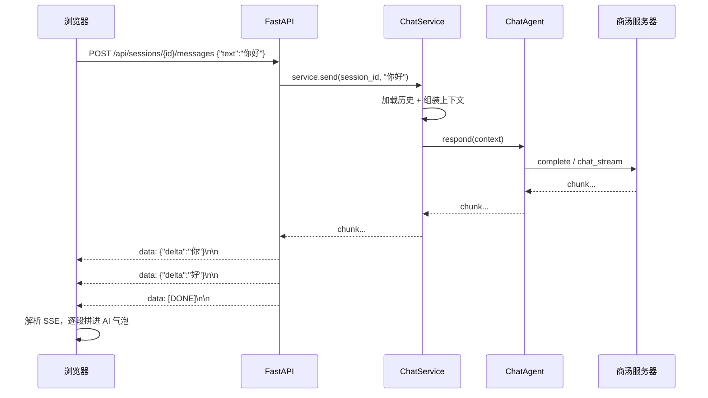
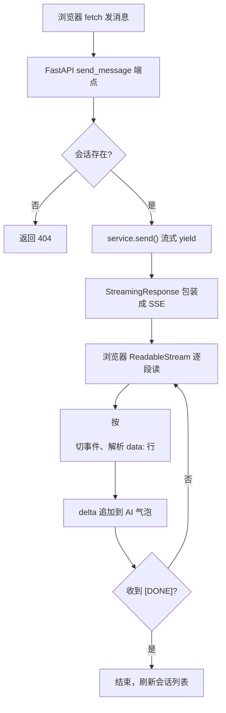

# 06 Web 界面（Web 化）

> **目标**：把只能在命令行跑的 Agent，变成一个**能在浏览器里打开、聊天、切会话、删会话**的产品——给 `ChatService` 包一层 HTTP，复用已有的全部能力。
>
> **本文档定位**：帮你**快速吃透 Web 化这段代码、看懂项目进度**，落到「哪一行代码怎么写的」。建议阅读顺序：
> **1 全景图 → 2 数据流（时序图）→ 3 代码变更地图 → 4 逐个模块 → 5 关键代码块逐行解读 → 6 流程图 → 7 实测发现 → 8 动手实验**。
> 只想快速了解进度，看 3、6、7 三节即可。

---

## 1. 全景图：Web 加在哪？

前面几个里程碑的递进：M1「会说话的大脑」→ M2「笔记本 + 管家」→ M3「一部电话（工具）」→ M4「资料室秘书」。Web 化做的不是"加能力"，而是**换一个门面**——把「终端里打字」换成「浏览器里点按钮」。

但它换得极省：**只是给 `ChatService` 上面套一层 HTTP 壳**，壳下面的一切（Agent / 记忆 / 工具 / RAG）原样复用。

```
┌─────────────────────────────────────────────────┐
│  浏览器（static/index.html）                      │
│  会话列表 + 聊天窗口 + 输入框（原生 HTML/JS）      │
└──────────────────────┬──────────────────────────┘
                       │ HTTP + SSE（流式）
                       ▼
┌─────────────────────────────────────────────────┐
│  FastAPI 应用（src/api.py）          ← Web 新增   │
│  REST：会话增删改查 / 发消息                       │
│  SSE：把 ChatService 的回复推给浏览器              │
└──────────────────────┬──────────────────────────┘
                       │ service.send(session_id, text)  ← 复用！
                       ▼
┌─────────────────────────────────────────────────┐
│  ChatService（M2 已有，一行不改）                  │
│  ├─ ChatAgent（ReAct 循环，M3）                   │
│  ├─ MemoryStore（记忆持久化，M2）                 │
│  └─ ToolRegistry（计算器/时间/RAG，M3/M4）        │
└─────────────────────────────────────────────────┘
```

**一句话记住**：**浏览器是新的"界面"，`ChatService` 还是那个"管家"，中间加了个"翻译官(FastAPI)"——把浏览器的 HTTP 请求翻译成 `service.send()` 调用，再把管家吐出的字一段段推回浏览器。**

**核心结论一句话**：Web 化是**纯"加法 + 一次搬家"**——新增 3 个文件 + 把 cli 里的构建函数挪到共享模块，**Agent 核心一行不动**。这是分层架构**第五次兑现红利**：换个界面，内核无感。

---

## 2. 数据流：浏览器里发一句话（时序图）



**两个关键点**：

1. **`service.send()` 本来就是生成器（yield）**——M2 就设计好了"流式"这件事。所以 Web 层几乎不用改造它：FastAPI 的 `StreamingResponse` 正好能"包住一个生成器，边产出边往外推"。
2. **SSE 是一种"单向流"协议**——服务器不停往浏览器推数据，浏览器只负责接收。这正好匹配"模型一个字一个字吐，前端一个字一个字显示"的场景。它不是 WebSocket（双向），MVP 用不到双向。

---

## 3. 代码变更地图：Web 化相比 M4 加了/改了哪些？

| 文件                     | 状态               | 改了什么                                                      |
| ------------------------ | ------------------ | ------------------------------------------------------------- |
| `src/bootstrap.py`     | 🆕**新增**   | 提取共享构建逻辑（`build_retriever`/`build_service`）     |
| `src/api.py`           | 🆕**新增**   | FastAPI 应用（REST + SSE + 托管前端）                         |
| `static/index.html`    | 🆕**新增**   | 聊天前端（原生 HTML/JS，会话列表 + 删除 + 流式渲染）          |
| `tests/test_api.py`    | 🆕**新增**   | API 层测试（9 个，全用假 provider）                           |
| `src/cli.py`           | ✏️**改动** | 改用`bootstrap` 的构建函数（删掉重复代码）                  |
| `src/core/service.py`  | ✏️**改动** | 加`delete_session()`（补上 M2 就有的删除入口）              |
| `requirements.txt`     | ✏️**改动** | 加`fastapi` / `uvicorn` / `httpx`                       |
| `src/core/agent.py` 等 | ➖**不变**   | agent / memory / tools / rag / embeddings / provider 一行不改 |

**核心结论**：Web 化是**纯"加法 + 一次搬家 + 一个补入口"**——新增 3 个文件、把 cli 的构建函数挪个位置、给 M2 就写好的 `delete` 补了个界面入口。**Agent 核心一行不动。**

---

## 4. 逐个模块讲解

### 4.1 FastAPI 应用（src/api.py）—— 新增的"翻译官"

它只做两件事：**REST 接口**（会话的增删改查）和 **SSE 流式接口**（发消息）。核心是一张"路由表"：

| 方法   | 路径                            | 作用                      |
| ------ | ------------------------------- | ------------------------- |
| GET    | `/`                           | 返回聊天页面（HTML）      |
| GET    | `/api/sessions`               | 列出所有会话              |
| POST   | `/api/sessions`               | 新建会话                  |
| GET    | `/api/sessions/{id}`          | 查单个会话（含消息）      |
| POST   | `/api/sessions/{id}/messages` | 发消息 →**SSE 流** |
| POST   | `/api/sessions/{id}/clear`    | 清空历史                  |
| DELETE | `/api/sessions/{id}`          | **删除会话**        |

- **REST 部分很薄**：每个端点基本就是"调 `service` 的一个方法 → 返回 JSON"。
- **`create_app(service=None)` 是工厂函数**（见 5.2）：传了 service 就用传入的，没传就按默认配置构建。这就是它**可测试**的关键。

### 4.2 共享构建逻辑（src/bootstrap.py）—— 一次搬家

M4 时 `build_retriever()` / `build_service()` 写在 `cli.py` 里。现在 CLI 和 Web 都要用，于是搬到 `bootstrap.py`：

```python
# src/bootstrap.py —— CLI 和 Web 共用的"组装车间"
def build_retriever(): ...      # 原样从 cli.py 搬来
def build_service(retriever=None) -> ChatService: ...   # 原样从 cli.py 搬来
```

- **"搬家不改行为"**：两个函数的内容一字未动，只是换了个文件。所以 M1~M4 的所有测试都不该受影响。
- 顺带在这里加了一个**条件系统提示词**（见 5.4）——有知识库时多塞一句"查资料优先"。

### 4.3 前端（static/index.html）—— 一个文件搞定

一个页面三个区域：**会话列表（左侧）+ 聊天窗口（中间）+ 输入框（底部）**。零框架、零构建、零依赖——原生 HTML/CSS/JS。

- **流式渲染**靠浏览器自带的 `fetch` + `ReadableStream`（见 5.3），逐段解析 SSE、逐段拼进气泡。
- **删除会话**：每个会话标题右侧有个悬停才显示的 `✕`，点它先 `confirm` 确认，再发 DELETE 请求。

### 4.4 删除会话（service.py + api.py）—— 补一个"早就该有"的入口

M2 时 `MemoryStore.delete(id)` 就写好了，但一直没有任何界面调它（02 文档还专门提过"能删但没入口"）。Web 化顺手把它补上：

```python
# service.py —— 给 ChatService 加一层薄封装
def delete_session(self, session_id: str) -> None:
    self._memory.delete(session_id)
```

---

## 5. 关键代码块逐行解读

### 5.1 SSE 流式端点（src/api.py）

```python
@app.post("/api/sessions/{session_id}/messages")
def send_message(session_id: str, body: SendBody):
    _require(session_id)                             # ① 会话不存在则 404

    def stream():                                    # ② 生成器 = SSE 的内容源
        try:
            for chunk in service.send(session_id, body.text):   # ③ 复用 ChatService！
                yield f"data: {json.dumps({'delta': chunk}, ensure_ascii=False)}\n\n"
        except Exception as exc:                     # ④ 出错也以事件告知前端
            yield f"data: {json.dumps({'error': str(exc)}, ensure_ascii=False)}\n\n"
        yield "data: [DONE]\n\n"                     # ⑤ 结束标记

    return StreamingResponse(stream(), media_type="text/event-stream")  # ⑥
```

- **③ 是灵魂**：`service.send()` 每吐一个 chunk，就 `yield` 一条 `data: {...}`。FastAPI 会边产出边把字节推给浏览器——这就是"流式"。
- **`data: {...}\n\n` 是 SSE 的固定格式**：一行 `data:` 开头、事件之间用空行 `\n\n` 分隔。前端按这个规则切事件。
- **④ 是健壮性**：模型请求失败时，不 return 一个错误页，而是把错误**当成一个事件**推过去——前端能显示"⚠️ 错误"，而不是卡死。
- **⑤ `[DONE]`** 是自定义的结束哨兵，前端收到它就停止读取。

### 5.2 `create_app` 工厂（src/api.py）

```python
def create_app(service: ChatService | None = None) -> FastAPI:
    if service is None:                              # ① 不传才按默认构建
        from src.bootstrap import build_retriever, build_service
        service = build_service(build_retriever())
    app = FastAPI(title="SenseNova Agent")           # ② 路由都闭包引用 service
    ...                                              # ③ 定义各端点
    return app
```

- **①② 是"依赖注入"在 Web 层的体现**：生产环境（`python -m src.api`）不传 service，走真实构建（加载 BGE 模型 + 检查 API Key）；测试环境传一个**注入假 provider 的 service**，不花额度、不下载模型。
- **③ 闭包**：路由函数直接引用外层的 `service`，简单直接，省掉 FastAPI 的依赖注入那套样板。
- 因为 `app` **不在模块顶层创建**，所以 `import src.api` 不会有副作用（不会偷偷加载 BGE 模型）。运行入口用 `uvicorn src.api:create_app --factory` 这种"工厂模式"启动。

### 5.3 前端流式读取（static/index.html）

```javascript
const reader = resp.body.getReader();            // ① 拿到字节流
const decoder = new TextDecoder('utf-8');        // ② 字节 → 文本
let buffer = '';
while (!finished) {
  const { done, value } = await reader.read();    // ③ 读一段
  if (done) break;
  buffer += decoder.decode(value, { stream: true });  // ④ 增量解码，防中文被切断
  let idx;
  while ((idx = buffer.indexOf('\n\n')) >= 0) {  // ⑤ 按空行切事件
    const event = buffer.slice(0, idx);
    buffer = buffer.slice(idx + 2);
    for (const line of event.split('\n')) {
      if (!line.startsWith('data: ')) continue;
      const payload = line.slice(6);              // 去掉 "data: " 前缀
      if (payload === '[DONE]') { finished = true; break; }
      const obj = JSON.parse(payload);
      if (obj.delta) aiBubble.textContent += obj.delta;   // ⑥ 追加到气泡
    }
  }
}
```

- **④ `stream: true` 是关键**：UTF-8 一个中文是 3 字节，网络可能把"你"切成两半到达。增量解码 + 保留 `buffer` 残片，等凑齐了再解析，就不会出现乱码。
- **⑤ 按 `\n\n` 切**：对应 5.1 里"事件之间空行分隔"的格式。因为一个 chunk 可能跨多个事件、一个事件也可能分两次到达，所以要用 buffer 累积 + 循环切。
- **⑥ 追加而非覆盖**：每个 delta 都拼到同一个气泡末尾，就是"打字机"效果（即便现在后端是整段一次性到达，这段代码也天然兼容未来的真流式）。

### 5.4 bootstrap 的条件系统提示词（src/bootstrap.py）

这是 Web 化过程中修的一个真实问题的产物（见 7 实测发现）：

```python
system_prompt = settings.system_prompt
if retriever is not None:                    # ① 只在"有知识库"时追加
    system_prompt += (
        "\n\n本系统接入了本地知识库。当用户询问的可能是存在于资料/文档中的信息"
        "（如某个项目、公司、产品、人物等具体问题）时，优先调用 search_knowledge_base 工具检索后再回答，"
        "不要直接说不知道。"
    )
```

- **① 条件追加很关键**：如果无条件把"查资料"写进系统提示词，那没接知识库的时候，模型会试图调一个不存在的工具、还困惑"我的检索工具呢"。所以这段只在 `retriever is not None` 时加。
- **为什么要加这段**：实测模型经常"该查不查"（直接说"我不知道你项目代号"）。一句明确的"优先检索、别直接说不知道"，能显著压低这个概率（见 7 发现二）。

---

## 6. 流程图：一次 Web 请求的生命周期



- 正常路径是 `A→B→C(是)→D→E→F→G→H→I(否)→F…` 循环，直到 `[DONE]` 才走到 `J`。
- **两个"防御出口"**：`C→404`（会话不存在）和 5.1 里 `④` 的错误事件（模型请求失败也推一个 `error` 事件而不是崩）。

---

## 7. 实测发现（2026-09-17 真实调用验证）

### 发现一：当前回复是"整段出现"，不是逐字流式

因为 M3 之后工具始终注册，`respond()` 走非流式 `complete()` 循环，所以 `service.send()` 实际是**一次性 yield 整段**（前面有"思考中"）。Web 端看到的是"思考中… → 整段出现"，不是 ChatGPT 式打字机。

> 但 **SSE 基础设施已经搭对**——前端按 5.3 那样"逐段追加"，将来把最终答案改成真流式时，**前端一行不用改**就自动变打字机。

> 🔁 **这个「将来」在 docs/16 兑现了**（2026-10-15）：最终答案现在是真逐 token，前端一行没改。
> 首字耗时没变（工具轮不出正文），变的是答案的渲染方式——见 docs/16 §7.1。

### 发现二：RAG 会"该查不查"，靠提示词压住

第一次 Web 端到端，模型对"项目代号是什么"直接说"我没有相关信息"，**不调检索工具**（工具链路本身是通的——同一轮里计算器能跑）。这是"工具式 RAG"的非确定性：检索是否触发，取决于模型那一刻的"心情"。

修复就是 5.4 的**条件提示词**——有知识库时明确"优先检索、别直接说不知道"。改后复测，稳定命中（答"蓝鲸计划/王小锤"）。

### 发现三：TestClient 能不花额度测完整 HTTP 层

`tests/test_api.py` 用 FastAPI 的 `TestClient` + **注入假 provider 的 service**，把"发 HTTP 请求 → SSE 流 → 会话持久化"整条链路都测了，**不花一分钱模型额度、不下载 BGE 模型**。这是依赖注入的第四次回报。

---

## 8. 动手对照小实验

```bash
# 1. 启动 Web（首次会自动加载 BGE 模型，几秒）
python -m src.api
#    浏览器打开 http://localhost:8000
#    接口文档：http://localhost:8000/docs

# 2. 用 curl 直接打接口（体会 SSE 格式）
curl -N -X POST http://localhost:8000/api/sessions -H "Content-Type: application/json"
#    → 拿到 {"id": "..."}，把 id 代入下面
curl -N -X POST http://localhost:8000/api/sessions/<id>/messages \
     -H "Content-Type: application/json" -d '{"text":"帮我算 123×45"}'
#    → 能看到 data: {...} 一段段吐出来，最后 data: [DONE]

# 3. Web 端到端（真实模型 + RAG + 记忆，走 HTTP 层）
python scripts/e2e_web.py
```

---

## 9. 测试验证了什么（怎么看懂进度）

`tests/test_api.py` 是 Web 层的"验收单"，9 个测试全用假 provider，覆盖：

| 测试                                                       | 测什么                                    | 对应代码             |
| ---------------------------------------------------------- | ----------------------------------------- | -------------------- |
| `test_index_serves_html`                                 | 首页返回 HTML                             | `GET /`            |
| `test_create_and_get_session` / `test_get_session_404` | 建/查会话、404                            | REST 端点            |
| `test_send_message_streams_reply`                        | **SSE 流里包含 delta + `[DONE]`** | `send_message`     |
| `test_send_message_persists`                             | 发消息后落盘 2 条（user+assistant）       | `ChatService.send` |
| `test_clear_session` / `test_delete_session`           | 清空 / 删除                               | 对应端点             |

**关键技巧**：`make_client(tmp_path)` 每次构建一个"注入 `FakeProvider` 的 service + 临时会话目录"，用 `TestClient` 打真实 HTTP 请求。这样**界面层和底层逻辑一起被验证**，但全程离线。

---

## 10. 小结：M4 → Web 对照

|              | M4 RAG（05 文档）               | Web 界面（本文档）                 |
| ------------ | ------------------------------- | ---------------------------------- |
| 做了什么     | 加"查资料"能力                  | 换一个"门面"（浏览器）             |
| 核心文件     | 新增 embeddings / rag           | 新增 bootstrap / api / index.html  |
| 是否动内核   | agent/service/provider 一行不改 | **同样一行不改**             |
| 新增后端能力 | search 工具                     | REST + SSE +**删除会话**     |
| 依赖注入     | KeywordEmbedder（假向量化）     | FakeProvider（假模型）+ TestClient |
| 实测踩坑     | 商汤无 embedding、HF 镜像       | 流式回归、RAG 该查不查             |

一句话总结：**M1~M4 造好了一个"会说话、会记事、会打电话、会查资料"的大脑和管家，Web 化只是给它配了第一个"像样的门面"——浏览器。而门面之下，大脑、管家、电话线全都纹丝没动。这就是分层架构第五次兑现红利。**
