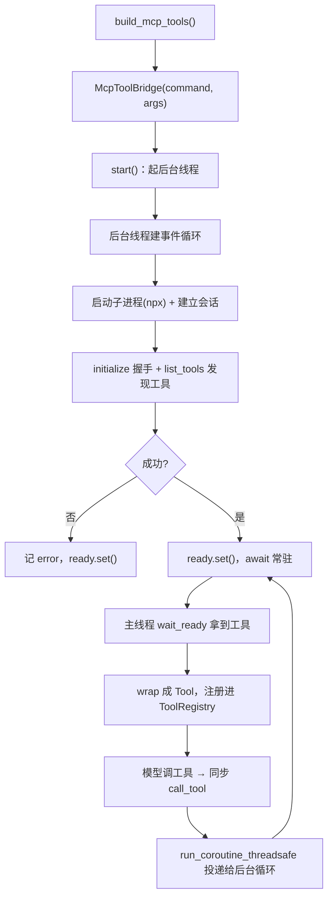

# 07 MCP 接入（M5）

> **目标**：让 Agent 能调用**外部工具服务器**的工具——通过 MCP 标准协议接入（如文件系统服务器），让 Agent 从"会算数/查时间/查资料"升级到"能读写文件"这类真实操作。
>
> **本文档定位**：帮你**快速吃透 M5 这段代码、看懂项目进度**，落到「哪一行代码怎么写的」。建议阅读顺序：
> **1 全景图 → 2 数据流（时序图）→ 3 代码变更地图 → 4 逐个模块 → 5 关键代码块逐行解读 → 6 流程图 → 7 实测发现 → 8 动手实验**。
> 只想快速了解进度，看 3、6、7 三节即可。

---

## 1. 全景图：MCP 加在哪？

回看"工具能力"这条线的递进，M5 是**收官之作**：

| 里程碑 | 工具从哪来                                                |
| ------ | --------------------------------------------------------- |
| M3     | **自己写**的工具（计算器 / 查时间）                 |
| M4     | **自己做**的检索工具（RAG）                         |
| M5     | **别人写**的工具，用**标准协议**接进来（MCP） |

三次都落在同一个 `ToolRegistry` 上。MCP（**Model Context Protocol**，模型上下文协议）是 Anthropic 提出的开放标准：**一个协议，让 AI 应用能连接任意"工具服务器"**——只要有人按协议写好了服务器，我们的 Agent 就能一键接进来，不用自己写任何工具代码。

```
┌─────────────────────────────────────────────────┐
│  MCP 服务器（独立进程，别人写的）                  │
│  如 filesystem：读写文件 / 列目录 / 搜索文件…      │
└──────────────────────┬──────────────────────────┘
                       │ MCP 协议（JSON-RPC over stdio）
                       ▼
┌─────────────────────────────────────────────────┐
│  McpToolBridge（src/core/mcp.py）   ← M5 新增    │
│  连接服务器 → 发现工具 → 包装成 Tool → 同步调用    │
└──────────────────────┬──────────────────────────┘
                       │ 注册进 ToolRegistry
                       ▼
┌─────────────────────────────────────────────────┐
│  ToolRegistry（M3 已有）                          │
│  get_current_time / calculator / search / MCP 工具│
└──────────────────────┬──────────────────────────┘
                       │ 模型调用（ReAct 循环，M3 已有）
                       ▼
┌─────────────────────────────────────────────────┐
│  ChatAgent ReAct 循环 —— 一行不改                 │
└─────────────────────────────────────────────────┘
```

**一句话记住**：**MCP 工具和计算器/检索工具在 Agent 眼里地位完全一样——都是"注册进 ToolRegistry 的工具"。M5 只做一件事：写一个"桥"，把外部 MCP 服务器的工具翻译成我们自己的 `Tool`。**

**最重要的一个结论**：M5 又是"纯加法"——新增一个桥文件、注册工具时多挂一批，**循环/记忆/Web 一行不改**。这是分层架构**第六次兑现红利**。

---

## 2. 数据流：模型调一次 MCP 工具（时序图）

以「列出 workspace 里的文件」为例：

```mermaid
sequenceDiagram
    participant U as 用户
    participant AGT as ChatAgent(ReAct)
    participant TOOL as ToolRegistry
    participant BRIDGE as McpToolBridge(同步线程)
    participant LOOP as 后台事件循环
    participant MCP as MCP 服务器(filesystem)

    U->>AGT: "列出 workspace 里的文件"
    AGT->>AGT: 问模型 → 返回 tool_calls(list_directory)
    AGT->>TOOL: execute("list_directory", {path})
    TOOL->>BRIDGE: func(path=...) → call_tool("list_directory", args)
    BRIDGE->>LOOP: run_coroutine_threadsafe(session.call_tool(...))
    LOOP->>MCP: JSON-RPC 请求 list_directory
    MCP-->>LOOP: 文件列表（JSON）
    LOOP-->>BRIDGE: future 结果
    BRIDGE-->>TOOL: 格式化成字符串
    TOOL-->>AGT: "hello.txt\nreadme.md"
    AGT->>AGT: 结果塞回对话 → 再问模型 → 最终回答
```

**两个关键点**：

1. **跨了一个"线程边界"**：`ToolRegistry.execute` 跑在同步线程（CLI 主线程 / Web 线程池），而 MCP 的 `session.call_tool` 是**异步**的、必须跑在事件循环里。所以中间有一个"桥"把同步调用**投递**给后台事件循环（见 5.1/5.2 详解）。
2. **MCP 服务器是独立进程**：它通过 stdio（标准输入输出）用 JSON-RPC 和我们的桥通信。整个交互对用户透明——用户只看到最终的文件列表。

---

## 3. 代码变更地图：M5 相比 Web 加了/改了哪些？

| 文件                                                       | 状态               | 改了什么                                                         |
| ---------------------------------------------------------- | ------------------ | ---------------------------------------------------------------- |
| `src/core/mcp.py`                                        | 🆕**新增**   | `McpToolBridge`（连接/发现/同步调用）+ `wrap_mcp_tools` 包装 |
| `tests/test_mcp.py`                                      | 🆕**新增**   | 纯逻辑 + 包装测试（6 个，不启动真 npx）                          |
| `src/core/tools.py`                                      | ✏️**改动** | `build_default_tools` 增加 `mcp_tools` 参数                  |
| `src/bootstrap.py`                                       | ✏️**改动** | `build_mcp_tools()`（失败降级）+ MCP 条件提示词                |
| `src/config.py`                                          | ✏️**改动** | MCP 服务器命令 / 参数 / 授权目录                                 |
| `requirements.txt`                                       | ✏️**改动** | 加`mcp`                                                        |
| `agent.py` / `service.py` / `memory.py` / `api.py` | ➖**不变**   | ReAct 循环、记忆、Web 一行不改                                   |

**核心结论**：M5 是"纯加法"——新增一个桥文件、注册工具时多挂一批。**循环/记忆/Web 全不动**。

---

## 4. 逐个模块讲解

### 4.1 MCP 是什么（协议层，一句话）

MCP 服务器 = 一个**独立进程**，通过 **JSON-RPC over stdio** 和客户端通信，暴露一组**工具**（每个工具有名字、描述、参数 schema，能被调用）。我们的 Agent 就是那个"客户端"。

`mcp` 这个 Python SDK 帮我们把 JSON-RPC 的细节封装掉了——我们只要 `session.list_tools()` 看有哪些工具、`session.call_tool(name, args)` 调一个工具。

### 4.2 `McpToolBridge`（src/core/mcp.py）—— 核心的"异步桥"

这是 M5 的灵魂，也是**最难的一处**。难点在于一个"不匹配"：

> **MCP 是异步的（asyncio），我们的 `Tool.func` 是同步的。**

- MCP SDK 的一切调用都要 `await`（`await session.call_tool(...)`）；
- 而 `ToolRegistry.execute()` 是同步的（直接 `tool.func(**args)`），且它跑在 Web 的线程池 / CLI 主线程里。

解法就是 `McpToolBridge`：**后台线程跑一个独立事件循环、保持 MCP 会话常开；对外暴露一个同步的 `call_tool`，内部把调用投递给那个循环、阻塞等结果。**

```python
class McpToolBridge:
    def __init__(self, command: str, args: list[str]):
        self._loop = None                      # 后台线程的事件循环
        self._session = None                   # 常开的 MCP 会话
        self._tools = []                       # 发现的工具
        self._ready = threading.Event()        # "连接完成"信号
        self._thread = threading.Thread(target=self._run, daemon=True)

    def start(self):                           # 起后台线程
        self._thread.start()

    def wait_ready(self, timeout=15.0):        # 阻塞等连接完成
        self._ready.wait(timeout)
        return self._error is None and bool(self._tools)

    def call_tool(self, name, args) -> str:    # 同步接口，Tool.func 直接调它
        future = asyncio.run_coroutine_threadsafe(
            self._session.call_tool(name, args), self._loop)
        return _format_call_result(future.result(timeout=60))
```

### 4.3 `wrap_mcp_tools`（mcp.py）—— MCP 工具 → 我们的 `Tool`

MCP 工具和我们的 `Tool` 几乎一一对应，翻译一下即可：

| MCP 侧                               | 我们的`Tool` 侧                    |
| ------------------------------------ | ------------------------------------ |
| `tool.name` / `tool.description` | `Tool.name` / `Tool.description` |
| `tool.inputSchema`                 | `Tool.parameters`（JSON Schema）   |
| `session.call_tool(name, args)`    | `Tool.func(**args)`                |

```python
def wrap_mcp_tools(bridge):
    def make_func(name):
        def func(**kwargs):                  # 把 kwargs 重新收集成 dict 传给桥
            return bridge.call_tool(name, kwargs)
        return func
    return [Tool(name=t["name"], description=t["description"],
                 parameters=t["parameters"], func=make_func(t["name"]))
            for t in bridge.tools()]
```

### 4.4 接线（bootstrap.py / config.py）

- **config.py**：三个配置——`mcp_server_command`（如 `npx`）、`mcp_server_args`（服务器包名）、`mcp_allowed_dir`（filesystem 授权目录）。
- **bootstrap.py**：`build_mcp_tools()` 连接服务器、发现工具、包装成 `Tool`；**失败降级返回 `[]`**（没装 Node、服务器启动失败都不影响聊天）。然后这些工具和计算器/检索一起注册进 `ToolRegistry`。

---

## 5. 关键代码块逐行解读

### 5.1 后台线程 + 常开事件循环（mcp.py）

```python
def _run(self) -> None:
    self._loop = asyncio.new_event_loop()       # ① 每个线程要有自己的事件循环
    asyncio.set_event_loop(self._loop)
    self._loop.run_until_complete(self._main()) # ② 在这个循环里跑 _main 直到退出

async def _main(self) -> None:
    try:
        server = StdioServerParameters(command=self._command, args=self._args)
        async with stdio_client(server) as (read, write):        # ③ 启动子进程(npx)
            async with ClientSession(read, write) as session:    # ④ 建立会话
                await session.initialize()                       # ⑤ 协议握手
                result = await session.list_tools()              # ⑥ 发现工具
                self._tools = [ ... ]                            # ⑦ 存下工具信息
                self._session = session
                self._ready.set()                                # ⑧ 通知主线程"好了"
                await asyncio.Event().wait()                     # ⑨ 常驻，保持会话
    except Exception as exc:
        self._error = exc
        self._ready.set()
```

- **①② 是"在非主线程跑事件循环"的标准姿势**：Python 规定一个线程一个事件循环，所以后台线程先 `new_event_loop` + `set_event_loop`，再 `run_until_complete`。
- **③④ 两个 `async with`** 分别管理"子进程生命周期"和"会话生命周期"——退出时自动关掉子进程、断开会话，不残留僵尸进程。
- **⑨ 是精妙的一笔**：`await asyncio.Event().wait()` 让 `_main` **永久挂起**，但事件循环**仍在运转**——这样后续 `run_coroutine_threadsafe` 投递来的调用能被及时处理，同时两个 `async with` 保持打开（会话常开）。这就是"常开连接"的实现方式。
- **⑧ 的 `_ready` 事件**是主线程和后台线程之间的"握手信号"：主线程调 `wait_ready()` 阻塞等它。

### 5.2 同步 `call_tool` —— 跨线程投递（mcp.py）

```python
def call_tool(self, name, args) -> str:
    if self._loop is None or self._session is None:      # ① 未连接时兜底
        return f"工具 {name} 不可用（MCP 未连接）"
    future = asyncio.run_coroutine_threadsafe(           # ② 把协程投递给后台循环
        self._session.call_tool(name, args), self._loop)
    return _format_call_result(future.result(timeout=60)) # ③ 阻塞等结果
```

- **② `run_coroutine_threadsafe` 是整个桥的命门**：它能从"另一个线程"安全地把一个协程塞进指定事件循环执行，返回一个 `concurrent.futures.Future`。
- **③ `future.result(timeout=60)`**：同步线程阻塞等待结果，超时 60 秒防卡死。拿到结果后格式化成字符串返回。
- **为什么不能直接 `asyncio.run(...)`？** 因为 `asyncio.run` 每次调用都新建又关闭一个事件循环，且不能在已有循环的线程里再建循环。而我们的连接要"常开"，所以必须用"后台循环 + 投递"而非"每调一次开一个循环"。

### 5.3 工具包装 + schema 清洗（mcp.py）

```python
def _clean_schema(schema: dict) -> dict:          # ① 只留 OpenAI 需要的字段
    return {
        "type": schema.get("type", "object"),
        "properties": schema.get("properties", {}),
        "required": schema.get("required", []),
    }

def _format_call_result(result) -> str:           # ② 结果 → 字符串
    parts = []
    for block in getattr(result, "content", []) or []:
        text = getattr(block, "text", None)       # ③ 只取文本块
        if text:
            parts.append(text)
    text = "\n".join(parts) if parts else "(无文本输出)"
    if getattr(result, "isError", False):          # ④ 错误标记
        text = f"[错误] {text}"
    return text
```

- **① 为什么清洗 schema**：MCP 的 `inputSchema` 可能带 `$schema`、`title`、`additionalProperties` 等字段，OpenAI 的 function calling 不一定认，直接透传可能报错。只留 `type/properties/required` 三个它需要的字段，最稳妥。
- **②③④ 把 `CallToolResult` 变成字符串**：结果里的 `content` 是一组内容块（文本、图片等），我们只提取文本块拼起来；`isError` 时加个 `[错误]` 前缀，让模型知道这次调用失败了、可以换参数重试。

### 5.4 失败降级（bootstrap.py）

```python
def build_mcp_tools():
    try:
        from src.core.mcp import McpToolBridge, wrap_mcp_tools
        bridge = McpToolBridge(
            settings.mcp_server_command,
            settings.mcp_server_args.split() + [settings.mcp_allowed_dir],  # ① 拼命令
        )
        bridge.start()
        if not bridge.wait_ready(timeout=15):        # ② 15 秒连不上就放弃
            print("[提示] MCP 服务器连接超时，本次会话不含 MCP 工具", file=sys.stderr)
            return []
        tools = wrap_mcp_tools(bridge)
        print(f"已连接 MCP 服务器，注册 {len(tools)} 个工具")
        return tools
    except Exception as exc:                          # ③ 任何失败都降级
        print(f"[提示] MCP 不可用（{exc}），本次会话不含 MCP 工具", file=sys.stderr)
        return []
```

- **① 命令怎么拼**：`npx -y @modelcontextprotocol/server-filesystem data/mcp_workspace`——最后那个参数是 filesystem 的**授权目录**（安全关键，见 7 实测发现）。
- **②③ 是 M5 的健壮性设计**：MCP 是"锦上添花"，绝不因为没装 Node、服务器下载慢、连不上而拖垮聊天。任何失败都只是打印一句提示、返回 `[]`——没有 MCP 工具，Agent 照常能用计算器/检索/记忆。

---

## 6. 流程图：异步桥的生命周期



- **正常路径**：`A→…→H→I→J` 完成启动；之后每次模型调工具走 `K→L→H` 循环（投递到常驻循环、处理完继续等）。
- **失败路径** `G→G1`：连接失败时 `ready.set()` 也会被调用，主线程 `wait_ready` 醒来发现 `error` 非空 → 返回 `[]` 降级。

---

## 7. 实测发现（2026-09-18 真实调用验证）

### 发现一：npm 缓存目录 EPERM（环境坑，和 M4 的 HF 镜像同类）

npx 首次下载 `server-filesystem` 时报 `EPERM`（写 `D:\node\node_cache` 被系统拒绝，疑似杀软拦截）。解决：`npm config set cache "C:/Users/admin/npm-cache"` 换缓存目录即可。和 M4 的"HF 要镜像"是同一类**环境坑**，都写进了文档。

### 发现二：filesystem 服务器一次给了 14 个工具

连接后 `list_tools()` 返回 14 个：`read_file` / `write_file` / `edit_file` / `list_directory` / `search_files` / `move_file` / `create_directory` / `get_file_info`… 一个服务器就顶我们 M3 自己写的好几倍工具——这就是 MCP 的价值：**接一个服务器，白得一堆工具**。

### 发现三：模型真的能读写磁盘了（能力跃迁）

真实端到端里，模型问都不问就：

- 调 `list_directory` 列出了 `hello.txt` / `readme.md`；
- 调 `write_file` 真的在磁盘上创建了 `greeting.txt`（内容"你好世界\n"）。

这是 Agent 能力的实质跃迁——从"只能算数/查资料"到"能真正操作文件系统"。

### 发现四：MCP 工具同样会"该调不调"，靠条件提示词压住

和 RAG 一样，模型有时会"空口回答"而不调工具。修复同款：`build_service` 里当 `mcp_tools` 非空时，给 system prompt 追加一句"优先调用工具、不要空口回答"。

---

## 8. 动手对照小实验

```bash
# 1. 看一个 MCP 服务器有哪些工具（连 filesystem）
python scripts/spike_mcp.py

# 2. 看配置里的 MCP 命令怎么拼
python -c "from src.config import settings; print(settings.mcp_server_command, settings.mcp_server_args.split() + [settings.mcp_allowed_dir])"

# 3. 真实端到端：模型调 MCP 工具（列目录 + 写文件）
python scripts/e2e_mcp.py

# 4. 正常跑 Web，问一句文件操作
python -m src.api
#   浏览器里问「用工具列出 data/mcp_workspace 里有哪些文件」
```

> ⚠️ MCP 需要 Node.js（`npx`）。没装 Node 时，程序会自动降级为无 MCP 工具，聊天照常。

---

## 9. 测试验证了什么（怎么看懂进度）

`tests/test_mcp.py` 是 M5 的"验收单"，6 个测试**全不启动真实 npx**（慢且依赖环境）：

| 测试                               | 测什么                              | 对应代码                |
| ---------------------------------- | ----------------------------------- | ----------------------- |
| `test_format_call_result_*`      | 结果转字符串、错误标记              | `_format_call_result` |
| `test_clean_schema_*`            | 只留 type/properties/required       | `_clean_schema`       |
| `test_wrap_mcp_tools_dispatches` | MCP 工具 → Tool，func 正确派发到桥 | `wrap_mcp_tools`      |
| `test_build_default_tools_*`     | 有 mcp_tools 才注册                 | `build_default_tools` |

**关键技巧**：用一个 `_FakeBridge`（记录调用、返回固定结果）替代真 MCP 桥，就能断言"包装出的 `Tool.func` 是否把参数正确传给了桥"。**真正连真服务器的验证交给 spike 和 e2e**，单测只覆盖纯逻辑——这样测试又快又稳。

---

## 10. 小结：Web → M5 对照

|            | Web 界面（06 文档）               | MCP 接入（本文档）                   |
| ---------- | --------------------------------- | ------------------------------------ |
| 做了什么   | 换一个"门面"（浏览器）            | 加"标准协议接外部工具"               |
| 核心文件   | 新增 bootstrap / api / index.html | 新增 mcp.py（桥）                    |
| 是否动内核 | agent/service 一行不改            | **同样一行不改**               |
| 新增能力   | REST + SSE + 删除会话             | 异步桥 + 外部工具接入                |
| 最大难点   | SSE 流式                          | **异步 MCP ↔ 同步 Tool 的桥** |
| 环境坑     | —                                | npm 缓存 EPERM（需 Node.js）         |

一句话总结：**M1~M4 造好了大脑、笔记本、电话、资料室，Web 给它配了门面，M5 则用一根"标准协议的天线"把它接进了外面的工具世界——而大脑、笔记本、电话线全都没动。这就是分层架构第六次兑现红利。**
