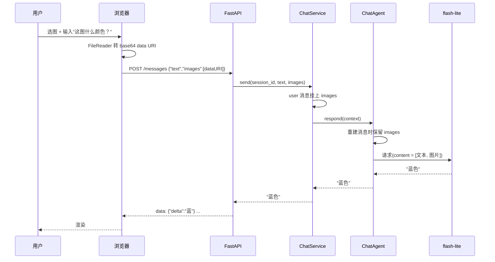
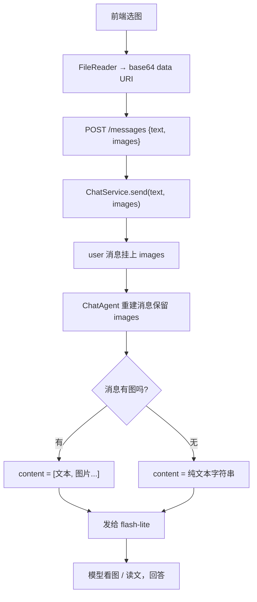

# 08 多模态（M6）

> **目标**：让 Agent **看懂图片**——用户上传一张图，Agent 能描述它、回答关于它的问题。
>
> **本文档定位**：帮你**快速吃透 M6 这段代码、看懂项目进度**，落到「哪一行代码怎么写的」。建议阅读顺序：
> **1 全景图 → 2 数据流（时序图）→ 3 代码变更地图 → 4 逐个模块 → 5 关键代码块逐行解读 → 6 流程图 → 7 实测发现 → 8 动手实验**。
> 只想快速了解进度，看 3、6、7 三节即可。

---

## 1. 全景图：M6 给 Agent 装了什么？

前面的递进：M1「会说话的大脑」→ M2「笔记本 + 管家」→ M3「一部电话」→ M4「资料室」→ M5「标准协议天线」。M6 做的是**给 Agent 长一双眼睛**——以前它只能"读字"，现在能"看图"。

但这次有一个**巨大的惊喜**（详见第 7 节）：**我们一直在用的主力模型 `flash-lite` 本身就支持看图**。所以多模态**不用换模型、不用接别的 API**——它几乎是"白捡"的能力。

```
  用户上传图片（浏览器）
       │ FileReader → base64 data URI
       ▼
┌─────────────────────────────────────────────────┐
│  FastAPI（api.py，小改）                          │
│  SendBody 加 images 字段 → service.send(...)      │
└──────────────────────┬──────────────────────────┘
                       ▼
┌─────────────────────────────────────────────────┐
│  ChatService（M2，小改）                          │
│  把 images 挂到 user 消息上                       │
└──────────────────────┬──────────────────────────┘
                       ▼
┌─────────────────────────────────────────────────┐
│  ChatAgent（M3，小改）                            │
│  重建消息时保留 images                            │
└──────────────────────┬──────────────────────────┘
                       ▼
┌─────────────────────────────────────────────────┐
│  Message.to_openai_dict（M1，小改）              │
│  有图时 content 变成 [文本, 图片] 结构化列表      │
└──────────────────────┬──────────────────────────┘
                       ▼
┌─────────────────────────────────────────────────┐
│  SenseNovaProvider —— 一行不改！                 │
│  它本来就把 message 转 dict 发给模型              │
└─────────────────────────────────────────────────┘
```

**一句话记住**：**图片本质就是"塞进消息 content 里的一段特殊数据"。M6 只做四件小事——让 `Message` 能装图、让 `send` 能接图、让前端能传图、让 agent 别丢图——底下的 ReAct 循环、记忆、工具、MCP 全都无感。**

**核心结论**：M6 是"**一把小手术**"——改 `Message` 一处（加字段 + 序列化），让图片一路透传到底，**Provider 和所有工具层零改动**。

---

## 2. 数据流：发一张图的完整旅程（时序图）

以「发一张蓝色图，问这是什么颜色」为例：



**两个关键点**：

1. **图片变成字符串后一路"搭便车"**：前端把图片读成 base64 字符串（data URI），之后它就是一串普通字符串，跟着 `text` 一起在 `Message` 里传递——所以中间每一层都只是"把 images 往下传"，不真的处理图片。
2. **只有 `to_openai_dict` 真正"理解"图片**：在发给模型前，它把 `images` 拼成 OpenAI 的"多模态 content 格式"（文本 + image_url 列表）。这是唯一一处"图片"和"协议格式"打交道的地方。

---

## 3. 代码变更地图：M6 相比 M5 加了/改了哪些？

| 文件                                                   | 状态               | 改了什么                                                                              |
| ------------------------------------------------------ | ------------------ | ------------------------------------------------------------------------------------- |
| `src/core/models.py`                                 | ✏️**改动** | `Message` 加 `images`；`to_openai_dict` 输出多模态；`to_openai_list` 剥离图片 |
| `src/core/service.py`                                | ✏️**改动** | `send()` 加 `images` 参数                                                         |
| `src/core/agent.py`                                  | ✏️**改动** | `respond()` 重建消息时保留 `images`                                               |
| `src/api.py`                                         | ✏️**改动** | `SendBody` 加 `images`                                                            |
| `static/index.html`                                  | ✏️**改动** | 图片上传 + 缩略图 + base64 转 data URI                                                |
| `tests/test_models.py` / `test_agent.py`           | ✏️**改动** | 加多模态序列化/透传测试                                                               |
| `provider.py` / `sensenova.py`                     | ➖**不变**   | `to_openai_dict` 自动带图，联网层零改动                                             |
| `tools.py` / `memory.py` / `rag.py` / `mcp.py` | ➖**不变**   | 工具/记忆/RAG/MCP 全无感                                                              |

**核心结论**：M6 是"**一把小手术**"——改 `Message` 一处、让图片透传到底，**Provider 和所有工具层零改动**。这是分层架构**第七次兑现红利**（加新能力，最底层的联网代码一行没动）。

---

## 4. 逐个模块讲解

### 4.1 `Message` 加 `images` 字段（而不是改 content 类型）

这是 M6 最关键的**设计取舍**。图片要进消息，最"直接"的做法是让 `content` 既能是字符串、又能是列表（`str | list`）。但那样会污染**所有**把 `content` 当字符串用的地方：

- M2 的 `_trim()` 用 `len(m.content)` 数字符；
- M2 的 `estimate_tokens()` 逐字符估算；
- M3 的 `scrub_text(m.content)` 清洗编码。

所以选择**加独立字段**，让 `content` 永远是字符串：

```python
@dataclass
class Message:
    role: Role
    content: str                      # 仍是纯文本，所有老代码不动
    ...
    images: list[str] | None = None   # 新增：图片 URL / data URI（M6）
```

- **好处**：截断、token 估算、编码清洗**全部零改动**，因为它们只看 `content`（还是字符串）。
- **图片是可选的**：普通消息 `images=None`，行为和以前一模一样。

### 4.2 `to_openai_dict` 多模态序列化

有图时，`content` 从字符串切换成 OpenAI 的"多模态列表"：

```python
def to_openai_dict(self) -> dict:
    if self.images:
        content = [{"type": "text", "text": self.content}]
        content += [{"type": "image_url",
                     "image_url": {"url": u}} for u in self.images]
    else:
        content = self.content
    data = {"role": self.role.value, "content": content}
    ...  # 工具字段照旧
    return data
```

- 无图时输出 `content: "你好"`（字符串）；有图时输出 `content: [{text}, {image_url}]`（列表）。**模型拿到哪种，取决于消息里有没有图**。

### 4.3 持久化剥离图片（`to_openai_list`）

图片的 base64 可能有几百 KB，**绝不能写进会话 JSON**（会撑爆、拖慢读写）。所以持久化用独立的 `to_openai_list`，只存文字：

```python
def to_openai_list(self) -> list[dict]:
    """只保留 role + content（文字）。刻意不用 to_openai_dict——那是给模型用的。"""
    return [{"role": m.role.value, "content": m.content} for m in self.messages]
```

- **两套序列化的分工**：`to_openai_dict`（给模型，带图片/工具）vs `to_openai_list`（落盘，只文字）。这是M6 里一个容易被忽略、但很重要的细节。

### 4.4 前端上传 + 图片透传

- **前端**：🖼️ 按钮 → 选图 → `FileReader` 转成 base64 data URI → 显示缩略图 → 发送时随 `POST` 提交。
- **API**：`SendBody` 加 `images`，传给 `service.send(text, images)`。
- **ChatService**：把 `images` 挂到 user 消息上。
- **ChatAgent**：`respond()` 重建消息时**保留 images**（原来 `Message(m.role, scrub_text(m.content))` 会把 images 丢掉）。

---

## 5. 关键代码块逐行解读

### 5.1 `to_openai_dict` —— 多模态序列化（models.py）

```python
def to_openai_dict(self) -> dict:
    if self.images:                                   # ① 有图才切换格式
        content = [{"type": "text", "text": self.content}]   # ② 文本部分
        content += [{"type": "image_url",             # ③ 图片部分
                     "image_url": {"url": u}} for u in self.images]
    else:
        content = self.content                        # ④ 无图：纯字符串
    data = {"role": self.role.value, "content": content}
    if self.tool_calls is not None:
        data["tool_calls"] = self.tool_calls
    if self.tool_call_id is not None:
        data["tool_call_id"] = self.tool_call_id
    if self.name is not None:
        data["name"] = self.name
    return data
```

- **②③ 是 OpenAI 的"多模态 content"格式**：一个 `content` 数组里，先放 `{type:text}` 文本、再放若干个 `{type:image_url}` 图片。模型按顺序读。
- **④ 无图时走老路径**：`content` 直接是字符串，完全兼容 M1~M5 的所有旧消息。
- **图片的 `url` 可以是 http 链接，也可以是 data URI**——我们用 data URI（`data:image/png;base64,...`），因为前端直接转、不用文件服务器。

### 5.2 `to_openai_list` —— 持久化剥离（models.py）

```python
def to_openai_list(self) -> list[dict]:
    return [{"role": m.role.value, "content": m.content} for m in self.messages]
```

- **一行 list 推导，只取 `role` + `content`**。图片（`images`）、工具字段（`tool_calls` 等）全都不进 JSON。
- **为什么不能复用 `to_openai_dict`**：那会带上 base64 图片（几百 KB）和工具字段，写进 JSON 会撑爆、读回来也对不上。持久化"只存文字"是刻意的取舍——代价是重启后看不到历史里发过哪张图（只看到文字），但换来了轻量的会话文件。

### 5.3 前端 `FileReader` 转 data URI（index.html）

```javascript
function fileToDataUri(file) {
  return new Promise((resolve, reject) => {
    const reader = new FileReader();        // ① 浏览器内置的文件读取器
    reader.onload = () => resolve(reader.result);  // ② 读完拿到 data URI
    reader.onerror = reject;
    reader.readAsDataURL(file);             // ③ 按 data URL 方式读
  });
}
```

- **`FileReader.readAsDataURL`** 是浏览器把本地图片文件转成 base64 data URI 的标准 API——零依赖、几行搞定。
- **为什么用 data URI 而不是上传文件**：MVP 不想搞文件服务器/存储，data URI 直接把图塞进请求体，最简单。

### 5.4 图片透传链（service.py / agent.py / api.py）

```python
# service.py —— 把图片挂到 user 消息
def send(self, session_id, text, images=None):
    ...
    conv.add(Role.USER, text, images=images)   # 图片跟着 user 消息走

# agent.py —— 重建消息时别丢图片
cleaned = [Message(m.role, scrub_text(m.content), images=m.images) for m in messages]

# api.py —— 接收前端传来的图片
class SendBody(BaseModel):
    text: str
    images: list[str] | None = None
```

- **agent.py 那一行是关键**：M3 时 `respond()` 会重建消息做编码清洗，如果只写 `Message(m.role, scrub_text(m.content))`，图片就被**悄悄丢掉**了。M6 补上 `images=m.images`，让图片跟着走完全程。
- **这条链上的每一层都只是"传参"**，不真的理解图片——理解图片的只有最后一环的模型。

---

## 6. 流程图：一张图的旅程



- **`G` 这个分叉就是 `to_openai_dict` 里的 `if self.images`**——整条链路的"图片感知"就这一处判断。
- **图不落盘**：注意整条链路上，图片只在内存里传递，最终只有 `content` 文字进了 `to_openai_list`。

---

## 7. 实测发现（2026-09-18 真实调用验证）

### 发现一：主力模型 flash-lite 本身就支持视觉（大惊喜）

Spike 给候选模型发纯色图测颜色：

| 模型                        | 结果              |
| --------------------------- | ----------------- |
| **`flash-lite`**    | ✅ 红/蓝/绿全答对 |
| `glm-5.2`                 | ✗ "无图片"       |
| `u1-fast` / `u1.5-lite` | ✗ 404            |

**结论**：我们一直在用的主力模型自带视觉，多模态不用换模型、不用接别的 API。这是 M6 成本远低于预期的根本原因。

### 发现二：`max_tokens` 太小会导致"空回复"（踩坑）

第一版 Spike 我随手加了 `max_tokens=20/60`，结果模型返回 `finish_reason=length` + `content=None`，**差点误判成"模型没视觉"**。真相是 `max_tokens` 太小，模型还没吐出正文就顶到上限了。

> **教训**：Spike 不要随手加 `max_tokens`；实现时也不要设过小的值。这个坑写进了 08 文档。

### 发现三：图片不落盘验证通过

真实端到端里，发完图后检查会话 JSON，**里面只有 `role + content`，没有 base64**——`to_openai_list` 剥离图片的逻辑正确生效。

### 发现四：flash-lite 视觉能力边界未知

目前只验证了"认颜色"这种基础视觉。复杂场景（OCR、图表、多物体）做不做得准，还没测——这是"用了才知道"的事，MVP 先跑通管道，能力上限交给模型本身。

---

## 8. 动手对照小实验

```bash
# 1. 看带图消息的序列化（有图 vs 无图）
python -c "from src.core.models import Message, Role; m=Message(Role.USER,'看图',images=['data:image/png;base64,abc']); print(m.to_openai_dict())"
python -c "from src.core.models import Message, Role; m=Message(Role.USER,'你好'); print(m.to_openai_dict())"

# 2. 看持久化剥离：带图消息落盘后只剩文字
python -c "from src.core.models import Conversation, Message, Role; c=Conversation([Message(Role.USER,'看图',images=['data:...'])]); print(c.to_openai_list())"

# 3. 真实端到端：走 Web 层发图，模型看图回答
python scripts/e2e_vision.py

# 4. 手动体验：跑 Web，点 🖼️ 上传一张图问问题
python -m src.api
```

---

## 9. 测试验证了什么（怎么看懂进度）

新增 4 个测试（`test_models.py` + `test_agent.py`），全程不花额度：

| 测试                                               | 测什么                      | 对应代码              |
| -------------------------------------------------- | --------------------------- | --------------------- |
| `test_message_to_openai_dict_with_images`        | 有图时 content 是多模态列表 | `to_openai_dict`    |
| `test_message_plain_content_stays_string`        | 无图时 content 是字符串     | `to_openai_dict`    |
| `test_conversation_to_openai_list_strips_images` | 持久化剥离图片              | `to_openai_list`    |
| `test_respond_preserves_images`                  | agent 重建消息不丢图片      | `ChatAgent.respond` |

**关键技巧**：序列化是纯函数，直接断言输出结构即可；透传测试用假 provider 记录收到的消息，断言 `images` 字段还在——不花额度就能验证整条链路。

---

## 10. 小结：M5 → M6 对照

|                 | M5 MCP 接入（07 文档）     | M6 多模态（本文档）                    |
| --------------- | -------------------------- | -------------------------------------- |
| 做了什么        | 接外部工具（协议）         | 看懂图片（新模态）                     |
| 核心文件        | 新增 mcp.py（异步桥）      | 改 models.py（加字段 + 序列化）        |
| 是否动 Provider | 一行不改                   | **同样一行不改**                 |
| 最大难点        | 异步 MCP ↔ 同步 Tool 的桥 | content 类型取舍（加字段 vs 改 union） |
| 惊喜            | filesystem 白给 14 个工具  | **flash-lite 自带视觉**          |
| 踩坑            | npm 缓存 EPERM             | max_tokens 太小→空回复                |

一句话总结：**M1~M5 造好了会说话、会记事、会打电话、会查资料、会接外部工具的 Agent，M6 给它长了一双眼睛——而这双眼睛，原来它一直就长着（flash-lite 自带视觉），我们只是把"图片"塞进消息、一路透传到了模型面前。大脑、管家、电话线、天线全都没动。这就是分层架构第七次兑现红利。**
