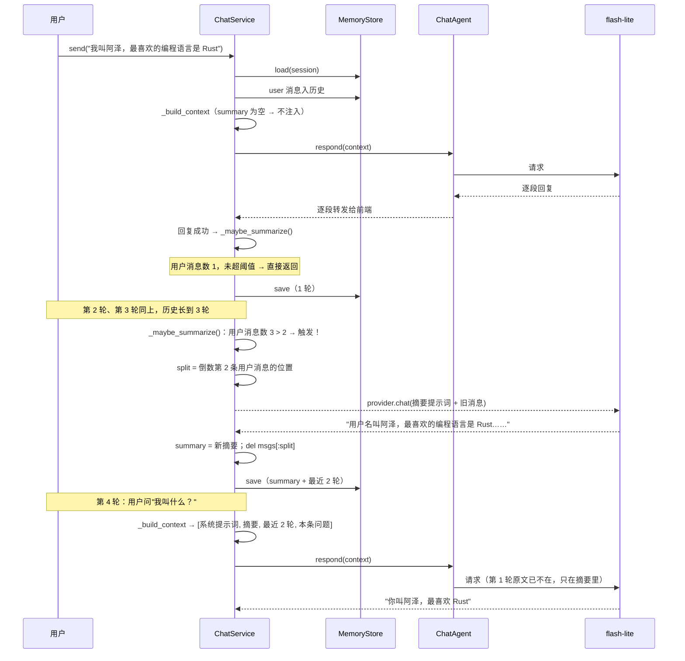
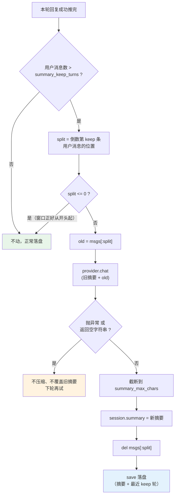

# 09 长对话摘要（Summary Memory）

> **目标**：让 Agent **记住聊了很久的对话**——对话一长，旧消息不再被"直接撕掉"，而是**先让 LLM 把大意抄进摘要**，聊到第 30 轮它还记得第 1 轮说过什么。
>
> **本文档定位**：帮你**快速吃透 09 这段代码、看懂项目进度**，落到「哪一行代码怎么写的」。建议阅读顺序：
> **1 全景图 → 2 数据流（时序图）→ 3 代码变更地图 → 4 逐个模块 → 5 关键代码块逐行解读 → 6 流程图 → 7 实测发现 → 8 动手实验 → 9 测试 → 10 小结**。
> 只想快速了解进度，看 3、6、7 三节即可。

---

## 1. 全景图：09 给管家教了什么新本事？

回看这条"记忆能力"的递进线：

| 里程碑 | 记忆怎么处理"聊太久"                              |
| ------ | ------------------------------------------------- |
| M2     | **硬截断**——超上限直接丢最旧的消息        |
| 09     | **滚动摘要**——丢之前先让 LLM 把大意抄下来 |

M2 当时的 `_trim()` 是"本子写满了，把前面的纸撕掉"。副作用很直白：

> 你跟它聊了 30 轮，第 1 轮说的"我喜欢吃辣"，到第 30 轮已经被**彻底撕掉**了。

09 教给管家一招：**撕纸之前，先把那些页面的大意抄在扉页上。** 于是第 30 轮它还"记得"你爱吃辣——哪怕记不住原话。

M2 文档里其实早就留了这个口子（"将来做上下文压缩，只替换 `_trim`"），09 就是来兑现它的。

```
  会话历史（越聊越长）
   ┌──────────────────────────────────────────────┐
   │  旧消息 旧消息 旧消息 │  最近消息 最近消息      │
   └────────┬─────────────┴───────────┬───────────┘
            │ 超过 summary_keep_turns？│
            ▼                         ▼
   ┌──────────────────────┐   ┌─────────────────┐
   │ 让 LLM 总结旧消息     │   │ 原样保留为完整消息 │
   │ → Session.summary    │   │                  │
   └──────────┬───────────┘   └────────┬─────────┘
              │                        │
              └────────┬───────────────┘
                       ▼
   ┌──────────────────────────────────────────────┐
   │  _build_context：                            │
   │  [系统提示词] + [摘要] + [最近几轮原文]        │
   └──────────────────────┬───────────────────────┘
                          ▼
              SenseNovaProvider —— 一行不改
```

**一句话记住**：**摘要就是"把撕掉的旧页先抄在扉页上"——模型看到的是「扉页 + 最近的几页」，你存到磁盘上的也是「扉页 + 最近的几页」，两边都不再是无限长的本子。**

**最重要的一个结论**：09 是"**纯后端补强**"——只改 `memory.py`（加一个字段）和 `service.py`（一段编排逻辑），**Provider / 工具 / RAG / MCP / Web 前端全都没动**。这是分层架构**第八次兑现红利**：加一种记忆能力，最底层的联网代码一行没改。

---

## 2. 数据流：长对话里摘要的完整旅程（时序图）

以「第 1 轮埋下"我叫阿泽、喜欢 Rust"，聊到第 3 轮时第 1 轮被压掉」为例（`summary_keep_turns=2`）：



**两个关键点**：

1. **摘要发生在回复推完之后**：注意时序——`AGT-->>SVC: 逐段转发` 之后才 `_maybe_summarize`。用户看到回复的时间**完全没被摘要那次额外 LLM 调用拖慢**，摘要是在"你已经开始读了"之后才悄悄做的。
2. **摘要是独立的一次 `provider.chat()`，不走 Agent、不走工具**：它不需要 ReAct 循环，只是一次非流式的"请把这段总结一下"。所以摘要逻辑在 `ChatService` 里，`ChatAgent` 一行不用改。

---

## 3. 代码变更地图：09 相比 M6 加了/改了哪些？

| 文件                                                     | 状态               | 改了什么                                                                |
| -------------------------------------------------------- | ------------------ | ----------------------------------------------------------------------- |
| `src/core/memory.py`                                   | ✏️**改动** | `Session` 加 `summary` 字段；`to_dict` / `from_dict` 持久化     |
| `src/core/service.py`                                  | ✏️**改动** | `_maybe_summarize` / `_summarize` 新增；`_build_context` 注入摘要 |
| `src/config.py`                                        | ✏️**改动** | `summary_keep_turns` / `summary_max_chars` 两个配置                 |
| `src/bootstrap.py`                                     | ✏️**改动** | 把两个新配置传给`ChatService`                                         |
| `src/core/agent.py`                                    | ✏️**改动** | 删掉`_chunked` 的打字机微延迟（顺带还债，见 7 发现一）                |
| `src/cli.py`                                           | ✏️**改动** | 补`/delete`；`/sessions` 显示"已摘要"标记                           |
| `.env.example` / `README.md`                         | ✏️**改动** | 补齐配置项到 M5、更新路线图                                             |
| `tests/test_summary.py`                                | 🆕**新增**   | 摘要逻辑 17 个测试                                                      |
| `scripts/e2e_summary.py`                               | 🆕**新增**   | 真实端到端：长对话不丢早期记忆（花额度）                                |
| `agent.py` 循环体 / `provider.py` / `sensenova.py` | ➖**不变**   | 摘要复用现有`provider.chat()`，联网层零改动                           |
| `tools.py` / `rag.py` / `mcp.py` / `index.html`  | ➖**不变**   | 摘要纯后端行为，工具和前端全无感                                        |

**核心结论**：09 是"**纯后端补强**"——改 `Session` 一个字段 + `ChatService` 一段逻辑，**前端、工具、联网层一行没动**。用户界面看不到摘要的存在（除了聊得更久还记得事），这是它最优雅的地方。

---

## 4. 逐个模块讲解

### 4.1 `Session.summary` 字段（加字段，不重构）

记忆模型上只加了一个字符串字段：

```python
@dataclass
class Session:
    """一个会话 = 元信息 + 消息历史（Conversation）+ 早期对话摘要（09）。"""

    id: str
    conversation: Conversation
    summary: str = ""          # 早期对话的滚动摘要；空字符串 = 还没溢出过
    created_at: str = field(default_factory=_now)
    updated_at: str = field(default_factory=_now)
```

**两个设计取舍**：

- **摘要和会话绑定，而不是单独一张"摘要表"**：一个会话一份历史、一份摘要，同生同死。删会话连摘要一起删，不用管孤儿数据。
- **用 `""` 而不是 `None` 表示"没有摘要"**：这样 `if session.summary:` 就能直接判空，不用到处写 `is not None`。空字符串就是"还没溢出过"的语义。

**向后兼容的关键一行**：老版本的会话 JSON 里没有 `summary` 字段，所以读的时候用 `.get` 给默认值：

```python
summary=data.get("summary", ""),   # 旧版 JSON 无此字段，按"无摘要"处理
```

不加这行的话，程序升级后第一次读老会话会直接 `KeyError`——这是个很容易漏掉的迁移坑。

### 4.2 `_maybe_summarize`：何时触发（service.py）

这是 09 的决策核心。判定的全部逻辑：

```python
def _maybe_summarize(self, session: Session) -> None:
    msgs = session.conversation.messages
    user_positions = [i for i, m in enumerate(msgs) if m.role is Role.USER]
    if len(user_positions) <= self._summary_keep_turns:
        return                              # 没超阈值，不触发
    split = user_positions[-self._summary_keep_turns]
    if split <= 0:
        return                              # 保留窗口正好从开头起，没有旧消息可压
    old = msgs[:split]                      # 要压缩的旧消息
```

**几个值得注意的点**：

- **按"用户消息数"数轮次，不是按"消息条数"**：一轮 = 一条用户消息 + 一条回复。用 `user_positions` 定位，和 M2 `_trim()` 数轮次的方式完全一致——**同一套"什么算一轮"的定义，不会因为加了摘要而漂移**。
- **`summary_keep_turns=0` 就是"关闭摘要"**：这是个小彩蛋。第 1 轮时 `user_positions[-0]` 等于 `user_positions[0]` 等于 `0`，正好被 `split <= 0` 挡掉，天然永不触发。留个开关方便回退和做测试。
- **失败隔离放在最外层**（见 5.1）：摘要那次 LLM 调用可能失败、可能返回空字符串。两种情况都**不压缩、不覆盖旧摘要**，下一轮再试。主对话**永远**不受影响。

### 4.3 `_summarize`：滚动摘要（service.py）

关键在"**滚动**"二字——不是每次把全部旧消息重新总结一遍：

```python
def _summarize(self, existing: str, old: list[Message]) -> str:
    history = "\n".join(f"{m.role.value}: {m.content}" for m in old)
    prompt = SUMMARY_PROMPT.format(
        max_chars=self._summary_max_chars,
        existing=existing or "(空)",
        history=history,
    )
    summary = self._agent.provider.chat(
        [Message(role=Role.USER, content=prompt)]
    )
    return summary.strip()[: self._summary_max_chars]
```

**三个设计取舍**：

- **为什么是滚动的**：`新摘要 = 总结(旧摘要 + 新溢出的旧消息)`。好处是**摘要长度始终有界**——它每次只总结"一份摘要 + 一小段新消息"，输入规模恒定，不会随对话变长而膨胀。如果是"每次重新总结全部历史"，第 100 轮时那次调用会比第 3 轮贵几十倍。
- **为什么用 `provider.chat()` 而不是 `agent.respond()`**：摘要不需要工具调用，不需要 ReAct 循环。走非流式直答最快最省，而且**完全绕开了 Agent**——这就是 `ChatAgent` 一行不改的原因。
- **为什么还要 `[:self._summary_max_chars]` 截断**：提示词里已经说了"控制在 N 字以内"，但 LLM 不一定听话。截断是**代码层兜底**，不信任模型的自我约束。这是 09 里"防御性"思维的体现。

### 4.4 `_build_context`：摘要插在哪个位置

```python
def _build_context(self, session: Session) -> list[Message]:
    msgs = list(session.conversation.messages)
    msgs = self._trim(msgs)
    if self._system_prompt:
        msgs.insert(0, Message(role=Role.SYSTEM, content=self._system_prompt))
    if session.summary:
        msgs.insert(1, Message(role=Role.SYSTEM, content=f"[对话历史摘要]\n{session.summary}"))
    return msgs
```

**位置很重要**：摘要作为 **system 消息**插在**系统提示词之后、对话历史之前**。

- 插在最前面？那它会盖过你的人设。
- 插在历史中间？模型会把它当成"某个时刻发生过的对话"。
- 插在最后面？模型可能把它当成"最新的信息"，盖过你刚说的话。

放在 index 1 是"背景知识"的标准位置：模型自然把它当成"更早聊过的大意"，既不抢人设、也不假装成一条用户发言。

**注意 `_trim` 还在**：摘要压缩了存储，所以 `_trim` 通常不再触发；但它是**兜底**，留着以防摘要关掉（`keep_turns=0`）或历史里有超长单条消息。

### 4.5 一个隐蔽的丢数据点：`max_turns` 的自动抬升

这是 09 里最反直觉的一处代码，在 `__init__` 里：

```python
# 防止「已摘要的内容又被 _trim 静默丢掉」：保留窗口不能比摘要窗口更短
if max_turns < summary_keep_turns:
    self._max_turns = summary_keep_turns
```

**不写它会怎样**：假设用户配 `SUMMARY_KEEP_TURNS=30` 但 `MAX_HISTORY_TURNS=20`。那存储里会攒到 31 轮（摘要窗口是 30），而 `_trim` 只保留最近 20 轮——**中间那 11 轮既没进摘要、又被截断丢弃**，静默丢失，没有任何报错。

这是两个独立配置碰在一起才产生的坑：一个管"存多少"，一个管"给模型看多少"，**它们有隐含的先后关系，但配置层看不出来**。所以不靠文档叮嘱，直接在代码里把不变式守住。

---

## 5. 关键代码块逐行解读

### 5.1 `_maybe_summarize` 的失败隔离（service.py）

```python
        try:
            new_summary = self._summarize(session.summary, old)   # ① 一次额外的 LLM 调用
        except Exception:                       # noqa: BLE001  摘要失败不影响主对话
            return
        if not new_summary:                     # ② LLM 返回空也算失败
            return                              # 不压缩，下轮再试

        session.summary = new_summary           # ③ 先写摘要
        del msgs[:split]                        # ④ 再删已压缩的旧消息（同一次落盘）
```

- **① 被 `try/except Exception` 整体包住**：摘要调用的任何失败（限流、断网、超时、429）都不往上传。`send()` 的回复已经推完了，摘要失败不该让这一轮报错。
- **② 是最容易漏的一种失败**："调用成功、返回空字符串"。如果照样删掉旧消息，就是**白丢了一轮信息**（摘要没写到、旧消息没了）。所以空摘要视为失败，下一轮再试。
- **③④ 的顺序刻意**：先写摘要再删消息，两步在**同一次 `save()` 里落盘**（`_maybe_summarize` 在 `send()` 的 `finally` 之前调用）。不会出现"摘要写成功了但旧消息还在"或"旧消息删了但摘要没写"的中间态。
- **④ 用 `del msgs[:split]` 而不是 `session.conversation.messages = msgs[split:]`**：前者**原地修改同一个 list 对象**，后者会换成一个新 list。原地修改保证 `Conversation` 里那个 list 的身份不变，避免持有旧引用的代码拿到过期数据。

### 5.2 摘要的注入（service.py）

```python
        if self._system_prompt:                                              # ① 人设在前
            msgs.insert(0, Message(role=Role.SYSTEM, content=self._system_prompt))
        if session.summary:                                                  # ② 摘要紧随其后
            msgs.insert(1, Message(role=Role.SYSTEM,
                                   content=f"[对话历史摘要]\n{session.summary}"))
```

- **①② 都是 system 角色**：这样摘要不会出现在"用户说过什么"的序列里，模型不会误以为是用户的新指令。
- **`[对话历史摘要]` 这个前缀是给模型看的"路标"**：告诉它"下面这段不是对话原文，是大意"。没有这个前缀，模型更容易把摘要当成逐字对话来引用。
- **摘要**不落进 `session.conversation`**：注意它是临时插进 `context` 的，`_send_locked` 只把用户问题和模型回复 `add` 进历史。所以翻会话记录时看不到摘要消息，摘要只存在 `session.summary` 字段里。

### 5.3 `SUMMARY_PROMPT`：提示词也是代码（service.py）

```python
SUMMARY_PROMPT = """\
你是一个对话摘要器。下面给你一段已有摘要和一段新的对话历史。
请把它们合并成一段新的摘要：
- 保留关键事实：人物与称呼、事件、数字、时间、用户偏好与双方约定
- 丢弃寒暄、重复与无关细节，不要逐句复述
- 控制在 {max_chars} 字以内，用简洁的中文叙述
直接输出摘要正文，不要任何前缀或解释。

[已有摘要]
{existing}

[新对话历史]
{history}"""
```

- **"保留关键事实"列得很具体**：人物与称呼、事件、数字、时间、偏好与约定。列得越具体，摘要遗漏的概率越低——这是 09 文档 §8 风险 1（"摘要可能遗漏关键细节"）的缓解手段。
- **"不要任何前缀或解释"**：防止模型输出"以下是摘要：……"这种废话，否则摘要里会攒一堆元语言。
- **`{existing}` 和 `{history}` 分开两个区块**：模型需要清楚区分"这是以前的结论"和"这是新发生的事"，否则容易把旧结论当新事复述一遍。
- **`existing or "(空)"`**：第一次摘要时没有旧摘要，塞个 `(空)` 占位而不是空字符串——避免 prompt 里出现"两个连续空行"这种让模型困惑的格式。

### 5.4 滚动摘要的两行核心（service.py）

把 `_maybe_summarize` 和 `_summarize` 合起来看，滚动逻辑其实只有两行：

```python
new_summary = self._summarize(session.summary, old)   # 旧摘要 + 新溢出 → 新摘要
session.summary = new_summary                          # 覆盖写回
```

**推演一遍为什么长度有界**：

| 轮次     | 旧摘要   | 新溢出      | 新摘要           |
| -------- | -------- | ----------- | ---------------- |
| 第 21 轮 | `(空)` | 第 1~20 轮  | 一段             |
| 第 41 轮 | 一段     | 第 21~40 轮 | 一段（长度相近） |
| 第 61 轮 | 一段     | 第 41~60 轮 | 一段（长度相近） |

每次输入都是"一份摘要 + 最近溢出的 20 轮"，规模恒定，所以输出也恒定。这就是"摘要不会无限膨胀"的原理——不是靠截断硬压，而是**输入规模本身就有界**。

### 5.5 `_trim` 与摘要的分工

```python
def _trim(self, msgs: list[Message]) -> list[Message]:
    """双上限截断，从最旧开始丢：
    1) 轮数上限  2) 字符上限
    有摘要后这里通常不会触发（存储已被压缩），保留作为兜底。
    """
```

两者是**保险丝和断路器**的关系：

- **摘要 = 断路器**：在存储层面主动压缩，让历史**根本不会**长到需要截断（`keep_turns` 轮就压一次）。
- **`_trim` = 保险丝**：万一摘要被关掉、或被超长单条消息撑爆字符上限，它还在最后一道防线。

**注意区别**：`_trim` 丢的内容**没人知道**（直接消失）；摘要丢的内容**至少有份大意**。这就是 09 带来的本质区别——**从"静默遗忘"变成"有损记忆"**。

---

## 6. 流程图：一轮回复里的摘要判定



- **绿色路径 `Z`**：绝大多数轮次走这里（没超阈值），**零额外成本**。摘要是"按需触发"，不是每轮都跑。
- **橙色路径 `H`**：失败隔离。这条路径上**什么都不会坏**——旧消息还在、旧摘要还在，只是这一轮没压缩。
- **蓝色路径 `L`**：真正发生压缩。注意它和 `Z` 走的是**同一次 `save()`**（都在 `_send_locked` 的 `finally` 里），所以"摘要 + 删消息"是一次原子落盘。

---

## 7. 实测发现（2026-09-20 真实调用验证）

### 发现一：flash-lite 是"整段算完再下发"，真流式没有收益（重要）

09 的任务清单里有一条债是"把假流式升级为真流式"。我写了个探针 `scripts/probe_streaming.py` 先验证前提，结果：

```
模型：sensenova-6.8-flash-lite
第 1 段 (+166.208s)：'\n\n冰雪消融，万物复苏。嫩'
第 2 段 (+0.011s)   ：'绿破土而出，'
第 3 段 (+0.017s)   ：'繁花竞相绽放。燕子归来，'
共 8 段，总耗时 166.36s
→ 结论：服务端一次性下发（无逐 token 流式）
```

**首段间隔 166 秒，其余 7 段全部在 0.06 秒内到达。** 也就是说 `stream=True` 并没有带来逐 token 的下发——服务端把整段算完才一次性吐出。

> **教训**：README 里早就记过"服务端先算完再下发"，但**不实测你不知道有多彻底**（166 秒 vs 0.06 秒）。
>
> 所以"真流式"改造被判定为**无可见收益**——模型不逐 token 出字，改成流式用户照样是"等 166 秒然后整段出现"。要真流式得改 provider 接口层（流式返回文本 + 末尾返回工具调用），收益为零。
>
> 实际做的替代：**删掉 `_chunked` 里那段打字机微延迟**（`time.sleep(0.01)` × 125 次 ≈ 白等 1 秒）。模型既然已经算完了，再人为延迟只会让用户多等。

> 🔁 **这条结论只对商汤成立**（本文档写于 SenseNova 时代）。换成 DeepSeek 后实测真逐 token
> （`docs/14`），「真流式改造收益为零」不再成立——`docs/16` 已按 §9.2 里预想的路线做完
> （provider 层「流式返回文本 + 末尾返回工具调用」）。**保留原文不改，因为 166 秒那个数字是
> 商汤时代真实测出来的。**

### 发现二：摘要真的记住了"未决问题"（超出预期）

真实端到端（`scripts/e2e_summary.py --keep 2`）里，摘要的实际输出是：

> 用户名叫阿泽，最喜欢的编程语言是 Rust。**助手已记住该信息，并询问阿泽用 Rust 主要做什么方向（系统编程、Web 后端如 Actix/Axum、CLI 工具或底层基础设施等），阿泽尚未回复。** 助手还说明了记忆机制……

最后我反问"我叫什么？最喜欢什么语言？"，模型答：

> 你叫**阿泽**，最喜欢的编程语言是 **Rust** 🦀
>
> 记得清清楚楚～（不过当时问你主要做哪个方向——系统编程、Web 后端如 Actix/Axum、CLI 工具、还是底层基础设施——你还没回答我呢 😄）

**这个细节超出预期**：摘要不只是记住了"叫阿泽、喜欢 Rust"这些静态事实，还把**"我问了你一个你还没回答的问题"这个对话状态**也带了下来。这是"滚动摘要 + 保留关键事实"提示词的自然结果，不是我特意设计的。

**顺带验证了压缩真实生效**：磁盘消息数 = `keep × 2 = 4`，第 1 轮原文确实从消息历史里消失了，只活在摘要里。

### 发现三：`max_turns` 和 `summary_keep_turns` 相配错了会静默丢数据

实测构造出来的坑：配 `SUMMARY_KEEP_TURNS=30` + `MAX_HISTORY_TURNS=20` 时，存储攒到 31 轮，`_trim` 只留 20 轮——**中间 11 轮既没进摘要又被截断丢弃**，全程无任何报错。

修复见 4.5：`__init__` 里把 `max_turns` 抬到不低于 `summary_keep_turns`。测试 `test_max_turns_clamped_to_summary_keep_turns` 守着它。

> **教训**：两个"看起来独立"的配置其实有隐含约束。**与其在文档里叮嘱用户别这么配，不如在代码里让这么配也坏不了**——这是比文档更强的约束。

### 发现四：摘要 LLM 会"成功返回空字符串"

除了解决网络/限流这种明显失败，还有种更隐蔽的失败：**HTTP 200、调用成功、但 `content` 是空字符串**。

如果这种情况下照样删旧消息，就是"摘要没写到、旧消息没了"的白丢。所以 `if not new_summary: return`——空摘要视为失败，不压缩，下一轮再试。测试 `test_empty_summary_result_skips_compression` 守着它。

> **教训**：对 LLM 调用做防御时，**"没抛异常"不等于"成功了"**。返回值本身也要判。

### 发现五：111 → 113 个测试，摘要相关 17 个全不花额度

`tests/test_summary.py` 17 个测试全程用**假 provider**，一次真实请求都不发。核心技巧：假 provider 把 `chat()`（摘要调用）和 `chat_stream()`（真正的回复）**分开记录**，于是就能分别断言"摘要的 prompt 长什么样"和"回复的上下文长什么样"——不花额度就能验证整条摘要链路。

---

## 8. 动手对照小实验

```bash
# 1. 看 Session 的 summary 字段怎么序列化（含向后兼容）
python -c "from src.core.memory import Session, Conversation; s=Session('x', Conversation([]), summary='摘要内容'); print(s.to_dict())"
python -c "from src.core.memory import Session; print(Session.from_dict({'id':'old','messages':[]}).summary)"
#   → 第二个输出 ''：旧版 JSON 没有 summary 字段也不会 KeyError

# 2. 看摘要插在上下文的哪个位置（第 2 条，紧跟系统提示词）
python -c "
from src.core.agent import ChatAgent
from src.core.memory import MemoryStore, Session, Conversation
from src.core.models import Role
from src.core.provider import BaseProvider, Completion
from src.core.service import ChatService
class P(BaseProvider):
    def chat(self, m): return ''
    def chat_stream(self, m): return iter(['ok'])
    def complete(self, m, tools=None): return Completion(finish_reason='stop', content='ok')
import tempfile
s = MemoryStore(tempfile.mkdtemp()).create()
s.summary = '用户叫阿泽。'
s.conversation.add(Role.USER, '我叫什么')
svc = ChatService(ChatAgent(P()), s, system_prompt='你是助手')
for m in svc._build_context(s): print(m.role.value, '->', m.content[:40])
"

# 3. 关掉摘要做对比（keep_turns=0）
python -c "
import tempfile
from src.core.memory import MemoryStore
from src.core.service import ChatService
s = ChatService(None, MemoryStore(tempfile.mkdtemp()), summary_keep_turns=0)
print('摘要窗口:', s._summary_keep_turns)
"

# 4. 看摘要提示词长什么样
python -c "from src.core.service import SUMMARY_PROMPT; print(SUMMARY_PROMPT)"

# 5. 跑摘要单测（17 个，不花额度）
pytest tests/test_summary.py -v

# 6. 真实端到端：长对话不丢早期记忆（花额度，4 轮）
python scripts/e2e_summary.py
python scripts/e2e_summary.py --keep 20 --turns 22   # 真实阈值，22 轮（贵）

# 7. 正常跑 Web，多聊几轮看侧栏"已摘要"
python -m src.api
#   CLI 里 /sessions 会显示「· 已摘要」标记
```

> ⚠️ `e2e_summary.py` 走真实 API、**花额度**。用 `--keep 2` 的默认配置只需 4 轮就能触发摘要，`--keep 20` 要 22 轮。

---

## 9. 测试验证了什么（怎么看懂进度）

`tests/test_summary.py` 是 09 的"验收单"，17 个测试**全用假 provider、不花额度**：

| 测试                                               | 测什么                                             | 对应代码                      |
| -------------------------------------------------- | -------------------------------------------------- | ----------------------------- |
| `test_session_summary_roundtrip`                 | 摘要能落盘再读回                                   | `Session.to_dict/from_dict` |
| `test_session_json_contains_summary`             | 磁盘 JSON 里真的有 summary 字段                    | `Session.to_dict`           |
| `test_old_json_without_summary_is_loadable`      | **旧版 JSON（无 summary）仍能加载**          | `from_dict` 的 `.get`     |
| `test_empty_summary_means_never_overflowed`      | 新建会话默认无摘要                                 | `Session` 默认值            |
| `test_no_summary_under_threshold`                | 没超阈值不触发，**也不额外调 LLM**           | `_maybe_summarize`          |
| `test_summary_triggers_over_threshold`           | 超阈值：旧消息被压，最近 N 轮保留                  | `_maybe_summarize`          |
| `test_summary_rolling_uses_existing_summary`     | 滚动：prompt 同时含旧摘要 + 新溢出，且不重复旧内容 | `_summarize`                |
| `test_short_conversation_unchanged`              | 短对话行为完全不变（无摘要消息）                   | `_build_context`            |
| `test_summary_injected_after_system_prompt`      | **注入位置**：系统提示词后、历史前           | `_build_context`            |
| `test_summary_not_persisted_as_history`          | 摘要只进上下文，不落进历史                         | `_build_context`            |
| `test_summary_persists_across_reload`            | 重启后摘要还在                                     | 持久化                        |
| `test_summary_max_chars_truncates`               | LLM 输出过长会被截断到上限                         | `_summarize`                |
| `test_summary_failure_keeps_turn_intact`         | **摘要失败：回复照常、旧消息不丢**           | `_maybe_summarize`          |
| `test_summary_failure_then_retry`                | 这轮失败、下轮重试并成功                           | `_maybe_summarize`          |
| `test_empty_summary_result_skips_compression`    | **返回空摘要：不压缩**（见 7 发现四）        | `_maybe_summarize`          |
| `test_summary_coexists_with_tools`               | 摘要 + 工具调用共存，两条路径分开记                | 与 M3 共存                    |
| `test_multi_image_messages_do_not_break_summary` | 带图消息进摘要只取文字，不报错                     | `_summarize`                |

**关键技巧**：假 `RecordingProvider` 把 `chat()` 和 `chat_stream()` 分开记录。`chat()` 只被摘要调用、`chat_stream()` 只被真正的回复调用——所以断言 `provider.summaries` 就能验证"摘要的 prompt 长什么样"，断言 `provider.replies` 就能验证"回复的上下文长什么样"。**两条路径的输入输出互不污染**，这是不花额度就能验证摘要的唯一办法。

---

## 10. 小结：M6 → 09 对照

|                 | M6 多模态（08 文档）                | 09 长对话摘要（本文档）                          |
| --------------- | ----------------------------------- | ------------------------------------------------ |
| 做了什么        | 让 Agent 看懂图片                   | 让 Agent 聊得久也不忘早期内容                    |
| 核心文件        | 改`models.py`（加字段 + 序列化）  | 改`memory.py`（加字段）+ `service.py`        |
| 是否动 Provider | 一行不改                            | **同样一行不改**（复用 `provider.chat`） |
| 最大难点        | content 类型取舍（加字段 vs union） | **摘要的触发时机 + 失败隔离**              |
| 惊喜            | flash-lite 自带视觉                 | 摘要带下了"未回答的问题"这个对话状态             |
| 踩坑            | max_tokens 太小 → 空回复           | max_turns / keep_turns 相配错 → 静默丢数据      |
| 关键取舍        | 图片用独立字段，不污染 content      | 摘要是 system 消息，不落进历史                   |

一句话总结：**M1~M6 造好了会说话、会记事、会打电话、会查资料、会接外部工具、会看图的 Agent，09 则治好了它"聊久了就忘"的病——从"本子写满就撕页"变成"撕页之前先抄个大意到扉页上"。而这一次的记忆升级，大脑、管家的手、电话线、天线、眼睛全都没动，只改了笔记本子和抄笔记的那个动作。这就是分层架构第八次兑现红利。**

> **下一步**：并发（多窗口同时跑）是 `docs/10_并发与多窗口.md` 的内容——09 改完 `Session` 数据模型后，10 的会话锁加在了这个**最终形态**上，顺序是对的。
