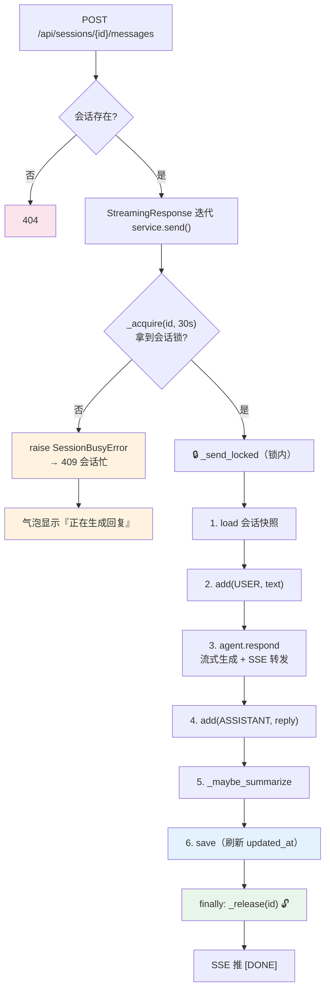
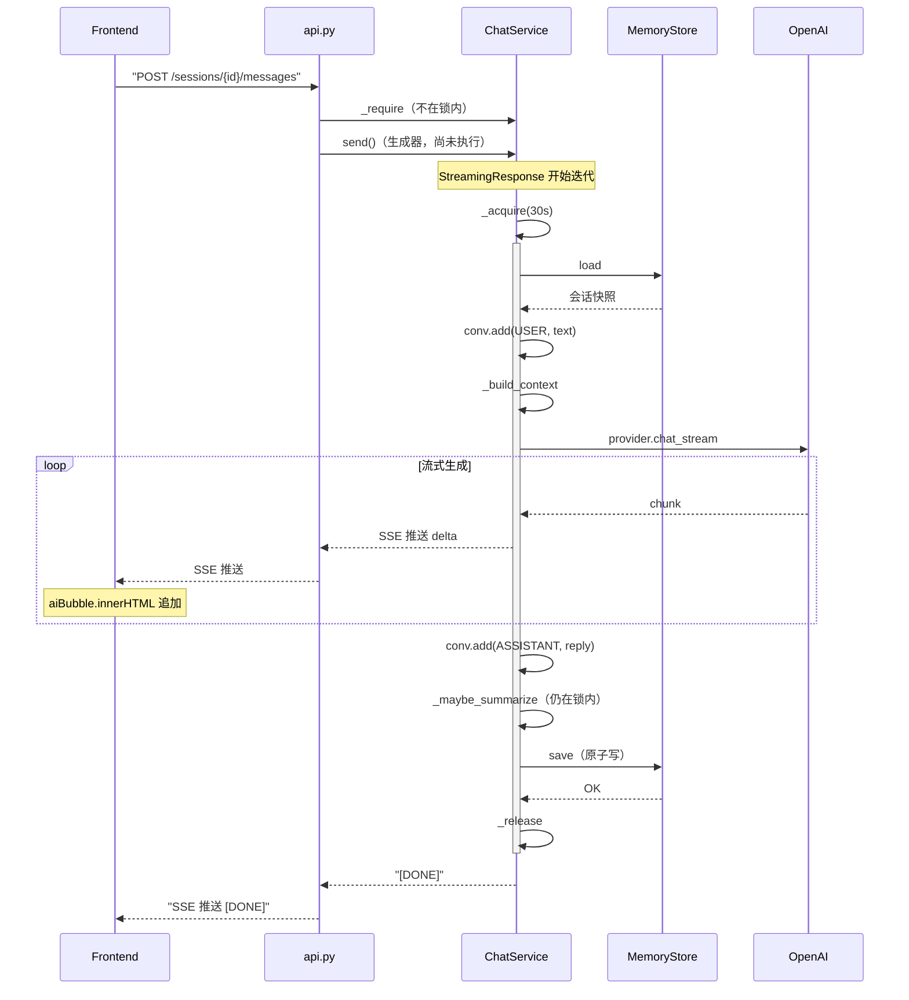

# 10 并发与多窗口

> **目标**：一个窗口正在生成回复时，**切到另一个会话不会把它打断**；多个窗口可以**同时各自跑各自的对话**，像豆包那样。
>
> **本节范围**：M7「并发 / 性能优化 + 多 Agent 编排」里**只做"多会话并发的正确性"**。其余条目（多进程并发、跨窗口历史同步、多 Agent 编排、并发上限 / 限流、性能优化、摘要挪后台）**有意不做**，逐条判过的原因见 §10.2 —— 不是烂尾，是取舍。
>
> **本文档定位**：帮你**快速吃透 10 这段代码、看懂项目进度**，落到「哪一行代码怎么写的」。建议阅读顺序：
> **1 全景图 → 2 数据流（时序图）→ 3 代码变更地图 → 4 逐个模块 → 5 关键代码块逐行解读 → 6 流程图 → 7 实测发现 → 8 动手对照小实验 → 9 测试 → 10 小结与范围取舍**。
> 只想快速了解进度，看 3、7、10 三节即可。

---

## 1. 全景图：10 修了什么？

回看用户报的那个 bug：

> 窗口 1 正在生成回复，点侧栏切到窗口 2 —— 窗口 1 被直接中断了。

一个直觉的假设是"服务端生成被打断了"。**实测证明不是**（见 §7 发现一）。真相反过来：数据从头到尾都是好的，**是前端把视图清空了**。

所以 10 其实是修**两件互不相干**的事：

```
  ┌─────────────────────────────────────────────────────┐
  │  症状：切窗口，在途回复"消失"                          │
  ├─────────────────────────────────────────────────────┤
  │                                                     │
  │  ① 前端（主因）                                       │
  │     #messages 是所有会话共用的唯一容器                 │
  │     切会话 = innerHTML='' = 把在途气泡从 DOM 摘掉     │
  │     → 回复被写进已脱离 DOM 的节点，等于白写            │
  │                                                     │
  │  ② 后端（真 bug）                                     │
  │     send() = load → 改内存 → save                    │
  │     同会话两条消息并发 → 两线程拿到同一份旧快照         │
  │     → 各自落盘，后写的覆盖先写的，消息被静默吞掉        │
  │                                                     │
  └─────────────────────────────────────────────────────┘
```

**一句话记住**：**不同会话各拿各的锁、真并行；同一会话拿到同一把锁、排队而不是互相覆盖。前端则从"一个共用容器"改成"每会话一个视图、切换只改显隐"。**

**最重要的一个结论**：并发能力加在**编排层（ChatService）和存储层（MemoryStore）**，**模型调用层一行没动**——一个 provider 实例被所有会话共享，`openai.OpenAI` 底层的 httpx client 本身线程安全，实测并发没问题。这是分层架构**第九次兑现红利**。

---

## 2. 数据流：切窗口那一刻，前后端各自在干什么

用户报的症状只有一句话：**"窗口 1 正在生成回复，切到窗口 2，窗口 1 被打断了。"**

这句话里藏着两个互不相干的动作：**前端在改 DOM，后端在往磁盘写 JSON**。把它们分开看，问题就只剩一边了。

### 2.1 前端：一次切窗口，旧 vs 新

```
旧版（所有会话共用 #messages）              新版（每个会话一个 .session-view）

点侧栏切到会话B                              点侧栏切到会话B
      │                                          │
      ▼                                          ▼
refreshView(B):                               showView(B):
  fetch /sessions/B                           视图A.style.display = 'none'
  容器.innerHTML = ''    ← 清空                视图B.style.display = ''
  把 B 的历史画进去                           ← 只改显隐，不碰任何节点

  ↑ 此刻 A 的在途气泡被这个 '' 一起带走         ↑ A 的在途气泡原封不动躺在 DOM 里
      │                                          │
SSE 段继续到达                                   SSE 段继续到达
  → 写进"已脱离 DOM 的气泡"                      → 继续写进 A 的气泡
  → 用户什么都看不见，像被打断                    → 你看不见它，但它还在长
```

**新旧的唯一区别是 `innerHTML = ''` 换成了 `style.display = 'none'`**——前者是"销毁内容"，后者是"掀开盖子"。而 SSE 的读循环从头到尾都跑在同一个 `sendMessage` 协程里，它根本不关心你正看着哪个窗口。

所以要害在这里：**只要前端敢在生成中途清空容器，这次回复就永远看不见了**——它还在被写入，只是写进了一个没有父节点的节点。这不是"被打断"，是"还在写，但你把它藏起来了"。

### 2.2 后端：三条请求落在同一把 / 不同的锁上

```
时间轴 ──────────────────────────────────────────────────────►

会话1 请求A   │██████████████████│
会话2 请求B         │██████████████████│          ← 各拿各的锁：真并行
会话1 请求C                         │░░等锁░░░░│████████│   ← 同一把锁：排队
（若 30s 内没排上 → 409 会话忙）
```

- **A 和 B 同时跑**：`_locks["会话1"]` 和 `_locks["会话2"]` 是两把互不相干的锁，谁也不挡谁。
- **C 只能排队**：它和 A 拿到的是**同一把**锁，所以 C 会安静地等 A 落盘并释放，再用自己的新快照开工——这正是"不互相覆盖"的机制本身。
- 如果 C 等不及（超过 `busy_timeout`），它拿到一个明确的 `SessionBusyError`，而不是悄悄写坏历史。

### 2.3 一句话把两端串起来

切窗口本来是**纯前端事件**，不该碰后端。10 做的第一件事是把前端"切窗口 = 清空"这个副作用摘掉；**第二件事才是后端**——因为一旦前端能真正同时看两个窗口，用户就会真的同时发两条消息，同一会话的两个请求才会撞到同一个 `send()`。前端修复是让并发"被看见"，后端修复是让并发"不出错"。

---

## 3. 代码变更地图：10 相比 09 加了/改了哪些？

| 文件                                                              | 状态               | 改了什么                                                                                                                                                                                                                               |
| ----------------------------------------------------------------- | ------------------ | -------------------------------------------------------------------------------------------------------------------------------------------------------------------------------------------------------------------------------------- |
| `src/core/service.py`                                           | ✏️**改动** | 会话级锁`_locks` + `_lock_for` / `_acquire` / `_release`；`send` 拆成持锁外壳 + `_send_locked`；新增 `SessionBusyError`；`clear_session` / `delete_session` 也持锁；新增 `busy_timeout` / `housekeeping_timeout` |
| `src/core/memory.py`                                            | ✏️**改动** | 实例级`RLock` 罩住全部磁盘 IO；新增 `_atomic_write`（临时文件 + `os.replace` + `fsync` + 重试）                                                                                                                                |
| `static/index.html`                                             | ✏️**改动** | `views`（会话→视图）+ `generating`（在途集合）；切窗口只改 `display`；`refreshView` 跳过生成中的会话；侧栏绿点；侧栏 5 秒轮询                                                                                                 |
| `src/api.py`                                                    | ✏️**改动** | `SessionBusyError` → HTTP 409                                                                                                                                                                                                       |
| `tests/test_concurrency.py`                                     | 🆕**新增**   | 12 个用例：并行 / 串行 / 报忙 / 原子写                                                                                                                                                                                                 |
| `scripts/probe_concurrency.py`                                  | 🆕**新增**   | 探针：并行耗时、同会话排队、客户端断开（假 provider，不花额度）                                                                                                                                                                        |
| `README.md` / `docs/01`                                       | ✏️**改动** | 路线图拆成 M7-a / M7-b；新增"并发与多窗口说明"和"已知限制"                                                                                                                                                                             |
| `provider.py` / `sensenova.py` / `agent.py` / `models.py` | ➖**不变**   | 并发加在编排层与存储层，**模型调用层一行没动**（09 结尾那句"全都没动"在 10 继续成立）                                                                                                                                            |
| `config.py` / `bootstrap.py` / `cli.py`                     | ➖**不变**   | 两个超时是代码常量、没进`.env`；CLI 是单线程交互，锁永远拿得到                                                                                                                                                                       |

**核心结论**：10 是"**两层各加一把锁 + 前端不再销毁**"。后端只在**编排层（`ChatService`）**和**存储层（`MemoryStore`）**各加一把锁，前端从"一个共用容器"变成"每会话一个视图"，中间隔着的那一层（`provider` / `sensenova`，真正打电话的地方）完全没动。

---

## 4. 逐个模块讲解

### 4.1 会话级锁：一个字典 + 一把守卫锁（service.py）

```python
# 会话级锁：send / clear / delete 各会话互不阻塞，同会话互斥
self._locks: dict[str, threading.RLock] = {}
self._locks_guard = threading.Lock()
```

这里有个新手最容易问的问题：**既然已有 `_locks`，为什么还要 `_locks_guard`？**

因为 `_locks` 本身也是个共享可变对象。两个线程同时 `self._locks[session_id]` 读、再同时判定"没有则创建"，就会各自 new 出一把锁、各写各的——**从此同一个会话有两把不同的锁，谁都能进去，互斥等于没加**。`_locks_guard` 就是保护"取锁"这个动作的锁：它只罩住字典的读写，几微秒就释放，**不罩住生成回复的几十秒**。

```python
def _lock_for(self, session_id: str) -> threading.RLock:
    with self._locks_guard:
        lock = self._locks.get(session_id)
        if lock is None:
            lock = threading.RLock()
            self._locks[session_id] = lock
        return lock
```

用 `RLock` 而不是 `Lock`，是为了同一线程内可以重入（比如将来某个方法内部再调 `send`），代价是测不出"同一线程自锁"——所以并发测试里**故意在另一个线程占锁**（见 §9 的关键技巧）。

### 4.2 `send` 的双层结构：持锁外壳 + `_send_locked`（service.py）

```python
def send(self, session_id, text, images=None) -> Iterator[str]:
    if not self._acquire(session_id, timeout=self._busy_timeout):
        raise SessionBusyError(session_id)
    try:
        yield from self._send_locked(session_id, text, images)
    finally:
        self._release(session_id)
```

拆成两层的原因是：**流式生成器必须能 `yield`，而"先拿锁再干活再放锁"这个骨架不能被打散**。`send` 只负责加锁、放锁；`_send_locked` 负责原来的全部业务逻辑（load → 组装上下文 → 流式转发 → 摘要 → save），它一行都没改，只是从 `send` 里搬了出来。

**锁的范围刻意盖到很宽**：从 `_memory.load` 一直盖到 `_memory.save`，连 `_maybe_summarize` 那次 LLM 调用也在锁内。看起来"锁得有点久"，但这是对的——摘要会改写 `session.summary` 并删掉旧消息，如果它在锁外跑，就会跟下一条消息的 `load` 撞车，等于把刚修好的竞态换个地方再造一遍。

### 4.3 `SessionBusyError` 与两个超时（service.py）

```python
class SessionBusyError(RuntimeError):
    """不抛出它而直接并发，会让两个请求读到同一份旧快照、各自落盘互相覆盖
    ——用户消息会被静默丢掉。宁可直接报错，也不要写坏历史。"""
```

这个类是**取舍的显式声明**：等不及就报错，也不要冒险写坏数据。它被 API 层翻译成 HTTP 409，前端据此把错误文案显示在气泡里（"会话 xxx 正在生成回复，请稍候再发"）。

两个超时常量分工不同：

| 常量                     | 默认值 | 用在                                   | 为什么是这个数                                                            |
| ------------------------ | ------ | -------------------------------------- | ------------------------------------------------------------------------- |
| `busy_timeout`         | 30 秒  | `send`                               | 一次回复可能长达十几秒，**排队是合理行为**，值得等                  |
| `housekeeping_timeout` | 5 秒   | `clear_session` / `delete_session` | 点"清空 / 删除"是即点即用的操作，**不该卡在生成中的请求后面半分钟** |

### 4.4 存储层：实例锁 + 原子写（memory.py）

编排层的锁解决"同一会话的请求不要重叠"，存储层的锁解决另一件事：**读的人不会看到写了一半的文件**。

```python
def __init__(self, session_dir) -> None:
    ...
    self._lock = threading.RLock()        # load / save / list / delete 全部持锁
```

而真正保证"不会出现半截 JSON"的是 `_atomic_write`——先写到同目录的临时文件，再用 `os.replace` 一步替换。`os.replace` 在同一文件系统内是原子操作：**读到的要么是旧文件、要么是新文件，不存在中间态**。

```python
tmp = path.with_name(f"{path.name}.{os.getpid()}.{threading.get_ident()}.tmp")
```

临时文件名里带 **pid + 线程 id**，这是刻意的：就算未来多个线程同时写同一个会话，它们的临时文件也不会撞名。

### 4.5 前端：两个 Map/Set 撑起"切窗口不销毁"（index.html）

```js
const views = new Map();        // 会话id -> 该会话的视图 <div>（切窗口不销毁）
const generating = new Set();   // 本窗口正在生成回复的会话id
```

- `views`：每个会话一个 `<div class="session-view">`，挂在同一个 `#messages` 下。**创建一次，永不重建**（除非用户删除该会话）。
- `generating`：记录哪些会话正在生成。它驱动三件事——发送按钮的"生成中…"状态、侧栏的脉冲绿点、以及 `refreshView` 要不要重建视图。

切换的整个动作因此只剩两行：

```js
function showView(id) {
  views.forEach((v, sid) => { v.style.display = (sid === id) ? '' : 'none'; });
  viewFor(id).style.display = '';
  scrollToBottom();
}
```

侧栏的绿点是这套机制给用户的**唯一可见信号**：一个会话的 `generating` 里有它，就亮一个会脉冲的绿点，意思是"那个窗口还在跑，不用去点它"。

### 4.6 两把锁的关系：谁罩谁

```
        ChatService（编排层）
        ┌────────────────────────────────────────────┐
        │  _locks[会话id]        ← 按会话分：不同会话互不阻塞 │
        │  ┌──────────────────────────────────────┐  │
        │  │ load → 组装 → 生成 → 摘要 → save     │  │
        │  │           │                            │  │
        │  └───────────┼────────────────────────────┘  │
        └──────────────┼───────────────────────────────┘
                       ▼
        MemoryStore（存储层）
        ┌────────────────────────────────────────────┐
        │  _lock（一个实例锁，罩住全部磁盘 IO）       │
        │  save() → _atomic_write()                   │
        └────────────────────────────────────────────┘
```

**两层粒度不同、职责不同，不重叠**：

- 会话锁管**"谁可以改这段对话"**——粒度是每个会话，不同会话真并行。
- 存储锁管**"谁可以碰这块磁盘"**——粒度是整个存储实例，任何时刻只有一个线程在读写 JSON。

存储锁是**跨会话共享**的，所以会话 1 和会话 2 虽然在编排层并行，落到 `save()` 时会短暂排队。但 `save` 只是几次文件 IO（毫秒级），这个排队在实测里完全看不见（§7 发现二）。

---

## 5. 关键代码块逐行解读

### 5.1 取锁：几微秒的临界区（service.py）

```python
def _lock_for(self, session_id: str) -> threading.RLock:
    with self._locks_guard:          # ← 临界区 1：只保护"查字典/建字典"
        lock = self._locks.get(session_id)
        if lock is None:
            lock = threading.RLock()
            self._locks[session_id] = lock
        return lock                  # ← 出 with，守卫锁立即释放
```

然后才轮到真正的长锁：

```python
def _acquire(self, session_id: str, timeout: float) -> bool:
    return self._lock_for(session_id).acquire(timeout=timeout)
    #   ↑ 先取到那把会话锁，再"等它"；等不到就返回 False，绝不无限阻塞
```

**`acquire(timeout=...)` 返回布尔值是这里的关键**：它把"会不会写坏数据"这个问题从运行时变成了**明确的返回值**——调用方拿得到就是安全的，拿不到就抛 `SessionBusyError`，全程没有第三种状态。

### 5.2 放锁：为什么必须写在 `finally` 里（service.py）

```python
    if not self._acquire(session_id, timeout=self._busy_timeout):
        raise SessionBusyError(session_id)     # 没拿到锁，直接抛，没锁要放
    try:
        yield from self._send_locked(session_id, text, images)
    finally:
        self._release(session_id)              # ← 无论正常返回、抛错、还是生成器被 close，都会执行
```

**`yield from` 把锁的持有期跨过了所有 `yield`**——这正是"整轮持锁"的实现方式：流式回复的每一段都发生在锁内，而不是"先 yield 出去再回来"。如果这里少了 `finally`，任何一次模型报错都会让那把锁永久占用，之后这个会话的所有请求都会得到 409。

### 5.3 原子写：三步缺一不可（memory.py）

```python
def _atomic_write(self, path: Path, data: dict) -> None:
    tmp = path.with_name(f"{path.name}.{os.getpid()}.{threading.get_ident()}.tmp")
    for attempt in range(3):
        with tmp.open("w", encoding="utf-8") as f:
            json.dump(data, f, ensure_ascii=False, indent=2)
            f.flush()
            os.fsync(f.fileno())      # ① 先刷到磁盘：进程被杀也不留半截 tmp
        try:
            os.replace(tmp, path)     # ② 原子替换：读者只见到旧或新
            return
        except PermissionError:       # ③ 换不掉（文件被别处打开）就退避重试
            time.sleep(0.02 * (attempt + 1))
    raise
```

三步的分工：

| 步骤                    | 防什么                                                                                   |
| ----------------------- | ---------------------------------------------------------------------------------------- |
| ①`flush` + `fsync` | 断电 / 进程被杀时留下一个**不完整但能识别为 tmp** 的文件，而不是坏掉的目标文件     |
| ②`os.replace`        | 读者永远不会读到"写了一半的 JSON"（`list()` 里会话突然消失的根因）                     |
| ③ 退避重试             | Windows 上文件可能被另一个进程短暂占用（同时开 CLI 和 Web 时就会撞上），重试而不是立刻崩 |

顺带一提：临时文件名带 `pid.threadid`，所以**不需要清理残留也不会互相覆盖**；测试 `test_no_leftover_tmp_files` 顺手断言了 tmp 不残留。

### 5.4 前端那一行：`force || !generating.has(id)`（index.html）

```js
async function refreshView(id, force) {
  const resp = await fetch('/api/sessions/' + id);
  if (!resp.ok) return null;
  const session = await resp.json();
  const v = viewFor(id);
  if (force || !generating.has(id)) {     // ← 本窗口正在生成这个会话 → 不重建
    v.innerHTML = '';
    (session.messages || []).forEach((m) => addBubble(v, m.role, m.content));
  }
  return session;
}
```

这是全篇最精妙的一行。注意 `refreshView` 被调用的时机有**两种完全相反**的场合：

- **切到一个正在生成的会话**：跳过重建——服务器快照里没有"在途的那一轮"，覆盖掉就等于自己把回复藏起来。
- **切到一个已经跑完的会话**（或别的窗口刚改过它）：正常重建——用服务器快照对齐，别的窗口新建/删除的会话也能被看见。

`generating` 在这里充当的正是那个**"我在不该覆盖的时候别覆盖"的判据**。它不是可优化掉的冗余状态，而是前端唯一能判断"这份快照是否新鲜"的依据。

### 5.5 生成器被关闭：整轮撤回，历史一条不留（service.py）

```python
        try:
            for chunk in self._agent.respond(context):
                reply += chunk
                yield chunk                      # 3. 流式转发给调用方
        except GeneratorExit:
            conv.messages.pop()                  # 用户中途打断（如 Ctrl+C）：撤回本轮消息
            raise
        except Exception:
            conv.messages.pop()                  # 4. 请求失败：撤回本轮消息，不污染历史
            raise
```

这段在 09 之前就有，但**10 让它变得重要起来**——因为只有切窗口能真的同时看两个会话，"客户端中途消失"才从理论问题变成日常路径。它的语义是：**这一轮从未发生过**，用户消息和 AI 回复一起不写盘。

实测（真跑，非推测）：

```
gen = svc.send(sid, '中途断开'); next(gen) → 'R1'
gen.close()            # 模拟客户端断开 / 生成器被 close
→ 历史条数 0 []        # 用户消息也被撤回了
gen2 = svc.send(sid, '正常一条') → 'R1R2'，历史条数 2   # 下一轮完全正常
```

这条行为直接决定了前端的修法：**切窗口绝不能去 abort 请求**。服务端对"客户端消失"的处理是**把这轮对话扔掉**，不是暂停、更不是保留。所以 10 的做法是"继续读、只是不看"，而不是"切走就断流"。（细节见 §7 发现三。）

---

## 6. 流程图与时序图：一条消息在锁里的旅程



**读法提示**：`_acquire` 之前的一切（HTTP 路由、`_require` 校验）都不在锁内；`_release` 之后的一切（SSE 封装、`[DONE]`）也不在锁内。**只有中间的六步是排他的**。

而存储层的第二把锁藏在这条流程的"6"里面：`save()` 会先拿 `MemoryStore._lock`，然后 `_atomic_write` 写临时文件再 `os.replace`。这把锁跨会话共享，所以会话 1 和会话 2 的 `save` 会在这里短暂排队（毫秒级，实测看不见）。

前端则是另一条独立流程，它决定"用户在生成中看到什么"：点侧栏切换会话时，如果 `generating.has(id)` 为真，只改 `display` 跳过重建（保留在途气泡）；否则 `fetch` 快照 → `innerHTML=''` → 重画。侧栏的脉冲绿点也由 `generating` 集合决定——有就在，就亮。

上面那张是抽象的锁流程。下面这张把**同一次请求**的参与者全部列出来——前端、HTTP 路由、编排层、存储层、模型服务端——看它们之间到底怎么传：



**三个容易看错的关键点**：

1. **锁的获取/释放位置**：`_acquire` 在 `send()` 入口，`_release` 在 `finally` 里——**只有中间的六步是排他的**。`_require`（HTTP 校验）和 SSE 封装都不在锁内。
2. **生成器的执行时机**：`send()` 是个生成器函数，**调用它时什么都不发生**——只有 `api.py` 的 `stream()` 第一次迭代它时，才真正开始执行 `_acquire`。这也是为什么 `SessionBusyError` 在 HTTP 层会被转成 SSE 错误事件，而不是普通的 409 响应。
3. **SSE 和锁的关系**：`yield chunk` 发生在锁内，意味着"正在流式输出"和"持有会话锁"是同一件事。所以切窗口如果去 abort 请求，会触发 `GeneratorExit`，本轮对话被撤回（见 §7 发现三）。

---

## 7. 实测发现（`scripts/probe_concurrency.py` + 手动验证）

探针用假 provider（`SlowProvider`，每次生成固定睡 1 秒后返回两段），**不花额度**。以下是 2026-09-23 在本机跑出来的真实数字。

### 发现一：服务端从头到尾没被打断（这是最重要的一个）

用户报的 bug 是"切窗口把在途回复打断了"。**修完之后回头看代码，这个假设是错的**：

- SSE 的读循环跑在 `sendMessage` 这个协程里，**切窗口只改了 `style.display`，从来没有中止这个协程**（全项目搜索 `abort` 是零命中——前端根本没有任何中止请求的代码）。
- 服务端更不知道前端在切来切去，它照样生成、照样 `save`。

所以真相是 §1 说的那句话：**数据从头到尾都是好的，是前端把视图清空了**。旧代码里 `refreshView` 的那句 `innerHTML = ''` 会连正在写入的那个气泡一起从 DOM 上摘掉——回复还在被写，只是写进了一个没有父节点的节点，用户自然什么都看不见。

**这个发现的价值**：如果当初顺着"服务端被打断"去改（加个后台队列、让服务端支持暂停续传），就是给一个不存在的问题造一个复杂的系统。真正的修复是前端一行 `display`。

### 发现二：三个数字证明"并行 / 排队 / 不丢"

```
实验 1（两个不同会话同时发问，假 provider 各 1s）
  会话A 耗时 1.038s    会话B 耗时 1.037s    总耗时 1.044s
  → 真并行（串行会是 2.0s）

实验 2（同一个会话同时发两条）
  会话C-2 耗时 1.026s    会话C-1 耗时 2.039s   ← 后者排队等了整个前者
  最终消息数 = 4（期望 4），两条用户消息都在
```

三个数字分别对应三条约定：**A 和 B 总耗时 1.04s** 证明不同会话真并行；**C-1 耗时 2.04s** 证明同会话是排队而非并发；**消息数 4 且两条用户消息都在** 证明"后写覆盖先写"已经不存在。

修复前这里是 2 条：两个请求各自 `load` 到同一份旧快照，各自 `save`，后写的把先写的整条历史盖掉。这是 10 修掉的**唯一真实数据丢失**。

### 发现三：客户端"消失"有两种，行为完全不同（容易搞混）

这是最容易被文档说漏、但**直接决定了前端怎么修**的一条。客户端"提前不见"其实有两条完全不同的路径：

| 情况                                                                        | 服务端发生什么                                    | 这一轮的对话                  |
| --------------------------------------------------------------------------- | ------------------------------------------------- | ----------------------------- |
| **客户端读超时 / 不再读**（httpx `Timeout(0.2)`、前端切走继续挂着） | 生成器没有被 close，服务端照跑完                  | **完整落盘**            |
| **生成器真被 close**（`gen.close()`、浏览器关闭连接触发取消）       | 走到`except GeneratorExit: conv.messages.pop()` | **整轮撤回，历史 0 条** |

实测证据（同一次运行）：

```
探针实验 3：客户端超时断开 → 会话A 最终消息数 = 4，
  其中包含 user: '断开测试' + assistant: 'R1R2'      ← 服务端跑完了，写盘了

手动验证：gen.close() → 历史条数 0 []                ← 用户消息也被撤回
   同一会话再发一条正常请求 → 回复 'R1R2'，历史条数 2  ← 完全不受影响
```

**为什么这很重要**：服务端对"客户端消失"的处理是**把这轮对话扔掉**（宁可不要，也不要留下一个"有问无答"的残缺历史），而不是暂停或保留。所以前端的正确修法只能是"继续读、只是不看"——**切窗口去 abort 请求，等于主动替用户删掉这一轮对话**。§5.5 那句 `except GeneratorExit` 就是这条规则的代码化身。

### 发现四：并发只保证"单进程内"

`threading.RLock` 管的是**同一进程内的线程**。两个进程（比如同时开一个 CLI、一个 Web，共用同一个 `SESSION_DIR`）各有各的 `_locks` 字典，互不通信——**会话锁对它们完全不生效**。

存储层的两道防线仍然有效（`_atomic_write` 保证不产生坏文件，重试处理文件占用），但**"同一会话串行"这条约定在跨进程时不成立**，消息仍可能互相覆盖。

所以 README 里那条警告不是客套话：*别同时开 CLI 和 Web 共享同一个 `SESSION_DIR`*。这不是 10 的缺陷，是它明确声明的边界（§10.2 第一行）。

### 发现五：两个超时是代码常量，没进 `.env`

`busy_timeout = 30.0` / `housekeeping_timeout = 5.0` 直接写在 `ChatService.__init__` 的默认参数里，`config.py` 和 `bootstrap.py` 一行没动（见 §3 表格最后一行）。

这不是漏改，是刻意：**当前只有两个值、没有第二个使用者，进配置就是纯仪式**。真要调，改动也就三行（加字段 → bootstrap 传参 → `.env.example` 补一行）。但它确实意味着**你现在改不了它**——如果哪天发现 30 秒排队太久或太短，得改代码。这一点如实记在这里，方便将来的自己知道该补哪三行（§10.2 也归了类）。

---

## 8. 动手对照小实验

除标注"花额度"的之外，下面全部用假 provider，**不花钱**。

### 8.1 跑一遍并发验收单（12 个用例，3 秒）

```bash
python -m pytest tests/test_concurrency.py -v
```

挑三个最有代表性的单独看：

```bash
# 修 bug 的回归用例：修复前这里只剩 2 条消息
python -m pytest tests/test_concurrency.py -k no_lost_messages -v

# 证明"不同会话真并行"：断言总耗时 < 0.7s（串行会是 1.6s）
python -m pytest tests/test_concurrency.py -k cross_session -v

# 证明"存储原子写"：60 次写 + 3 个并发读，list() 里会话不许闪没
python -m pytest tests/test_concurrency.py -k "atomic or tmp" -v
```

### 8.2 看真实数字（探针，不花额度）

```bash
python scripts/probe_concurrency.py
```

三个实验分别给出：并行总耗时（~1.0s 而非 2.0s）、同会话排队耗时（后到的那条 ~2.0s）、客户端断开后服务端是否落盘。

### 8.3 手动触发"会话忙"（30 秒默认不会触发，这里把超时调成 0）

```python
import time, threading, tempfile, pathlib
from src.core.agent import ChatAgent
from src.core.memory import MemoryStore
from src.core.provider import BaseProvider, Completion
from src.core.service import ChatService, SessionBusyError
from src.core.models import Message, Role

class Slow(BaseProvider):
    def chat(self, m): return "R"
    def chat_stream(self, m):
        time.sleep(0.3); yield "R"
    def complete(self, m, tools=None):
        return Completion(finish_reason="stop", content="R")

store = MemoryStore(pathlib.Path(tempfile.mkdtemp()))
svc = ChatService(ChatAgent(Slow()), store, system_prompt="x", busy_timeout=0)
sid = store.create().id

t = threading.Thread(target=lambda: list(svc.send(sid, "先到的")), daemon=True)
t.start(); time.sleep(0.05)                 # 让它先占住会话锁
try:
    list(svc.send(sid, "抢进来的"))
except SessionBusyError as e:
    print("被拒：", e)                        # 会话 xxx 正在生成回复，请稍候再发
t.join()
print("历史条数：", len(store.load(sid).conversation.messages))   # 2 = 只有先到那条
print("会话锁：", len(svc._locks), type(svc._locks[sid]).__name__)  # 1 RLock
```

**被拒的那条请求不会留下任何痕迹**——这是"宁可直接报错，也不写坏历史"的验收点。生产环境里这条路径的 `busy_timeout` 是 30 秒，所以第二条消息会**排队成功**而不是报错；想看到 409 只能像上面这样把超时调到 0。

### 8.4 在浏览器 console 里看"切窗口不销毁"

开 Web（`python -m src.api`），随便发一条长消息，然后在开发者工具 console 里：

```js
views                    // Map：会话id -> 该会话的 <div class="session-view">
generating               // Set：正在生成的会话id

[...views.values()].map(v => [v.dataset.id, v.style.display || 'visible', v.children.length])
```

真正的关键实验——**盯着一个被切走的视图，看它的 children 在偷偷增长**：

```js
setInterval(() => console.log([...views.values()]
  .map(v => `${v.dataset.id.slice(-8)} | ${v.style.display || 'visible'} | 气泡数 ${v.children.length}`)
  .join('\n')), 500)
```

切到另一个会话再发一条，然后留意上一个会话的行：**`display` 是 `none`，但气泡数一直在涨**。这就是"继续读、只是不看"。对照旧代码——那行 `innerHTML = ''` 会把气泡数直接清零。

### 8.5 真实端到端：两个窗口各聊各的（**花额度**）

1. 开两个浏览器窗口（或一个窗口 + 一个隐私窗口），都打开 `localhost:8000`。
2. 窗口 A 新建会话，发一句"讲一个很长的笑话，分几段"。
3. 生成还没结束时，在窗口 B 新建**另一个**会话，发另一句长问题。
4. 回窗口 A 观察：回复**还在继续输出**，侧栏那个会话的绿点在脉冲。

**注意**：不要在**同一个会话**里两个窗口同时发——那会排队（正确行为），不是并行。想要并行必须换成两个不同会话。

### 8.6 确认没弄坏别的东西

```bash
python -m pytest -q        # 全套 122 个，6 秒
```

重点看 09 的摘要那 17 个还全绿——**摘要是跑在会话锁里面的**（§4.2），锁的范围如果搞错了，摘要就是第一个受害者。

---

## 9. 测试验证了什么（怎么看懂进度）

`tests/test_concurrency.py` 是 10 的验收单，12 个用例**全用假 provider、不花额度**：

| 测试                                                  | 测什么                                                        | 对应代码                         |
| ----------------------------------------------------- | ------------------------------------------------------------- | -------------------------------- |
| `test_same_session_concurrent_no_lost_messages`     | 同会话并发两条：**两条都要落进历史**（修复前只剩 2 条） | `_lock_for` + `_send_locked` |
| `test_same_session_requests_do_not_overlap`         | 同会话两轮在**时间上互斥**（真串行，不是靠运气）        | `_acquire`                     |
| `test_cross_session_requests_run_in_parallel`       | 不同会话**必须时间重叠**（总耗时 < 0.7s）               | 会话锁按 id 分                   |
| `test_busy_rejected_when_timeout_expires`           | 占用且等不及 →`SessionBusyError`，**且不留任何痕迹** | `_acquire(timeout=0)`          |
| `test_busy_timeout_large_enough_waits_and_succeeds` | 等得久能排上队：两条都成功                                    | `_busy_timeout`                |
| `test_clear_rejects_when_session_busy`              | 生成中点清空 → 快速报错，**不误清空**                  | `clear_session`                |
| `test_delete_rejects_when_session_busy`             | 生成中删除 → 快速报错，**文件还在**                    | `delete_session`               |
| `test_delete_waits_for_inflight_then_removes`       | 空闲时正常删除                                                | `delete_session`               |
| `test_atomic_save_survives_concurrent_reads`        | 60 次写 + 3 个并发读：`list()` 里会话**不许闪没**     | `_atomic_write`                |
| `test_no_leftover_tmp_files`                        | 临时文件不残留                                                | `_atomic_write`                |
| `test_max_turns_clamped_to_summary_keep_turns`      | （09 的回归）`max_turns` 自动抬到 `keep_turns`            | `__init__`                     |
| `test_max_turns_kept_when_larger`                   | （09 的回归）本来就更大时不动                                 | `__init__`                     |

12 个里 **10 个是并发专项**，另外 2 个是 09 的 `max_turns` 回归——它们和并发共享同一个 `make_service` fixture，所以留在同一份文件里。

**关键技巧一：用"时间区间"证明并行/串行**。`TimedProvider.chat_stream` 把每次调用的 `(start, end)` 记进列表。断言两个区间**不重叠**就证明串行，断言**重叠**且总耗时小于单次的和就证明并行——比断言返回值硬得多，而且不需要猜调度。

**关键技巧二：占锁必须在另一个线程**。辅助函数 `hold_lock` 专门起了个后台线程去占锁：

```python
def runner() -> None:
    assert lock.acquire(timeout=5.0)
    started.set()
    release.wait(10)
    lock.release()
```

因为用的是 `RLock`（可重入），**同一线程占完锁再拿会直接成功**，测试就退化成了自嗨。必须从另一个线程占，才能制造出"真的被别人占着"的条件。

**关键技巧三：`threading.Barrier(2)` 让两个请求同时起跑**。没有 barrier 时，一个请求可能先跑完另一个才开跑，"并行测试"就悄悄变成了串行测试而你还不知道。

---

## 10. 小结与范围取舍

### 10.1 M6 / 09 → 10 对照

|                        | 09 长对话摘要                                       | 10 并发与多窗口（本文档）                          |
| ---------------------- | --------------------------------------------------- | -------------------------------------------------- |
| 做了什么               | 让 Agent 聊得久也不忘早期内容                       | 让多窗口同时用时**不打断、不互相覆盖**       |
| 核心文件               | `memory.py` + `service.py`                      | `service.py` + `memory.py` + **前端**    |
| 是否动 Provider        | 一行不改                                            | **同样一行不改**                             |
| 最大难点               | 摘要的触发时机 + 失败隔离                           | **同一会话的排队语义 + 前端不销毁在途视图**  |
| 踩坑                   | `max_turns` / `keep_turns` 相配错 → 静默丢数据 | 客户端"消失"有两条路径，行为完全相反（§7 发现三） |
| 有没有修掉真实数据丢失 | 否（只补能力，没修 bug）                            | **是：同会话并发覆盖历史**                   |
| 关键取舍               | 摘要是 system 消息，不落进历史                      | **等不及就报错，也不写坏历史**               |

一句话：**09 治好的是"聊久了就忘"，10 治好的是"多窗口一起用就互相踩"**。两次的共同点是——**大脑（模型层）一次都没动过**。

### 10.2 范围取舍：为什么 10 只做"多会话并发正确性"

`docs/01` 里 M7 写的是"并发 / 性能优化 + 多 Agent 编排"。下面逐条交代那些**没做**的部分。每一条都单独判过，**不是做了一半烂掉了**，而是判完确实不该在这个阶段做——并且明确标出它到底归 M8，还是根本没必要。

| 没做的                                                                       | 判断                           | 理由                                                                                                                                                                                                                                                   |
| ---------------------------------------------------------------------------- | ------------------------------ | ------------------------------------------------------------------------------------------------------------------------------------------------------------------------------------------------------------------------------------------------------ |
| **多进程并发**（进程间互斥；CLI 和 Web 共用 `SESSION_DIR` 也能互斥） | ❌**没必要做**           | 本地单用户工具，同一时刻只有一个进程拥有会话目录。给本地 JSON 文件加跨进程锁（`fcntl` / `msvcrt.lock_file`）是把一个不存在的问题复杂化。真要多人 / 多实例，属于 M8 的服务化范畴——那时正确做法是换服务端数据库 + 应用级队列，而不是给本地文件上锁 |
| **跨窗口历史同步**（同一会话，两个窗口实时互见）                       | ❌**没必要做**           | 成本收益比最差的一条。侧栏 5 秒轮询已经兜住了"别的窗口新建 / 删除会话"这一层；而"同一用户开两个窗口盯同一个会话"是极罕见的操作。要做就得加会话级 SSE 广播 + 快照版本号，复杂度陡增、收益趋近于零                                                       |
| **多 Agent 编排**                                                      | ⛔**不进 10，也不归 M8** | M7 在计划里把它和并发捆在一起，但两者**没有任何代码耦合**：编排要改 `agent.py` 的循环，并发只动 `service.py` / `memory.py` / 前端。本项目对标的是豆包式单 Agent 对话，多 Agent 超出目标——需要时单独开一版，不算 10 的欠账                |
| **并发上限 / 限流**（最大并发数、每会话速率限制）                      | ⏭**M8 顺带做**          | 只有对外提供服务（会有他人的请求）时才需要。现在单用户，把系统打爆的场景不存在；30 秒`busy_timeout` 已经能挡住"同会话连点"                                                                                                                           |
| **性能优化**（异步 IO、连接池、线程池）                                | ❌**没必要做**           | 瓶颈不在本地。docs/09 §7 已实测：商汤服务端"整段算完再一次性下发"，首段间隔可达 166 秒。客户端改 async / 连接池对总耗时**零改善**；本地磁盘写入是毫秒级，`save` 那点排队在实测里完全看不见（§7 发现二）                                      |
| **摘要挪后台**（现在摘要跑在会话锁内）                                 | ❌**没必要做**           | 摘要只在历史溢出时触发一次，耗时被限制在一次非流式调用。挪到后台线程池会引入"锁外改`session.summary`"的**新竞态**，风险大于收益。真要改，正确姿势是 M8 一起换成真正的任务队列                                                                  |
| **两个超时进 `.env`**                                                | ⏭**M8 顺带做**          | 见 §7 发现五。现在只有两个值、没有第二个使用者，进配置就是纯仪式；等 M8 有多实例 / 多用户时，超时就成了运维参数，那时再补三行                                                                                                                         |

**分类原则**（这样以后任何新条目都能自己归位）：

- **❌ 没必要做**：前提不成立（本项目是本地单用户工具，没有"多人同时用"），或收益趋近于零而成本明确更高。→ 多进程锁、跨窗口同步、性能优化、摘要挪后台。
- **⏭ M8 顺带做**：需要"多人 / 多实例 / 对外服务"这个前提才成立。→ 并发上限、超时进配置。
- **⛔ 另立山头**：跟并发没有代码耦合，也不属于上线准备。→ 多 Agent 编排。

**事后回填（M8 做完后补记）**：上面标 `⏭ M8 顺带做` 的两条——**「并发上限 / 限流」和「两个超时进 `.env`」——M8 实际都没做**。M8 判下来是「单用户场景打不爆系统，30 秒 `busy_timeout` 已够用」和「只有两个值、没有第二个使用者，等真有多实例再补」，见 `docs/11` §10.2。这两条从 `⏭` 变成了 `❌` / `⛔`，是判完以后改判的，不是忘了。

**一句话总结**：**M1~M6 加上 09 造好了一个会说话、会记事、会打电话、会查资料、会接外部工具、会看图、聊久了也不忘的 Agent；10 则治好了它"多窗口一起用时互相踩"的病——不同会话各拿各的锁真并行，同一会话拿到同一把锁排队，存储层再垫一层原子写，前端从"一个共用容器"变成"每会话一个视图、切换只改显隐"。而这一次，大脑（模型层）、电话线（provider）、笔记本子的字段（`Session`）全都没动，只在管家手里加了把锁、在保险柜门口加了个原子替换。这就是分层架构第九次兑现红利。**

> **后续**：M8「上线准备」已完成，见 `docs/11`。它和 10 的取舍直接挂钩——认证 / 合规 / 多实例被判为「本地单用户不成立」，只做了空回复处理、日志、一键部署三件，详见 `docs/11` §10.2。
