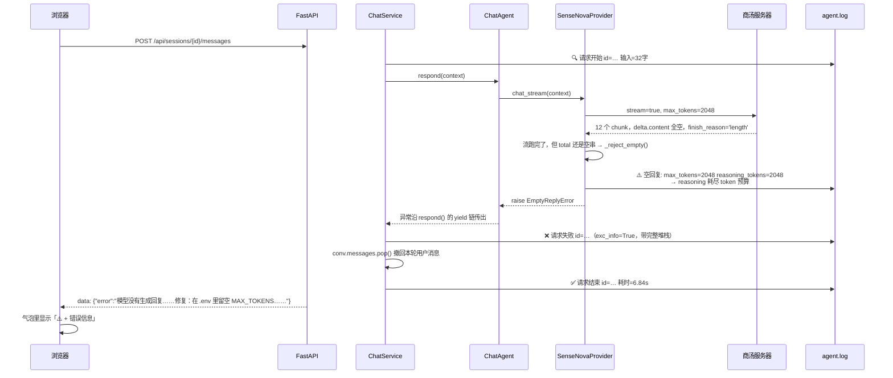
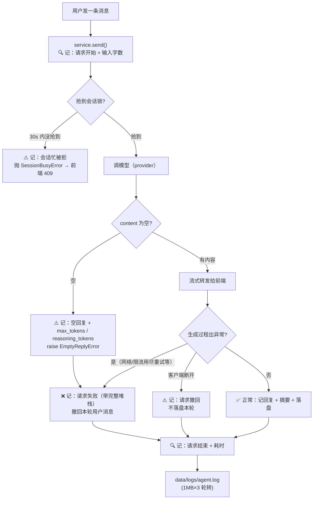

# 11 上线准备（M8）

> **目标**：不动 Agent 的能力，只把它变得**可靠、可排查、可一键跑起来**——空回复从「静默留坏数据」变成「明确报错」，事后失败从「查不到」变成「有据可查」。
>
> **本期范围**：`docs/01` 里 M8 定的是「上线准备（部署、监控、用户认证、合规）」，是照**对外服务**写的。本项目跑在 `127.0.0.1`、单用户、本地 JSON 存储——认证 / 合规 / 多实例套一遍 `docs/10` §10.2 的分类原则全不成立。所以本期**只做「本地能真有用的最小切片」：空回复处理、日志、一键部署**三件，逐条判过的原因见 §10.2 —— 不是烂尾，是取舍。
>
> **本文档定位**：记的是「**实际做了啥、代码改在哪、为什么这么写**」，帮你快速吃透 M8 这段代码、看懂项目进度，落到「哪一行代码怎么写的」。本期原来的计划方案已并入本文档后删除（范围取舍见 §10.2、验收达成见 §10.3、被 spike 推翻的原方案见 §4.1 和 §7 发现三），跟 03~10 一样只留这一份学习版。建议阅读顺序：
> **1 全景图 → 2 数据流（时序图）→ 3 代码变更地图 → 4 逐个模块 → 5 关键代码块逐行解读 → 6 流程图 → 7 实测发现 → 8 动手对照小实验 → 9 测试 → 10 小结与验收**。
> 只想快速了解进度，看 3、7、10 三节即可。
>
> ⚠️ **本文档写于 SenseNova 时代（2026-09）。** 2026-10-09 起默认供应商换成 DeepSeek，本文档里的实测数字全部是换之前的，没有逐条改——改掉就失真了。两处**结论已被推翻/收窄**，务必先看 `docs/14`：
> - §7 发现三里「根因在服务端，客户端改不了」**说得不精确**：空回复的根因是 *reasoning 模型通性*（DeepSeek 的三个 reasoning 模型一样会空回复），不是商汤的 bug；换成非 reasoning 的 `deepseek-chat` 后**空回复消失了**。
> - §7 发现三里「`max_tokens=4096` → 0/3 空」**当时对，现在不对**：同一模型同一句提问，复测 `max_tokens=4096` → `reasoning_tokens=4096`、`content` 长度 0。
> - 本文档没改的代码结论（`EmptyReplyError`、日志、一键部署）全部仍然有效；异常消息里补了一条修复建议（见 `src/core/provider.py`）。
> - **§4.2 的重试代码片段和 §7 的「820s」都是旧配置。** 重试判定已收敛进 `_retry()`（多了熔断记账），SDK 自带重试那层已经关掉（`max_retries=0`）——820s 那笔账里 3×3=9 次请求的一半是 SDK 重试的，单层最坏现在是 276s。现在多了**总时间预算**（`DEADLINE`）和**熔断器**，务必先看 `docs/15`。

---

## 1. 全景图：M8 给项目装了什么？

前几期的递进都是「加能力」：M1「会说话的大脑」→ M2「笔记本 + 管家」→ M3「一部电话（工具）」→ M4「资料室秘书」→ M5「MCP 外接工具」→ M6「眼睛」→ 09「压缩更早的记忆」→ M7-a「多个会话能同时跑」。

**M8 不一样：它不加任何能力，它修的是「信任」。**（原定「上线准备（部署、监控、用户认证、合规）」为什么砍到这么小，见开头的「本期范围」和 §10.2。）

但开工前的一次**真实环境验收**发现了两件比「认证 / 合规」严重得多的事（详见 §7），它们决定了本期范围：

1. **空回复率 36%**：14 次真实调用里 5 次返回空内容、**不抛异常**——用户每发 3 条消息就有 1 条是空气泡，而且空回复被**正常落盘**，历史里留下一个「有问无答」的脏记录。
2. **完全没日志**：全项目 `import logging` **零命中**，只有 4 处 stderr print。上面那件事之所以「事后查不到任何痕迹」，就是这个原因。

所以 M8 装的两件装备，都是**修「看不见」**：

```
  过去                              M8 之后
  ──────────────────              ──────────────────
  空回复 → 空气泡，静默落盘         空回复 → 明确报错，本轮整轮撤回
  失败  → 没有任何记录             失败  → data/logs/agent.log 里查得到耗时和原因
  新人  → 口头传授怎么跑            新人  → setup.bat 三步跑起来
```

**三块「新东西」各自负责什么，落在架构上**：

```
┌───────────────────────────────────────────────────────────┐
│  一键部署：scripts/setup.bat + .env.example + README        │  ← 门面（不进入运行时）
│  别人 clone 下来三步跑起来                                   │
└───────────────────────────────────────────────────────────┘
┌───────────────────────────────────────────────────────────┐
│  日志：src/core/logger.py（🆕）                             │  ← 新增「地基」
│  标准库 logging，data/logs/agent.log，1MB×3 轮转            │
│  只记元数据（耗时/结果/错误），**不记消息正文**               │
│        ▲ service.py / bootstrap.py / sensenova.py 都往这写   │
└───────────────────────────────────────────────────────────┘
┌───────────────────────────────────────────────────────────┐
│  SenseNovaProvider —— 空回复检测（M8 的核心改动）            │  ← 联网层加一道关
│  chat / chat_stream / complete 跑完检查 content 是否为空     │
│  为空 → raise EmptyReplyError（错误信息里带修复建议）         │
└────────────────────┬──────────────────────────────────────┘
                     ▼
  ChatService / ChatAgent / MemoryStore / ToolRegistry / RAG / MCP / models
  —— 全部一行没改（M1~M7-a 的所有能力照旧）
```

**一句话记住分工**（对照前面几期）：

> **管家（ChatService）还是管家、翻译员（ChatAgent）还是那个会打电话的翻译员、资料室秘书（RAG）还在查资料——M8 请来的是一个「值班员」：它不改变系统做什么，只让系统**做对和做错**时都留下痕迹，并且让出错时说的话人看得懂。**

**跟前面几期最关键的不同**：前七期是「分层架构兑现红利」（加功能时内核一行不动）。**M8 反过来**——加日志、加空回复检测、加部署脚本，**agent.py / memory.py / tools.py / rag.py / embeddings.py / mcp.py / models.py 一行都没改**。红利是双向的：改运维问题时，核心业务代码也不用动。

---

## 2. 数据流：空回复从「空气泡」变成「明确报错」（时序图）

这是本期最能体现「项目改变了什么」的一条链路。以 `MAX_TOKENS=2048` 时的一次真实调用为例（spike 实测这档空回复率 67%）：



**对比 M8 之前的同一条链路**（这是本期真正的「项目改变」）：

```
M8 之前：
  LLM 返回 12 个空 chunk
  → chat_stream 正常 return（不抛异常）
  → 服务端正常返回，ChatService 认为请求成功
  → 空 assistant 回复**正常落盘**，历史变成 [user, assistant(空)]
  → 前端显示「（空回复）」
  → 事后：零日志，无任何痕迹 ❌

M8 之后：
  LLM 返回 12 个空 chunk
  → chat_stream 抛 EmptyReplyError
  → ChatService 记 error 日志（带堆栈）+ 撤回本轮用户消息
  → 前端显示 ⚠️ + 带修复建议的错误信息 ✅
  → 事后：agent.log 里能查到当时 max_tokens 是多少、思考用了多少 token ✅
```

**三个关键点**：

1. **空回复检测必须放在 provider 层，不能放在 service 层**。因为只有 provider 拿得到 `usage.reasoning_tokens` 和 `finish_reason` 这些「为什么是空」的线索；到了 service 层，信息已经只剩一个空字符串。这就是为什么本期动的是 `sensenova.py` 而不是 `service.py`。
2. **空回复走的是「撤回整轮」路径，不是「留个空回复」路径**。用户消息和空回复一起 `pop()` 掉——宁可整轮扔掉，也不要留下有问无答的脏历史（这条设计原则最早定在 `docs/10` §5.5）。
3. **空回复率本身没有下降，降的是「静默率」**。根因在服务端（reasoning 模型），客户端改不了它，只能让它不再静默。这是本期**有意的取舍**，不是没做完——详见 §10.1。

---

## 3. 代码变更地图：M8 相比 M7-a 加了/改了哪些文件？

这是看懂「项目进度」最快的一节：

| 文件                                       | 状态                           | 改了什么                                                                                                                                                       |
| ------------------------------------------ | ------------------------------ | -------------------------------------------------------------------------------------------------------------------------------------------------------------- |
| `src/core/logger.py`                     | 🆕**新增**               | `setup()` / `get_logger()` / `reset()`：标准库 logging + 1MB×3 轮转，挂 root logger；**后补 `httpx2` / `openai` 降级**（§7 发现六）          |
| `src/core/provider.py`                   | ✏️**改动**             | 🆕`EmptyReplyError(RuntimeError)`：错误信息自带诊断 + 修复建议；**后补「本轮消息会被撤回」+ 删掉误导性的「设 4096 以上」**（§7 发现二结论 4、发现八） |
| `src/providers/sensenova.py`             | ✏️**改动（核心）**     | 🆕`_reject_empty()` + `_reasoning_tokens()`；`chat` / `chat_stream` / `complete` 三个方法加空检查 + `except EmptyReplyError: raise`                |
| `src/core/service.py`                    | ✏️**改动**             | 请求开始/结束/耗时、失败、撤回、会话创建/清空/删除、空回复观测 —— 共 9 处打点；另修一处过期注释（§7 发现九）                                                |
| `src/bootstrap.py`                       | ✏️**改动**             | RAG / MCP 的降级提示从 stderr print 改成写日志（原来是「只在 stderr 喊一声」）                                                                                 |
| `src/config.py`                          | ✏️**改动**             | 🆕`log_level` / `log_dir` 两个配置                                                                                                                         |
| `.env.example`                           | ✏️**改动**             | 补日志段 + 加**MAX_TOKENS 的重要提示**（空回复根因，最实用的一段）                                                                                       |
| `scripts/setup.bat`                      | 🆕**新增**               | Windows 一键装环境：检查 Python → 建 venv → 装依赖 → 复制 .env                                                                                              |
| `scripts/probe_empty_reply.py`           | 🆕**新增**               | spike：打印空回复 chunk 的完整 JSON + 对比 4 档`max_tokens` 的空回复率                                                                                       |
| `tests/test_logger.py`                   | 🆕**新增**               | 日志 7 个测试（含「消息正文永不进日志」这条隐私属性）                                                                                                          |
| `scripts/probe_empty_reply_real.py`      | 🆕**新增**               | 真实上下文下的空回复率 + 服务端默认上限实测（35 次 0 空回复，推翻 36%；见 §7 发现二）                                                                         |
| `tests/conftest.py`                      | 🆕**新增**               | 全局`autouse` fixture 隔离日志目录，测试不再写 `data/logs/agent.log`（§7 发现七）                                                                         |
| `static/index.html`                      | ✏️**改动**             | 「思考中…」两级提示：5s / 30s 各升级一次文案，30s 那级给出真实上限（实测最久 78s）；见 §7 发现四                                                             |
| `tests/test_sensenova.py`                | ✏️**改动**             | +11 个空回复检测测试（mock client，不联网）                                                                                                                    |
| `README.md`                              | ✏️**改动**             | 「快速开始」改成`setup.bat` 三步；配置表、注意事项、路线图同步                                                                                               |
| 本期计划方案文档                           | 🗑️**并入本文档后删除** | 范围取舍 → §10.2、验收标准 → §10.3、被 spike 推翻的原方案 → §4.1 / §7 发现三、任务决策记录 → §5.4                                                     |
| 代码 /`.env.example` 里的 `docs/` 引用 | ✏️**改动**             | 统一指向本文档对应章节（原来指向计划文档）                                                                                                                     |
| `src/core/agent.py` 等                   | ➖**不变**               | agent / memory / tools / rag / embeddings / mcp / models / api ——**一行没改**                                                                          |

**测试数：122 → 140 → 142**（M8 新增 18 个：空回复 11 + 日志 7；收尾再补 2 个真跑轮转的用例，见 §7 发现八。全 mock，不花额度、不联网）。

**和前面几期对比，本期动的是哪一层**：

- M2 加记忆 → 新增模块，provider 一行没改
- M3 加工具 → 动了 provider（透传 tools），service / memory 一行没改
- M4 加 RAG、M5 加 MCP、M6 加多模态 → 都是「挂一个新工具」，内核一行没改
- **M8 加运维 → 动的是 provider 联网层 + 新建一个 logger 地基 + 门面（脚本/文档），业务核心一行没改**

---

## 4. 逐个模块讲解

### 4.1 空回复异常（src/core/provider.py）—— 把「空气泡」变成一个会说话的错误

M1~M7-a 里，provider 只有一种失败方式：抛异常（限流、断网、5xx）。而空回复是**HTTP 200、没异常、就是没内容**——过去代码认为它是「成功」。本期给它一个专属异常：

```python
class EmptyReplyError(RuntimeError):
    """模型成功返回 HTTP 200 但没有产出任何 content。
    根因（docs/11 §7 发现三 spike 结论）：sensenova-6.8-flash-lite 是 reasoning 模型，
    输出分 `reasoning`（思考过程，计数进 completion_tokens）和 `content`（最终答案）
    两部分。当 `max_tokens` 小于模型实际需要的 reasoning 量时，思考耗尽整个预算，
    content 为空，`finish_reason='length'`。
    """

    def __init__(self, max_tokens: int | None = None, usage=None) -> None:
        ...
        super().__init__(
            "模型没有生成回复——它的「思考过程」耗尽了输出预算。"
            + (f"（MAX_TOKENS={max_tokens}，思考用了 {rt}）" if rt else "")
            + "　修复：在 .env 里留空 MAX_TOKENS，让服务端用它自己的默认上限"
              "（实测可放行 8500+ token）；显式设一个较低的数值反而更容易触发空回复。"
            + "另外：本轮你发的消息会被撤回，历史里不会留下有问无答的记录。"
        )
```

- **错误信息是给「用户」看的，不是给「开发者」看的**。它直接出现在前端气泡里（`api.py` 把 `str(exc)` 塞进 SSE 的 `{"error": ...}`），所以里面带了一句**可执行的修复建议**。这跟 `RateLimitError` 那类错误完全不同——那类错误用户只能等，这类错误用户能自己修好。
- **继承 `RuntimeError` 而不是自定义基类**：它是「运行时才知道」的一类失败，不需要被上层 `isinstance` 判断，抛上去让 service 的 `except Exception` 统一收口就够了。
- **注意**：`EmptyReplyError` 是 M8 在 `provider.py` 里加的**具体类**，**没有加进 `BaseProvider` 抽象接口**。所以 `FakeProvider` / `ScriptedProvider` / `EmptyProvider` 这些测试用的假 provider 一行都不用改——它们返回空字符串就行，不需要模拟服务端行为。M8 的一个测试（`test_message_body_never_logged`）正是利用这一点：它塞一个「返回空串的 provider」进 service，验证「空的观测日志里有元数据、但没有消息正文」。
- 文档字符串里那段「实测 2048 → 2/3 空、4096 → 0/3 空」是故意留的——它是**代码里的结论快照**，半年后回头看不用再翻 spike 脚本。

**本期计划里原本设计了三个判断分支，实现里只做了一个**（spike 只定位到了第一种，另外两种是「想到了但没证据」）：

| 现象                                                                  | 含义                                             | 计划里的处理                               | 实现里做了什么                                                                        |
| --------------------------------------------------------------------- | ------------------------------------------------ | ------------------------------------------ | ------------------------------------------------------------------------------------- |
| `reasoning_tokens == completion_tokens`、`finish_reason='length'` | **max_tokens 被 reasoning 耗尽**（最常见） | 抛`EmptyReplyError`，错误信息带 token 数 | ✅**做成了**——日志和错误信息都带 `reasoning_tokens` / `completion_tokens` |
| `finish_reason='stop'` 但 `content` 空                            | 模型正常停止但没输出（罕见）                     | 同样抛`EmptyReplyError`，但错误信息不同  | ❌**没做成**——统一走同一句「reasoning 耗尽」，罕见场景会被误诊                |
| `raw_chunks=0`、HTTP 200                                            | 服务端返回空 body（极罕见）                      | 当限流处理，走现有重试逻辑                 | ❌**没做成**——SDK 层面拿不到这个 chunk，会退化成前两种之一                    |

**为什么没做成也不算砍功能**：spike 14 次调用里出现的**只有第一种**（`reasoning` 字段 + `finish_reason='length'`），后两种是纯推测。按第一种做是对的；等真遇到第二种，日志里那句「reasoning 耗尽」会变成一条**误诊线索**，到时候再分叉也不迟。这是「先修观察到的、不猜没看到的」——对应 §10.2 那条「空回复根因彻底定位 ⛔ 服务端行为，查不清楚」。

### 4.2 Provider 的空回复检测（src/providers/sensenova.py）—— 联网层加的一道关

三个公开方法都在**跑完之后**检查一次，检查完再决定抛还是回：

```python
def _reject_empty(self, max_tokens: int | None, usage) -> None:
    rt = self._reasoning_tokens(usage)
    ct = getattr(usage, "completion_tokens", "?") if usage else "?"
    self._log.warning(
        "空回复: max_tokens=%s reasoning_tokens=%s completion_tokens=%s"
        " → reasoning 耗尽 token 预算",
        max_tokens, rt, ct,
    )
    raise EmptyReplyError(max_tokens=max_tokens, usage=usage)
```

| 方法            | 什么时候判空                                                | 为什么要单独写                                                      |
| --------------- | ----------------------------------------------------------- | ------------------------------------------------------------------- |
| `chat`        | `content = resp.choices[0].message.content or ""`，空则抛 | 最简单，直接看返回体                                                |
| `complete`    | 同上，**但 `tool_calls` 非空时不算空**              | 工具调用这一轮本来就不该有 content（见`docs/04`）                 |
| `chat_stream` | 遍历完所有 chunk 后看累计的`total` 是不是空串             | 流式要**攒完才知道**结果是不是空，所以检查必须在 for 循环之后 |

三个方法都补了同一个分支：

```python
except EmptyReplyError:
    raise          # 不重试：空回复重试大概率还是空
except Exception as exc:
    if not _is_retryable(exc) or attempt >= self._max_retries - 1:
        raise
```

- **「不重试」是本期一个有意的决策**（原方案「回退非流式再试一次」已被 spike 推翻，见 §10.1）。限流/断网重试有意义——下次调用可能就成功了。空回复重试没意义——同样的问题、同样的 reasoning 量、同样的 `max_tokens`，**大概率还是空**，纯粹浪费时间。`test_empty_reply_not_retried` 专门断言「只调了一次 API」。
- 顺序也有讲究：`except EmptyReplyError` 必须写在 `except Exception` **之前**。虽然 `EmptyReplyError` 不是「可重试类」、`_is_retryable` 会返回 False、最终也会 `raise`——但那样写会让一条确定性的业务错误走一遍重试判定，语义上说不通。

> 🔁 **上面这段代码现在长得不一样了**（2026-10-11 起）：重试判定收敛进 `_retry()`，裸 `time.sleep(2**attempt)` 换成按预算收窄的 `_backoff()`，每次失败还会记账给熔断器。本节文字保留原样——「不重试」「`except` 顺序」两条决策仍然有效，但**当前代码请读 `docs/15` §4**。

### 4.3 日志基础设施（src/core/logger.py）—— 新增的「地基」

设计约束只有三条，每条都对应一个真实痛点：

| 决策                               | 为什么                                                                               |
| ---------------------------------- | ------------------------------------------------------------------------------------ |
| 只用标准库`logging`              | 运维工具不该引第三方依赖（`requirements.txt` 一行没加）                            |
| 写`data/logs/agent.log`          | 跟`data/sessions/` 同级，`data/` 整个目录已在 `.gitignore` —— 日志不进版本库 |
| 1MB × 3 轮转                      | 本地单用户不需要长期留存，但要**防止无限增长**撑爆磁盘                         |
| **只记元数据，不记消息正文** | 历史已落盘在`data/sessions/`，重复记录既膨胀又没必要（详见 §5.3）                 |

四个公开函数：

```python
def setup() -> logging.Logger: ...        # 幂等初始化，handler 挂在 root
def get_logger(name) -> logging.Logger: ...  # "service" → agent.service，首次调用自动 setup
def reset() -> None: ...                  # 测试用：清 handler 和标记，允许重新 setup
def _effective_level() -> int: ...        # .env 的 LOG_LEVEL → 级别，非法值回退 INFO
```

- **`get_logger()` 首次调用时自动 `setup()`**——这是「任何模块直接 import 就能用」的关键。所以 `sensenova.py`、`service.py`、`bootstrap.py` 三处都只用一行 `get_logger("xxx")`，没有任何接线代码。
- **`reset()` 只有测试用**：`setup()` 是幂等的（挂过一次就不挂第二次），但测试需要每个用例用不同的临时日志目录，`reset()` 把 handler 摘干净重新挂。它靠一个约定标记 `_is_agent_handler` 区分「自己加的 handler」和「别人加的」，不会误删 pytest 自己的 handler。

### 4.4 打点位置（src/core/service.py / src/bootstrap.py）—— 记什么、不记什么

service 的 `send()` 是本项目最重要的一条路径，本期在它身上打了 6 个点：

| 位置           | 记什么                                             | 级别            |
| -------------- | -------------------------------------------------- | --------------- |
| 进入`send()` | `请求开始 id=… 输入=32字`                       | INFO            |
| 锁等待超时     | `会话忙被拒 id=…（等30s超时）`                  | WARNING         |
| 正常结束       | `请求结束 id=… 耗时=6.84s`                      | INFO            |
| 客户端断开     | `请求撤回 id=…（客户端断开，本轮不落盘）`       | WARNING         |
| 任何异常       | `请求失败 id=…` + `exc_info=True`（完整堆栈） | **ERROR** |
| 回复是空串     | `空回复 id=…（模型返回 0 字，仍按现状落盘）`    | WARNING         |

外加会话生命周期 3 个点：`会话创建` / `会话清空` / `会话删除`（被拒的那两种也各有一个 WARNING）。

**「记什么」的判断标准很简单**：一条日志回答的是「**这次请求发生了什么**」（谁、什么时候、多快、成没成、为什么不成）。`id=… 输入=32字 耗时=6.84s` 四个字段，事后翻日志就能重建一条请求的完整时间线。

### 4.5 一键部署（scripts/setup.bat + .env.example + README）—— 门面

`setup.bat` 四步：检查 Python → 建 `venv` → `pip install -r` → 复制 `.env`。每步都有失败提示和 `exit /b 1`，最后打印两种运行方式和测试命令。

**`.env.example` 里最实用的一段是 MAX_TOKENS 的提示**——它把 spike 的结论直接写进配置文件，让「改错 `MAX_TOKENS` 导致空回复」这个坑**在配置那一刻就被看见**：

```
# ⚠ 关于 MAX_TOKENS 的重要提示（docs/11 §7 发现二 / 发现三 实测）：
# sensenova-6.8-flash-lite 是 reasoning 模型，输出分 reasoning（思考）和 content（答案）两部分，
# reasoning_tokens 计入 completion_tokens。如果 MAX_TOKENS 小于模型实际需要的 reasoning 量，
# 思考会耗尽整个预算，content 为空 → 空回复。
#
# reasoning 消耗是**服务端随机抖动**的，跟提问复杂度关系不大：同一句「不超过 60 字」的提问，
# 实测 reasoning_tokens 从 70 跑到 8533。所以预算必须给得比这个抖动范围还宽。
#
#   MAX_TOKENS=50    → 100% 空回复
#   MAX_TOKENS=2048  → 67% 空回复
#   不传 MAX_TOKENS  → 0%（服务端默认上限够，实测一次放行 completion=8567 且未截断）
#
# 建议：留空（不传），让服务端用它的默认上限。
# ⚠ 不要显式设一个较低的值（比如 4096）：那等于**把预算砍到低于服务端默认上限**，
#   比留空更容易触发空回复。想留余量就留空，不要主动收窄。
```

> 这段注释是本期的一个「隐性交付」：空回复的根因在服务端、客户端修不好，但**把结论写进 `.env.example`，等于把唯一的可用修复手段（留空 MAX_TOKENS）放在用户最容易看到的地方**——比写在 README 里有效得多。
>
> 事后修正：原注释里还有「或设为 4096 以上」这半句，**是错的**（理由见 §7 发现二结论 4）——4096 低于服务端的默认上限，显式设它比留空更容易空回复。已删。

**部署这件事的验收程度要说清楚**：`setup.bat` **只在 Windows 11 上验证过**（项目就跑在这台机器上），Linux / macOS 的行为没人验证过——README 的「快速开始」里已经把 Windows 和「手动（任意平台）」分成两节，靠的是那条约定：「Windows 用脚本，其他平台手动装」。所以准确的说法是「Windows 上三步跑起来了」，不是「跨平台一键部署」。

---

## 5. 关键代码块逐行解读

### 5.1 空回复的两种「写法」差异（src/providers/sensenova.py）

同样是「跑完检查 content」，三个方法写出来的样子不一样，值得对照看：

```python
# ① 非流式（chat）：一次拿完整返回，检查最直接
resp = self._client.chat.completions.create(**kwargs)
content = resp.choices[0].message.content or ""      # ② None 归一成空串
if not content:
    self._reject_empty(kwargs.get("max_tokens"), resp.usage)   # ③ usage 在手，能带诊断
return content

# ④ 流式（chat_stream）：必须攒完才知道结果
total = ""
usage = None
for chunk in stream:
    if chunk.usage:
        usage = chunk.usage                    # ⑤ 最后的 chunk 才带 usage
    for choice in chunk.choices:
        if choice.delta and choice.delta.content:
            text = scrub_text(choice.delta.content)
            total += text
            yield text                         # ⑥ 一边吐一边攒
if not total:
    self._reject_empty(kwargs.get("max_tokens"), usage)   # ⑦ 检查只能在循环之后
return
```

- **② `or ""`** 是防御：SDK 返回的 `content` 可能是 `None`，不归一成空串，`if not content` 也会成立——但这句保证后面拼接不出 `None`。
- **⑤ 流式的 `usage` 在最后一个 chunk 上**。这是个容易踩的坑：如果在循环里提前用 `usage`，它还是 `None`。所以 `_reject_empty` 里对 `usage is None` 做了兜底（`_reasoning_tokens(None) == 0`，错误信息里就是不显示思考量）。
- **⑥ 流式的空检查必须放在 `yield` 之后**。因为生成器的 `yield` 会让出执行权——检查写在循环里等于「每吐一段就检查一次」，而我们要的是「全部吐完发现一个字都没有」。这个位置错了，症状是「明明没内容却不会报错」，很难查。
- **③/⑦ 传的是 `kwargs.get("max_tokens")`**——注意不是 `self._max_tokens`，因为「请求里实际下发了什么」才是错误信息里该写的（`_build_kwargs` 在 `max_tokens is None` 时压根不下发，用户看到的应该是「留空」而不是「None」）。

### 5.2 `complete()` 的「有 tool_calls 不算空」

```python
choice = resp.choices[0]
if choice.message.tool_calls:                     # ① 先看工具调用
    return Completion(
        finish_reason="tool_calls",
        tool_calls=[ToolCall(tc.id, tc.function.name, tc.function.arguments)
                    for tc in choice.message.tool_calls],
    )
content = choice.message.content or ""
if not content:                                   # ② 没工具调用、content 又空 → 才是空回复
    self._reject_empty(kwargs.get("max_tokens"), resp.usage)
```

- **① 顺序不能反**。M3 的工具调用那一轮，模型给的 `content` **本来就是空的**（它只发了「我要调这个工具」，还没开始回答）——如果先判空再判工具调用，`complete()` 会在每一轮工具调用时误抛 `EmptyReplyError`，直接把 ReAct 循环打断。`test_complete_no_raise_on_tool_calls` 就是守住这条的。
- 这也是为什么空检查写在 `return Completion(...)` 之前、而不是包在调用方：调用方（`agent.respond()`）根本不知道这一轮「有没有内容」是模型的意图还是异常。

### 5.3 `_reasoning_tokens()` —— 从 usage 里挖出「思考用了多少」

```python
@staticmethod
def _reasoning_tokens(usage) -> int:
    if usage is None:
        return 0
    try:
        ud = usage.model_dump()
    except Exception:
        return 0
    rt = ud.get("reasoning_tokens")           # ① 顶层
    if rt:
        return rt
    details = ud.get("completion_tokens_details") or {}   # ② 嵌套在 completion_tokens_details
    return details.get("reasoning_tokens") or 0
```

- **① 和 ② 是同一个字段的两种返回位置**。OpenAI 协议里 `reasoning_tokens` 的标准位置是 `usage.completion_tokens_details.reasoning_tokens`，而商汤的返回把它放在了**顶层**。这个字段不是所有模型都有（非 reasoning 模型没有），所以写成「先看顶层、再看嵌套、都没有返回 0」。
- **为什么值得单独提**：`reasoning_tokens` 是空回复的**根因证据**——它证明了「模型确实在生成 token，只是全花在思考上」。有了它，错误信息才能说出「思考用了 2048」而不是干巴巴一句「返回为空」。
- **全程 `try/except` 返回 0**：这是观测代码的写法——**观测不能把主流程搞挂**。usage 结构异常时，宁可少一条诊断信息，也不能让一次本来正常的调用崩掉。

### 5.4 日志的 handler 为什么挂在 root（src/core/logger.py）

```python
root = logging.getLogger()          # ① 取 root logger（空名字）
root.setLevel(_effective_level())
...
root.addHandler(file_handler)       # ② handler 挂在 root
root.addHandler(console_handler)
```

```python
def get_logger(name: str) -> logging.Logger:
    if not _initialized:
        setup()
    return logging.getLogger(f"agent.{name}")    # ③ agent.service / agent.provider ...
```

- **①② 挂在 root 而不是 `logging.getLogger("agent")` 命名空间**，是本期一个专门做的决策（本期计划的「关键决策记录」里也专门记了这条）。代码注释里写的两条理由：

  1. 任何模块（包括第三方库）的日志都会落到文件，不用逐个 logger 配 `propagate`；
  2. **pytest 的 `caplog` fixture 天然能捕获**——`caplog` 也是挂在 root 上的。

  补充一点实测观察：理由 1 是**已经生效的**（§7 发现六里那些 `httpx2` 行就是「非 agent 命名空间的日志也进来了」的证据）；理由 2 目前**没有测试真的用到**（`tests/` 下 `caplog` 零命中，`test_logger.py` 是直接读日志文件断言的）。它是个「预留的可测试性」，不是当下的收益。
- **两个 handler 是两个输出面**：文件收**所有级别**（事后可查），stderr 只收 **WARNING 以上**（跑起来时看得见降级和错误，但请求级的 INFO 不刷屏）。这个分流很关键——如果 INFO 也进 stderr，Web 服务一跑日志就把终端刷爆了。
- **降级第三方库**：`logging.getLogger("httpx").setLevel(WARNING)` / `httpcore` 同理。意图是别让 SDK 的每次请求刷一行。
  ⚠️ **但这行在本环境实际没生效——`openai` 3.3.1 的请求日志用的是 `httpx2` 这个 logger，不是 `httpx`**。实测：

  ```
  httpx     level=30    effective=WARNING   ← 降级成功
  httpcore  level=30    effective=WARNING   ← 降级成功
  httpx2    level=0     effective=INFO      ← 没被降级！
  openai    level=0     effective=INFO      ← 也没被降级
  ```

  所以每次真实调用商汤 API，`agent.log` 里都会多一行 `INFO httpx2: HTTP Request: POST .../chat/completions "200 OK"`（已实测验证）。**要真正生效，得再加两行**：

  ```python
  logging.getLogger("httpx2").setLevel(logging.WARNING)   # openai 3.3.1 实际用的
  logging.getLogger("openai").setLevel(logging.WARNING)
  ```

  坦白说，这一行 `httpx2` 的日志**内容本身挺有用**（能看到真实请求打到哪个 URL、返回什么状态码），只是它**没经过我们的设计决策**——既不是我们记的，也没打算记。详见 §7 发现六。
- **`delay=True`**：首次真正写日志才创建文件。这样只跑了测试、或者没触发任何日志的场景，`data/logs/` 目录不会被白建出来。
- **`reset()` 用 `_is_agent_handler` 标记而不是「删所有 handler」**：pytest 会在 root 上挂自己的 handler，误删会让 `caplog` 失效。所以只删自己打标记的那些。

### 5.5 service 的打点：一个「生成器」的细节（src/core/service.py）

```python
def send(self, session_id: str, text: str, images=None) -> Iterator[str]:
    self._log.info("请求开始 id=%s 输入=%d字", session_id, len(text))   # ①
    if not self._acquire(session_id, timeout=self._busy_timeout):
        self._log.warning("会话忙被拒 id=%s（等%.0fs超时）", ...)
        raise SessionBusyError(session_id)
    start = time.perf_counter()                                        # ②
    try:
        yield from self._send_locked(session_id, text, images)
    finally:
        self._release(session_id)
        self._log.info("请求结束 id=%s 耗时=%.2fs", session_id,        # ③
                       time.perf_counter() - start)
```

- **① 因为 `send()` 是生成器函数（里面有 `yield from`），这一行日志不是「调用 send 时」打印的，而是「第一次迭代生成器时」打印的**。`api.py` 里 `for chunk in service.send(...)` 包在 `try` 里，所以真正触发是在流式响应开始迭代那一刻。这个细节在排查「日志里为什么有请求开始、但没有请求结束」时有用——答案通常是**调用方拿到的生成器从头到尾没被迭代过**。
- **② `start` 在 `_send_locked` 之前记**，所以「耗时」覆盖的是**整轮**（加载历史 + 组装上下文 + 生成 + 摘要 + 落盘），不只是模型那一段。这个口径正好对应「用户体感等多久」。
- **③ 放在 `finally` 里**，所以**成功、异常、客户端断开（GeneratorExit）三条路径都会打印耗时**。断开的请求在 `_send_locked` 里已经单独打了「请求撤回」，再配上这里的「请求结束 耗时=…」，一条被 Ctrl+C 中断的请求在日志里也是完整的。
- **注意 `send()` 里 `请求开始` 在 `self._acquire()` 之前**——所以拿不到锁的请求，日志里是「请求开始」+「会话忙被拒」两条，**没有「请求结束」**（因为 `start` 在锁后面才记）。这是刻意的：没抢到锁的请求根本没进临界区，不算一次完整请求。

### 5.6 「撤回」这条路径怎么变成「明确报错」（src/core/service.py）

M8 的空回复是**复用 M7-a 早就有的失败路径**，一行没改：

```python
try:
    for chunk in self._agent.respond(context):
        reply += chunk
        yield chunk
except GeneratorExit:
    self._log.warning("请求撤回 id=%s（客户端断开，本轮不落盘）", session_id)
    conv.messages.pop()
    raise
except Exception:                                                  # ① EmptyReplyError 走这里
    self._log.error("请求失败 id=%s", session_id, exc_info=True)  # ② 带完整堆栈
    conv.messages.pop()                                            # ③ 撤回本轮用户消息
    raise                                                         # ④ 原样往上抛
else:
    if not reply:
        self._log.warning("空回复 id=%s（模型返回 0 字，仍按现状落盘）", session_id)
    conv.add(Role.ASSISTANT, reply)
```

- **①②③④ 是 M7-a 就写好的「请求失败 → 记日志 → 撤回 → 往上抛」**。M8 只需要让空回复变成一个异常，它就自动获得了这条完整路径：日志、撤回、给前端报错。**这是「错误用异常表达」最实在的收益**——不需要为一种新失败写一套新处理。
- **`exc_info=True`** 是唯一让它「可排查」的关键：不写这个，日志里只有一句「请求失败」，你还是不知道为什么会失败。有了它，堆栈会一路指到 `sensenova.py:89` 的 `raise EmptyReplyError`。
- **`else` 分支里那条「空回复」打点现在基本走不到了**。因为 `SenseNovaProvider` 遇到空 content 会在 provider 层抛异常，`reply` 不可能还是空串到达这里。它留着有两个用处：① 观测**不合规的 provider**（比如测试里的 `EmptyProvider` 直接 `yield ""`）；② 万一将来接了个没有空检查的新 provider，这里还能兜一层观测。
- 需要知道的**代价**：撤回意味着用户会看到「我明明发了消息，怎么没了」。这是「宁可整轮扔掉，也不要留下有问无答」的既定取舍（`docs/10` §5.5），当前错误信息里**没有解释这一点**，是遗留项（见 §7 发现六）。

---

## 6. 流程图：一条消息是怎么留下「三处痕迹」的



- **三条路径都能被完整复盘**：`请求开始 → 会话忙被拒`（超时被拒）、`请求开始 → 请求失败 → 请求结束 耗时`（报错）、`请求开始 → 请求结束 耗时`（正常）。三种情况的日志都成对、都有耗时（除了被拒那种，它根本没进临界区）。
- **空回复在流程图上只有一个出口**：抛异常 → 走失败路径。它**没有**「留个空回复落盘」这个分支了——这就是本期最核心的行为改变。

---

## 7. 实测发现（2026-09-29 真实调用验证）

### 发现一：真实环境验收通过了 M7-a 的并发承诺

`docs/10` 里的并发数字全部来自**假 provider**（探针睡固定秒数模拟 LLM 延迟），真实 LLM 下从没跑过。M8 开工前先补了这次验收（`scripts/probe_concurrency.py` 的思路 + 真 `SenseNovaProvider`）：

| 约定                   | 实测                                                                          | 结论 |
| ---------------------- | ----------------------------------------------------------------------------- | ---- |
| 不同会话真并行         | 6 个会话同时发问，总耗时 7.52s，单次 3.56~7.52s，时间区间互有重叠             | ✅   |
| 同一会话排队           | A 等锁 2.63s、B 等锁 0.01s；总耗时 5.35s ≈ ΣLLM 5.33s（若是并行应为 2.72s） | ✅   |
| 历史完整               | 6 个会话各 2 条 + 串行对照 12 条，角色序列全部`[user, assistant]`           | ✅   |
| 共享 provider 线程安全 | 6 线程同时打**同一个** `OpenAI` client，无异常、无串包                | ✅   |

最后一条是 `docs/10` §1 那句「实测并发没问题」的**真机版**——之前只有假 provider 的证据。这期的「上线准备」第一件事，就是先确认「真的能上线」。

### 发现二：空回复率 36%，而且与并发无关

**14 次真实调用里 5 次返回空内容、且不抛异常**：并发 6 次 → 3 次空；串行 6 次 → 2 次空。**并发 3/6 vs 串行 2/6 → 这不是并发问题**，不属于 M7/M8 的原始定义，是模型服务端的间歇性行为。

绕开项目里所有 wrapper、直接打 `openai` client 看原始响应：

```
第1次: raw_chunks=12, 有内容段=0, 总长=0, finish_reasons=['', '', ..., 'length']
```

**12 个 chunk，`delta.content` 全空，`finish_reason='length'`（达到 max_tokens 上限）**。模型确实在生成 token，但这些 token 没落到 `delta.content` 里。当时项目的行为后果：服务端正常返回无异常 → 认为成功 → 空回复**正常落盘** → 前端显示「（空回复）」→ **事后查不到任何痕迹**（因为完全没有日志）。

> **事后复查（同日，`scripts/probe_empty_reply_real.py`）：36% 没能重现，35 次真实调用 0 次空回复。**
>
> | 档位                                        | 空回复率       | reasoning_tokens   | 耗时（中位 / max）      |
> | ------------------------------------------- | -------------- | ------------------ | ----------------------- |
> | 简单提问 × 不传`max_tokens`              | **0/10** | 70 ~**8533** | 7.62s /**78.14s** |
> | **真实上下文 × 不传 `max_tokens`** | **0/15** | 23 ~ 846           | 4.78s / 18.71s          |
> | 真实上下文 ×`max_tokens=4096`            | **0/10** | 73 ~ 1025          | 4.89s / 14.36s          |
>
> 真实上下文 = 完整 system prompt + 当前时间 + 10 轮技术讨论历史 + 一次 `search_knowledge_base` 工具往返（681 字检索结果）+ 一个要求综合判断的提问，共 19 条消息 / 4737 字符。
>
> **四个结论**：
>
> 1. **36% 无法重现。** 最可能的解释是当时 `.env` 里设了较低的 `MAX_TOKENS`（spike 测出 2048 档 2/3 空），后来改回留空了——**但这只是推测，没法证明**，因为当时的 `.env` 状态没有记录。
> 2. **服务端默认上限至少 8567。** 第 ① 档第 4 次 `completion=8567`、`finish=stop`（**没有** `length`），说明服务端这次放行了 8567 个 token 且未截断。这把「不传 `max_tokens` 会不会撞上默认上限」关掉了：**不会**。「留空 MAX_TOKENS」这半句建议成立；但同一段里的「或设为 4096 以上」是错的，见结论 4。
> 3. **上下文越复杂，reasoning 反而越低。** 真实上下文（4737 字符）reasoning 只有 23~846，而最简单的「不超过 60 字」提问最高跑到 8533。带 RAG 检索片段时答案是「查资料 + 归纳」，不是凭空想——**我之前「上下文越重越容易空」的假设是错的**，撤回。
> 4. **`.env.example` 里「或设为 4096 以上」这半句是错的，已删。** spike 当时「4096 → 0% 空」只有 3 次样本，不足以证明 4096 够宽；而探针显示 reasoning 能到 8533。显式设 4096 等于**把预算砍到低于服务端默认上限**，比留空更容易空。`.env.example` 和 `EmptyReplyError` 的错误信息现在都只留「留空 MAX_TOKENS」一条建议，并明确写了「显式设一个较低的数值反而更容易触发空回复」。
>
> **但空回复防护不该撤。** 36% 这个数只出现了一次，可它确实出现过，而 `EmptyReplyError` 这套检测的代价只有三个方法各加一次 `if not content`。保留它是合理的保险，不是多余的复杂度。

### 发现三：根因是 reasoning 模型 + max_tokens 不够（spike 定方向）

`scripts/probe_empty_reply.py` 打印了空回复 chunk 的**完整 JSON 结构**，找到了内容去向：

```json
"delta": { "content": null, "reasoning": "，且不超过60字。我需要..." }
"usage": { "completion_tokens": 50, "reasoning_tokens": 50 }
```

**`sensenova-6.8-flash-lite` 是 reasoning 模型**——输出分 `reasoning`（思考过程）和 `content`（最终答案）两部分，而 **`reasoning_tokens` 计入 `completion_tokens`**。当 `max_tokens` 小于模型实际需要的 reasoning 量时，思考耗尽整个预算，content 为空。

| max_tokens | 空回复率    | reasoning_tokens 实测范围  | 结论       |
| ---------- | ----------- | -------------------------- | ---------- |
| 50         | 6/6（100%） | 50（= max_tokens，全耗尽） | 完全不够   |
| 2048       | 2/3（67%）  | 93~2048                    | 经常不够   |
| 4096       | 0/3（0%）   | 19~3872                    | 够用       |
| 不传       | 0/3（0%）   | 68~5525                    | 默认上限够 |

**这条 spike 结论直接推翻了原方案**——原方案是「回退非流式再试一次」，spike 证明根因是 `max_tokens`，回退非流式没用（同样的 `max_tokens` 还是会耗尽）。方案改为「**检测 + 明确报错**」。这是一个正面的例子：**先做 spike 再动手，能省掉一整轮无效实现。**

### 发现四：50 秒的延迟不是网络问题，是「模型在想」

`docs/09` §7 记过「首段间隔可达 166s」。本次 14 次调用全部在 2.6~7.5s 内完成。但 spike 里找到了真正的延迟来源——**reasoning 模型的思考时间**：

| 工况                    | 延迟   | reasoning_tokens |
| ----------------------- | ------ | ---------------- |
| 不传 max_tokens，思考少 | 3.97s  | 68               |
| 不传 max_tokens，思考多 | 51.67s | 5525             |
| max_tokens=4096，思考多 | 46.96s | 3872             |

**同一个 60 字提问，延迟从 4s 到 52s。** 「真流式没有收益」这个结论仍然成立（首段延迟 ≈ 总耗时，见 `docs/09` §9.2），但「很慢」的原因从「服务端整段下发」修正为「reasoning 模型思考久」。这对预期管理有直接影响：用户在 3~5s 时不该以为卡住了。

> **已修**：这句写的时候两级提示还没做，**后来做了**——`static/index.html` 的「思考中…」分两级升级：5s 时提示一次，30s 时给出真实上限（实测最久 78s）。驱动 30s 这级的是紧下面这条复查，§3 变更地图 `static/index.html` 那行也记着这次改动。

> **事后复查（同日）：延迟的上限比这更高。** `probe_empty_reply_real.py` 第 ① 档 10 次里，同一句「不超过 60 字」的提问最高跑到 **78.14s**（`reasoning=8533`），但**中位只有 7.62s**；真实上下文那档中位 **4.78s**、最高 18.71s。
>
> 也就是说这不是「慢」，是「**偶发地非常慢**」：10 次里有 2 次超过 36 秒，其余都在 10 秒内。这对前端提示文案的要求反而更明确了——不是把「思考中…」换成「模型正在思考」就够了，而是得在**十几秒之后**给出「模型这次想得很深，可以等一等」这类二次提示，否则用户会以为程序死了。

### 发现五：空回复率没下降，降的是「静默率」

本期验收标准里这一条（§10.3）写的是「空回复率显著下降（对比处理前 36%），**或至少不再静默**」——本期实现的是**后半条**。

根因在服务端（reasoning 模型的行为），客户端改不了它，只能做到「不再静默」：同一个 36% 的空回复率，从「空气泡 + 脏历史 + 无痕迹」变成「明确报错 + 整轮撤回 + 日志可查」。**用户看到的失败率没变，但失败变得可理解、可修复了。** 这是本期最诚实的一条结论——不要写成「修好了空回复」。

> **事后复查修正了这一条。** 见发现二末尾：36% 没能重现（35 次 0 空），而且服务端的真实上限（≥8567）远比当时推测的高。所以更准确的表述是——**M8 修的是「出现时不静默」，而「出现」这件事在默认配置下目前很难遇到**。这比原来的说法更准确，也更谦虚：不是「修好了一个 36% 的问题」，而是「给一个没再复现的问题上了保险」。

### 发现六：openai 3.3.1 的请求日志用的是 `httpx2`，降级没生效

写 `logger.py` 时按常识写了 `logging.getLogger("httpx").setLevel(WARNING)`。但 openai SDK 3.3.1 实际用的 logger 名叫 **`httpx2`**（`openai/_utils/_logs.py` 里写死的是 `logging.getLogger("httpx2")`）。

实测 `setup()` 之后各 logger 的有效级别：

| logger               | 有效级别       | 说明                                      |
| -------------------- | -------------- | ----------------------------------------- |
| `httpx`            | WARNING        | 降级成功（但这个没用上）                  |
| `httpcore`         | WARNING        | 降级成功                                  |
| **`httpx2`** | **INFO** | **openai 3.3.1 真正用的，没被降级** |
| `openai`           | INFO           | openai 自己的 logger，也没降级            |

后果：每次真实调用，`agent.log` 里多一行 `INFO httpx2: HTTP Request: POST .../chat/completions "HTTP/1.1 200 OK"`。**不影响 stderr**（stderr handler 是 WARNING 级别，这行只在文件里），**但确实让「只记我们自己记的元数据」这个承诺在文件里被打破了**。

好消息是这行日志内容不敏感（只有 URL 和状态码，请求/响应体都不在里面），而且诊断价值不小。所以**修法不是删掉，而是把 `httpx2` / `openai` 也纳入设计**。

> **已修**：`logger.py` 里改成循环降级四个 logger：
>
> ```python
> for _name in ("httpx", "httpcore", "httpx2", "openai"):
>     logging.getLogger(_name).setLevel(logging.WARNING)
> ```
>
> 注释里也写清了 `openai/_utils/_logs.py` 用的是 `httpx2` 这个奇怪的名字，免得以后有人照着「常识」改回去。验证：`setup()` 后四个 logger 的有效级别全是 WARNING。

### 发现七：跑测试套件也会往 `agent.log` 写日志

只有 `tests/test_logger.py` 用 fixture 把日志目录隔离到 `tmp_path` 并 `reset()`，**其他测试文件（如 `test_api.py`）没有**。它们跑到 `ChatService` 时会触发 `get_logger()` → `setup()`，于是测试的日志**真实写进了 `data/logs/agent.log`**。

跑完 `pytest -q` 后，那个文件里会有 100 多行 `httpx2` 请求日志和 `agent.service` 打点。这不影响测试正确性（`test_logger.py` 自己的用例因为 `autouse` fixture + `reset()` 是干净的），但有两个副作用：

1. 日志文件会**被测试污染**，事后翻日志分不清哪些是真实使用、哪些是测试跑出来的；
2. 测试**写了仓库里的工作目录**（`data/logs/`），而 `test_logger.py` 是干净的——两者不一致。

如果要修，最省事的做法是在 `tests/conftest.py` 里加一个全局 autouse fixture，把 `settings.log_dir` 指到 `tmp_path`。

> **已修**：新增 `tests/conftest.py`，一个全局 `autouse` fixture。只 patch `settings.log_dir`，**不动 logger 的 handler**——logger 是懒初始化的（`get_logger()` 首次调用才 `setup()`），所以不写日志的用例不会创建任何文件；写日志的用例在 teardown 时 `reset()` 掉自己挂的 handler，避免 142 个用例各挂一份导致文件句柄泄漏。验证：跑完 `pytest -q` 后 `data/logs/agent.log` 不再新增内容。

### 发现八：两处遗留（都修了）

1. ~~**错误信息没解释「消息被撤回」**~~ → **已修**。用户看到「模型没有生成回复……」时会困惑「我明明发了消息怎么没了」。现在 `EmptyReplyError` 的错误信息末尾加了一句「另外：本轮你发的消息会被撤回，历史里不会留下有问无答的记录」，`test_empty_reply_error_message_contains_diagnostics` 同步断言了这条。
2. ~~**日志轮转没被真实验证过**~~ → **已修**。`test_rotation_config` 只断言 `maxBytes == 1MB` / `backupCount == 3` 这两个**配置值**，没有真触发过一次轮转。当时判掉的理由是「本地单用户要撑到 1MB 需要不少量」——**这个理由其实站不住**：`RotatingFileHandler` 的轮转逻辑跟阈值大小无关，512 字节和 1MB 走的是同一条 `shouldRollover` / `rollOver`，阈值只是个参数。把 `_MAX_BYTES` 在测试里 patch 成 512，构造成本就是两个测试用例。

   新增 `test_rotation_actually_rotates`（300 条日志后 `agent.log` 仍 ≤ 阈值、`agent.log.1` 存在）和 `test_rotation_caps_backup_count`（备份恰为 `.1/.2/.3` 三份、`agent.log.4` 永不出现）——后者验的正是 `test_rotation_config` 从没验过的「滚出第 4 份时最旧的会被删掉」。

   实测（512 阈值）：单条记录 60 字节，300 条共 18,000 字节写进，**落盘只剩 1,440 字节**（`agent.log` 240 + 三份备份各 480），中间滚了 33 次。换成生产阈值就是同一套算术：最多 4MB 落盘（1MB + 3×1MB）。

   顺带一个坑：测试里的日志消息**只用 ASCII**。`shouldRollover` 用 `len(msg.encode())` 算字节数，中文会让「字符数 ≠ 字节数」，关于 `maxBytes` 的断言就不好算了。这一点写在了 `_write_lines` 的注释里。

### 发现九：两处文档不一致（顺手发现）

- `src/core/service.py` 里 `_send_locked` 的 `else` 分支原来有一句注释「处理逻辑等 `scripts/probe_empty_reply.py` 的 spike 结论再定」——**spike 做完了，这句已经过期**。改文档时顺手改成了「SenseNovaProvider 遇到空 content 会在 provider 层直接抛 `EmptyReplyError`，这里只对不抛异常的 provider 兜观测」（见 §5.6）。
- `README.md` 的「项目结构」里 `docs/` 目录原来只列到 `10_并发与多窗口.md`，**漏了本期的 11**；而 README 的「快速开始 / 配置项 / 注意事项 / 路线图」四节其实**已经跟着本期同步过了**——只有这个目录列表没跟上。另外 `.env.example`、`provider.py`、`service.py`、`setup.bat`、`probe_empty_reply.py` 和两个测试文件里原来共 8 处引用指向「本期计划文档」，随删除一并改指本文档对应章节。**这两处后来都改了**：`docs/` 列表补上了 11，`scripts/` 列表补上了两个探针脚本，`src/core/` 列表补上了漏掉的 `logger.py`。

---

## 8. 动手对照小实验

```bash
# 1. 看日志长什么样（一条 INFO 进文件、stderr 不出现）
python -c "from src.core.logger import get_logger; get_logger('demo').info('这是一条测试日志')"
cat data/logs/agent.log        # bash 下用 cat，cmd 下用 type data\logs\agent.log

# 2. 看元数据口径（一条请求留下成对的开始/结束 + 耗时，且没有消息正文）
python -c "from src.core.logger import get_logger; \
  log = get_logger('demo'); log.info('请求开始 id=abc 输入=32字'); log.info('请求结束 id=abc 耗时=6.84s')"
cat data/logs/agent.log

# 3. 亲手触发一次空回复，看「明确报错」和日志痕迹（花额度）
#    把 .env 里的 MAX_TOKENS 设成 50（spike 实测这档 100% 空），跑 CLI 问一句：
#      python -m src.cli
#    预期：气泡里显示「⚠️ 模型没有生成回复——它的「思考过程」耗尽了输出预算。……」
#          data/logs/agent.log 里同时有「空回复: max_tokens=50 reasoning_tokens=50」和「请求失败」
#    ⚠ 看完记得把 MAX_TOKENS 改回留空！否则之后每次提问都是报错

# 4. 亲手验证发现六（openai 的请求日志没被降级）
python -c "from src.core.logger import setup,reset;import logging;reset();setup();\
  [print(n, logging.getLevelName(logging.getLogger(n).getEffectiveLevel())) for n in ('httpx','httpx2','openai')]"
#    预期：httpx → WARNING，httpx2 → INFO  ← 这就是 §7 发现六

# 5. 复盘一次失败（跨平台，不依赖 grep/findstr）
python -c "print(open('data/logs/agent.log', encoding='utf-8').read())"

# 6. 一键部署（干净目录验证）
scripts/setup.bat

# 7. 看轮转真的在发生（512 字节阈值 × 300 条日志 → 4 个文件，见 §7 发现八）
python -m pytest tests/test_logger.py -k rotation -q
```

> 想直接看 spike 的证据，跑 `python scripts/probe_empty_reply.py`（**花额度**，它会按 4 档 `max_tokens` 各跑 6 次并打印空回复 chunk 的完整 JSON）。
>
> 提醒：`data/logs/agent.log` 里可能混着之前 `pytest -q` 写进去的日志（见 §7 发现七）——翻的时候认准 `agent.service` / `agent.provider` 这两个 logger 名，`httpx2` 前缀的是 SDK 自己刷的。

---

## 9. 测试验证了什么（怎么看懂进度）

**122 → 140 → 142**，M8 新增 18 个、收尾再补 2 个真跑轮转，**全 mock、不联网、不花额度**：

| 测试文件 / 分组                                                                        | 测什么                                                                            | 对应代码                             |
| -------------------------------------------------------------------------------------- | --------------------------------------------------------------------------------- | ------------------------------------ |
| `test_sensenova.py::test_chat_stream_raises_on_empty_content` / `..._null_content` | 流式跑完 content 全空 → 抛                                                       | `chat_stream`                      |
| `test_sensenova.py::test_chat_stream_no_raise_on_content`                            | 有内容时不误报                                                                    | `chat_stream`                      |
| `test_sensenova.py::test_chat_raises_on_empty`                                       | 非流式返回空串 → 抛                                                              | `chat`                             |
| `test_sensenova.py::test_complete_raises_on_empty_content`                           | `complete()` 空 content → 抛                                                   | `complete`                         |
| `test_sensenova.py::test_complete_no_raise_on_tool_calls`                            | **有 tool_calls 时不算空**（守住 ReAct 循环不被误打断）                     | `complete`                         |
| `test_sensenova.py::test_empty_reply_not_retried`                                    | **不重试**：断言 API 只被调了 1 次                                          | 三个方法的`except` 顺序            |
| `test_sensenova.py::test_empty_reply_error_message_contains_diagnostics`             | 错误信息含`MAX_TOKENS` / 思考量 / 「留空」修复建议 / 撤回提示                   | `EmptyReplyError`                  |
| `test_sensenova.py::test_reasoning_tokens_*`（3 个）                                 | usage 顶层 / 嵌套 /`None` 三种情况                                              | `_reasoning_tokens`                |
| `test_logger.py::test_get_logger_creates_file_and_writes`                            | 首次调用自动 setup 并落盘                                                         | `get_logger` / `setup`           |
| `test_logger.py::test_setup_is_idempotent`                                           | 重复调用不重复挂 handler                                                          | `setup`                            |
| `test_logger.py::test_level_from_settings_filters`                                   | `LOG_LEVEL=WARNING` 时 INFO 不进文件                                            | `_effective_level`                 |
| `test_logger.py::test_invalid_level_falls_back_to_info`                              | `.env` 写错级别不崩，回退 INFO                                                  | `_effective_level`                 |
| `test_logger.py::test_rotation_config`                                               | `maxBytes` / `backupCount` 是预期值（**只验配置**，真跑轮转见下两行）   | `setup`                            |
| `test_logger.py::test_rotation_actually_rotates`                                     | **真触发轮转**：300 条日志后 `agent.log` 仍 ≤ 阈值、`agent.log.1` 存在 | `setup` → `RotatingFileHandler` |
| `test_logger.py::test_rotation_caps_backup_count`                                    | **`backupCount` 真被 enforcing**：备份恰为 `.1/.2/.3`，`.4` 永不出现  | 同上                                 |
| `test_logger.py::test_reset_allows_reinit`                                           | `reset()` 清干净后可重新初始化                                                  | `reset`                            |
| `test_logger.py::test_message_body_never_logged`                                     | **隐私属性：消息正文永不进日志**，但元数据（「空回复」）应该在              | 全链路                               |

**关键技巧（前几期一脉相承）**：

1. **用 mock client 验证 provider 行为，一次 API 都不花**。`p._client.chat.completions.create.return_value = iter(_stream_chunks([], usage))`——把「12 个空 chunk + usage」直接喂进去，空回复就稳定复现了。不用靠 36% 的随机率碰运气。
2. **`test_empty_reply_not_retried` 断言 `call_count == 1`**，把「不重试」这个决策**锁进测试**。这种「决策的守卫测试」最值钱：半年后有人想加自动重试，它会第一个红。
3. **隐私属性用「构造不可能随机出现的正文」来断言**（`"这是一段极不可能随机出现的秘密正文 XXXXZZZZ9999"`），再断言它**不在日志里**。这是「记什么/不记什么」这条设计承诺的可执行化——不是靠约定，是靠测试。
4. **`reset()` 让日志测试可以隔离**：每个用例换 `tmp_path`、清 handler、重新挂，测试之间互不污染。这是 `reset()` 存在的唯一理由——它为「可测试性」服务。**隔离最初只覆盖 `test_logger.py`**，其他测试文件的日志照样写进 `data/logs/agent.log`（见 §7 发现七）——**那条后来用 `tests/conftest.py` 一个全局 autouse fixture 补上了**，现在所有用例的日志都落在各自的 `tmp_path`，仓库里的 `data/logs/` 不再被测试写。

---

## 10. 小结：M7-a → M8 对照

|                    | M7-a 并发与多窗口（`docs/10`）        | M8 上线准备（本文档）                                                   |
| ------------------ | --------------------------------------- | ----------------------------------------------------------------------- |
| 本期性质           | 加能力（多会话并行）                    | **加可靠性**（不加任何能力）                                      |
| Agent 能力         | 多会话同时跑，切会话不打断              | **不变**——能力一点没动                                          |
| 核心改动文件       | service / memory / api / static         | provider / sensenova / 🆕logger / service 打点                          |
| 新增文件           | —                                      | `logger.py` / `setup.bat` / `probe_empty_reply.py`                |
| **业务核心** | 改了 service（会话锁）                  | **一行没改**（agent / memory / tools / rag / mcp / models / api） |
| 关键决策           | 同会话串行 + 存储原子写，避免静默丢消息 | 空回复抛异常不重试；日志不记消息正文；handler 挂 root                   |
| 真实环境验证       | 只有假 provider                         | **真机验收通过** + spike 定位空回复根因                           |
| 测试               | 并发测试（假 provider）                 | 18 个新增（全 mock），122 → 140；收尾 +2 真跑轮转 → 142               |

### 10.1 一条最诚实的结论：本期修的是「可见性」，不是「正确性」

空回复率当时测到 36%——根因在服务端（reasoning 模型 + `max_tokens`），客户端改不了。本期能做到的是：**同样的失败，从「空气泡 + 脏历史 + 无痕迹」变成「明确报错 + 整轮撤回 + 日志可查」**。不要把它写成「修好了空回复」。

> **事后复查后，更准确的说法是**：36% 没能重现（35 次真实调用 0 空，见 §7 发现二），服务端的真实上限远超当时的推测。所以本期修的不是「一个 36% 的问题」，而是**「一个没再复现的问题出现时的表现」**——从静默留坏数据变成明确报错。这是给一次真实观察到过的服务端行为上的保险，代价是三个方法各加一次 `if not content`。这个代价换这个保险是划算的，但**别把它的价值说大**：它不是一个性能问题的修复，是一个防御性分支。

对应地，原计划里那些「回退非流式再试一次」的方案**已经被 spike 推翻**——回退非流式没用，同样的 `max_tokens` 还是会耗尽。这一点写进了 §3 变更地图，也写进了 `.env.example` 的注释，避免以后有人再试一次。

### 10.2 本期明确不做的（逐条判过）

| 没做的                                                               | 判断                     | 理由                                                                                                                                                                                   |
| -------------------------------------------------------------------- | ------------------------ | -------------------------------------------------------------------------------------------------------------------------------------------------------------------------------------- |
| 用户认证                                                             | ❌ 没必要做              | 跑在`127.0.0.1`，没有「他人」要挡                                                                                                                                                    |
| 合规                                                                 | ❌ 没必要做              | 不对外服务                                                                                                                                                                             |
| 多实例 / 跨进程隔离                                                  | ❌ 没必要做              | 本地只有一个进程拥有会话目录（`docs/10` §10.2 已判）                                                                                                                                |
| 并发上限 / 限流                                                      | ❌ 本期限定不做          | 单用户没有打爆系统的场景；30s`busy_timeout` 已挡住同会话连点                                                                                                                         |
| 性能优化（async / 连接池）                                           | ❌ 没必要做              | 瓶颈在服务端，不在客户端（`docs/10` §10.2 已判）                                                                                                                                    |
| 摘要挪后台                                                           | ❌ 没必要做              | 风险大于收益（`docs/10` §10.2 已判）                                                                                                                                                |
| **空回复的根因修复**                                           | ❌**不可能做**     | 根因在服务端，客户端只能处理、不能修好（§10.1）                                                                                                                                       |
| **空回复自适应探测**（自动探测 `max_tokens` 上限、自动重传） | ❌**过度工程**     | 根因在服务端、行为不可预测（延迟从 4s 到 52s，空回复率 0%~100%），写自适应逻辑等于在服务端行为上押注。客户端能做的只有「检测 + 明确报错」，不要为了追求 0 空回复把简单问题做成复杂问题 |
| 多 Agent 编排                                                        | ⛔ 另立山头              | `docs/10` §10.2 已判                                                                                                                                                                |
| 两个超时进`.env`                                                   | ⛔ 等真有多实例          | `docs/10` §7 发现五，补三行就行                                                                                                                                                     |
| 空回复根因彻底定位                                                   | ⛔ 本期只做 spike 定方向 | 服务端行为，查不清楚                                                                                                                                                                   |

**范围比原计划（"部署、监控、用户认证、合规"）小，但不是缩水——是把不该做的判掉了。**

### 10.3 验收达成对照（诚实版）

当初给本期定的 6 条验收标准，逐条对照：

| 验收项     | 当初的标准                                                             | 达成情况                                                                                                                                                                                            |
| ---------- | ---------------------------------------------------------------------- | --------------------------------------------------------------------------------------------------------------------------------------------------------------------------------------------------- |
| 空回复处理 | 空回复时要么重试成功，要么给出明确错误（**不是静默落盘空消息**） | ✅**达成**——抛 `EmptyReplyError`，走撤回路径，前端显示带修复建议的报错。`test_empty_reply_not_retried` 锁住「不重试」                                                                   |
| 空回复率   | 处理后的空回复率显著下降（对比 36%），**或至少不再静默**         | ✅**达成前半条**——事后复查 35 次真实调用 0 空回复，36% 没能重现（根因推测、服务端上限见 §7 发现二）。同时也不静默                                                                          |
| 日志       | 能查到每次请求的耗时和失败原因；**轮转生效**（不无限增长）       | ✅**达成**——请求耗时/失败原因可查；轮转收尾时补测真跑通了（`test_rotation_actually_rotates` / `test_rotation_caps_backup_count`，见 §7 发现八）。打点与目录两处坑见 §7 发现六、发现七 |
| 部署       | 新人 clone → 三步跑起来，中途无报错                                   | ⚠️**只在 Windows 验证过**，跨平台未验证（详见 §4.5）                                                                                                                                       |
| 回归       | `pytest -q` 全绿                                                     | ✅**达成**——142 passed（原 122 + M8 18 + 收尾 2）                                                                                                                                           |
| 文档       | 学习版 + README 同步                                                   | ✅**达成**——学习版有了；README 的「项目结构」也补齐了（`docs/` 加 11、`scripts/` 加两个探针、`src/core/` 补上漏掉的 `logger.py`）                                                   |

**现在只剩一条 ⚠️**：跨平台部署没人验证过——要另一台机器才行。原来那条「轮转没被真跑过」收尾时补上了（见 §7 发现八）。把验收按「真跑过的」和「有条件地没验证」分开记，比写成 6 个 ✅ 有用。

**表下这批 ⚠️ 后来修掉的**（改动记录在各条 §7 发现里）：`httpx2` 降级没生效（发现六）、测试污染 `agent.log`（发现七）、错误文案没解释撤回 + 轮转真跑（发现八）、README 项目结构漏项（发现九）、`.env.example` 修复建议有误（发现二结论 4）、本文档把已做的两级提示写成「本期没改」（发现四）、§9 关键技巧 4 说日志隔离只覆盖 `test_logger.py`（发现七）。**现在没有未修的遗留了**——最后那条本来判成「本地单用户不值得专门构造」，结果阈值可以在测试里 patch，构造成本只有两个用例。

---

**一句话总结**：**M1 造了"会说话的大脑"，M2 配了"笔记本和管家"，M3 装了一部"电话"，M4 接了个"资料室秘书"，M5 把电话线换成了"标准接口"，M6 给了它"眼睛"，09 给了它"压缩更早记忆的能力"，M7-a 让它"能同时应付多个话题"——而 M8 请来了一个「值班员」：不改变系统做什么，只让系统做对和做错时都留下痕迹，并且让出错时说的话人看得懂。日志是新增的地基（挂 root、只记元数据、1MB×3 轮转），空回复检测是联网层加的一道关（空 content → 抛异常 → 走已有的撤回路径 → 前端看到带修复建议的报错），部署是门面（`setup.bat` + 把 spike 结论写进 `.env.example`）。业务核心一行没改——分层架构的红利是双向的：加功能时内核不用动，改运维问题时核心也不用动。**
