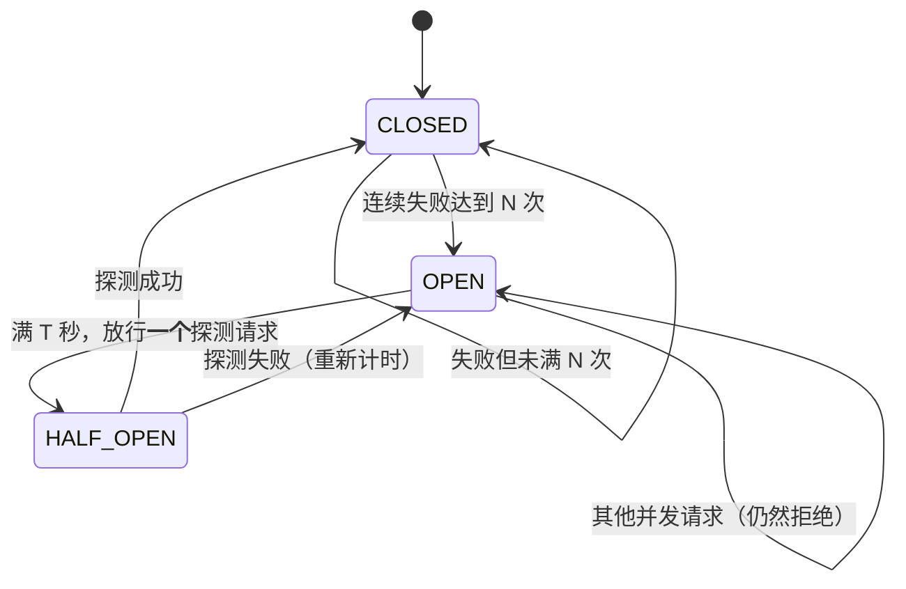

# 15 调用可靠性：总时间预算与熔断器

> **目标**：让「上游挂掉」这件事不再占住我们的线程、不再拖死我们的探活。
>
> **背景**：`docs/11` §7 量到一个数字——单次调用最坏能占住一个线程 **820 秒 ≈ 13.7 分钟**（我们自己重试 3 次 × openai SDK 自带重试 2 次 = 9 次 HTTP 请求 × read 90s + 两层退避）。这不是理论上限，是当时真实测出来的。
>
> **为什么 820 秒是问题**：uvicorn 的同步端点共享一个 40 槽的线程池。45 个并发会话把池占满后，`/health` 也会排队 → 探活超时 → 负载均衡判服务挂掉去重启。而上游其实只是慢。**我们把「上游慢」错报成了「我们挂了」。**
>
> **建议阅读顺序**：**1 结论先行 → 2 两个机制各管什么 → 3 代码变更地图 → 4 逐行解读（反直觉的那几条）→ 5 实测 → 6 自己复现 → 7 测试 → 8 还没修好的 → 9 小结**。只想看结论读 §1 和 §8。
>
> **时间与条件**：2026-10-11 ~ 10-12，Windows 本地，`openai` 3.3.1，Python 3.14。§5 的数字全部由 `scripts/probe_deadline_breaker.py` 真跑得出（不联网、不花额度）。

---

## 1. 结论先行

原定的 P0/P1 清单，现在的状态：

| 项 | 内容 | 状态 |
| --- | --- | --- |
| P0 | 总时间预算（跨所有重试层，墙钟封顶） | ✅ `DEADLINE=30` |
| P0 | 关掉 SDK 那层重试，重试策略只留自己一份 | ✅ 上一轮已做（`OpenAI(max_retries=0)`） |
| P0 | `async def health()` | ✅ 探活不再需要线程池槽位 |
| P1 | 熔断器：连续 N 次失败 → 打开 T 秒 → 快速失败 | ✅ `BREAKER_FAILURE_THRESHOLD=3` / `BREAKER_OPEN_SECONDS=30` |
| P1 | 打开 `AUTH_TOKEN` / `RATE_LIMIT_RPM` | ⚠️ **没开，且不建议现在开**（见 §8.1） |
| P2 | 结构化 JSON 日志 + 告警 | ❌ 未做 |

实测效果（同一台「挂掉的上游」，真实 TCP socket，见 §5）：

| 场景 | 改造前 | 改造后 |
| --- | --- | --- |
| 一次调用最坏耗时（read=90，重试 3 次） | **276s ≈ 4.6 分钟** | **30s** |
| 一次调用最坏耗时（含 SDK 那层重试） | **900s = 15 分钟** | **30s** |
| 上游挂着时连续 6 次调用 | 6 次全发请求，6.10s | **只发 1 次**，1.02s（后 5 次 0.000s） |
| `/health` 探活 | 占线程池槽位，会被上游拖超时 | 跑在事件循环上，**0.008s** |

一个必须先说清的取舍：`DEADLINE=30` **会掐断 `docs/11` §7 实测到的 78.14s 长尾**（那次的 `reasoning=8533`）。中位延迟是 4.78~7.62s，所以这是砍尾不是砍腰，但它是真会发生的失败，不是理论风险。改一行 `.env` 就能放宽。

---

## 2. 两个机制各管什么

重试和熔断看起来都在处理失败，但**假设是相反的**：

```
                        一次 chat() 调用
                              │
          ┌───────────────────┴───────────────────┐
          │                                       │
    熔断器：要不要花预算                    时间预算：花了最多花多少
    ─────────────────────────                ─────────────────────────
    假设：下次**也不会**好                    假设：下次**可能**会好
    （连续失败是趋势，不是抖动）                （限流/断网/偶发 5xx 下次可能就成）
          │                                       │
    治：上游真的挂了                             治：偶发抖动
    动作：秒级失败，不发请求                      动作：退避后重发，但总时长有上限
          │                                       │
          └───────────────────┬───────────────────┘
                              ▼
            40 槽线程池不会被占满，/health 不会被拖死
```

**一句话记住分工**：熔断决定「要不要花预算」，时间预算决定「花了之后最多花多少」。两个都要——只有重试没有熔断，上游挂着时每个请求都各烧一遍完整预算；只有熔断没有预算，单个请求自己就能烧 276 秒。

### 2.1 熔断为什么值得加（不是过度设计）

成本结构是关键。上游「挂掉」的典型形态是**连得上但不回包**（TCP 握手成功，然后沉默），所以唯一的止损手段是等 read 超时——那是**分钟级**的。

没有熔断时，「上游挂了」的账单是这样算的：

```
每个在途请求：最多 30s（DEADLINE）   ← 有了 P0 之后，已经是能接受的上限
并发会话数：   40（uvicorn 线程池槽位数）
─────────────────────────────────
合计：         1200 秒 = 20 分钟的「线程占用总量」，而这段时间系统 0 产出
```

熔断打开后，只有**第一个**请求付了代价，后面全部秒级返回。§5 实验 2 实测：6 次调用里真的发出去的 HTTP 请求是 1 个，不是 6 个。

### 2.2 为什么要「先探测一个」再放行



`HALF_OPEN` 存在的理由：如果窗口一到就把**所有**请求都放过去，上游还没恢复的话，等于集体重复付一次代价。放一个、看到结果再决定，代价最小。

并发下这里有个必须处理的坑：线程池里 40 个请求同时醒来，如果没有「只放一个」的约束，HALF_OPEN 会瞬间变成放行 40 个。`check()` 里 `HALF_OPEN` 状态也抛 `CircuitOpenError`，就是这个约束（§4.3 有个我踩过的真 bug）。

---

## 3. 代码变更地图

| 文件 | 状态 | 改了什么 |
| --- | --- | --- |
| `src/core/circuit_breaker.py` | 🆕**新增** | 熔断器本体：`CircuitBreaker`（三态、线程安全）+ `CircuitOpenError`。174 行，含注释 |
| `src/providers/openai_compat.py` | ✏️**改动** | ①把已存在的 `_remaining`/`_timeout_for`/`_backoff` **真正接线**（上一轮写成死代码了）；②新增 `_retry()` 收拢三个方法的重试判定；③三次尝试都传按预算收窄的 timeout；④每次失败记账给熔断器 |
| `src/core/provider.py` | ✏️**改动** | `BaseProvider` 新增 `breaker_state()`（默认报 `unknown`）；`DeadlineExceeded` 上一轮已定义，本轮首次被抛出 |
| `src/api.py` | ✏️**改动** | `health()` → `async def health()`；`/health` 新增 `upstream` 字段（熔断状态） |
| `src/core/service.py` | ✏️**改动** | 新增 `upstream_state()`，`/health` 从这取熔断状态 |
| `src/core/agent.py` | ➖**未改** | `provider` 属性上一轮就有，直接复用 |
| `src/config.py` | ✏️**改动** | 🆕`max_retries` / `deadline` / `breaker_failure_threshold` / `breaker_open_seconds` 四项 |
| `src/bootstrap.py` | ✏️**改动** | `build_provider()` 把这四个旋钮传给 provider |
| `src/core/memory.py` `tools.py` `rag.py` `mcp.py` `models.py` `logger.py` `embeddings.py` | ➖**未改** | Agent 核心一行没动。改动全在「供应商边界 + 探活端点」 |
| `static/index.html` | ➖**未改** | 前端读 `/health` 的逻辑不受影响（新增字段是向后兼容的） |
| `tests/test_deadline_breaker.py` | 🆕**新增** | 31 个测试：熔断器状态机、时间预算数学、重试循环、真实 socket 端到端 |
| `tests/test_bootstrap.py` | ✏️**改动** | 补 2 个测试锁住「新旋钮真的传进了 provider 内部」；`_settings()` fixture 补新字段 |
| `tests/test_security.py` | ✏️**改动** | 只补 `_boot_settings()` 的字段（否则构造 provider 时 AttributeError），**没有改任何断言** |
| `scripts/probe_deadline_breaker.py` | 🆕**新增** | §5 三个实验的来源，不联网 |
| `.env.example` | ✏️**改动** | 新增 4 个旋钮的说明与取舍 |
| `README.md` | ➖**未改**（等你决定） | 配置表和本期文档都还没更新，见 §8.6 |

**为什么熔断器是独立模块、不是塞进 provider**：`CircuitBreaker` 不认识 openai、不认识 HTTP，只认「一次调用成功还是失败」+ 一个「这个失败算不算上游的错」的谓词。这样它能被单独测（31 个测试里有 11 个只测熔断器，连 provider 都不构造），将来 RAG 的向量化请求、MCP 的外部工具调用要加熔断，直接复用。

---

## 4. 关键代码逐行解读

### 4.1 上一轮留下的死代码：三个助手函数没人调用

接手时的真实状态是这样的：

```python
# src/providers/openai_compat.py —— 上一轮写好的
def _remaining(self, deadline_start): ...
def _timeout_for(self, deadline_start): ...      # ← 定义了
def _backoff(self, attempt, deadline_start): ... # ← 定义了

def chat(self, messages):
    ...
    resp = self._client.chat.completions.create(**kwargs)   # ← 没传 timeout！
    ...
    except Exception as exc:
        if not _is_retryable(exc) or attempt >= self._max_retries - 1:
            raise
        attempt += 1
        time.sleep(2 ** attempt)              # ← 还是裸的固定退避，没有 _backoff
```

`_timeout_for` / `_backoff` / `DeadlineExceeded` 一个都没被引用——**那轮改动的线上效果是零**。这也是本期第一个结论：**写了助手函数不等于接线**，判「P0 做完了」得看调用点，不是看有没有定义。

### 4.2 timeout 按单次请求传，绝不改 client 属性

```python
resp = self._client.chat.completions.create(**kwargs, timeout=self._timeout_for(start))
```

`_timeout_for()` 每次调用都返回**新的** `httpx.Timeout` 实例，按剩余预算收窄：

```python
def _timeout_for(self, deadline_start):
    t = min(self._timeout, max(self._remaining(deadline_start), 1.0))
    return httpx.Timeout(connect=5.0, read=t, write=t, pool=t)
```

反直觉的点有三个：

1. **不能改 `self._client.timeout`。** provider 是多会话共享的单例，改 client 属性会让并发会话互相踩——A 会话把 read 收窄到 2s，B 会话的长请求就被 2s 掐断了。按单次请求传就没这个问题，且 openai SDK 支持。
2. **收窄的是第一次尝试，不只重试。** `deadline=30 < request_timeout=90` 时，**第一次**尝试的 read 也只有 30s。这是刻意的——不这么做的上限是 90s，不是 30s。副作用是 `REQUEST_TIMEOUT` 现在事实上被 `DEADLINE` 压住，`.env.example` 里写清楚了。
3. **地板是 1.0s。** `max(..., 1.0)` 保证预算耗尽时也给个最小值，否则 httpx 会立刻拒绝而不是干净地报超时。

### 4.3 熔断器初版有个真 bug：探测变成放行全部

第一版 `check()` 是这样的，测试立刻抓出错了：

```python
def check(self):
    with self._lock:
        if self._state != self.OPEN:
            return                              # ← bug 在这
        ...
        self._state = self.HALF_OPEN            # 第一个请求切到这里
```

状态切到 `HALF_OPEN` 后，**后来的请求走 `if state != OPEN: return` 直接被放行了**。于是「只放行一个探测」变成了「窗口一到，放行全部」——40 个并发请求同时醒来，集体重复付一次代价，这正是熔断器想避免的事。

修法是让 `HALF_OPEN` 也拒绝：

```python
def check(self):
    with self._lock:
        if self._state == self.CLOSED:
            return
        if self._state == self.HALF_OPEN:
            raise CircuitOpenError(1.0, self._failures)   # 探测在别家身上
        # state == OPEN
        elapsed = self._clock() - self._opened_at
        if elapsed < self._open_seconds:
            raise CircuitOpenError(self._open_seconds - elapsed, self._failures)
        self._state = self.HALF_OPEN              # 到点：放行这一条，它成了探测请求
```

修完后 `_probe_in_flight` 这个布尔标记变成了多余的——`HALF_OPEN` 状态本身就是「有一个探测在路上」，砍掉了。`tests/test_deadline_breaker.py::test_half_open_allows_exactly_one_probe` 锁住这条。

### 4.4 每次失败都记账，不只记最终结果

`_retry()` 的第一版只在「放弃重试」时记账，测试又抓出一个问题：

```python
# 第一版（错的）
def _retry(self, exc, attempt, start):
    if not _is_retryable(exc) or attempt >= self._max_retries - 1:
        self._breaker.record_failure(exc)      # 只有放弃时才记
        raise exc
    ...重试...
```

后果：一条调用要把 **30s 预算全部烧完**才可能让熔断器打开。那「上游真挂时秒级失败」就变成了「上游挂时先陪它烧 30 秒」——P1 的核心价值（§2.1）直接归零。

改成每次失败都记：

```python
def _retry(self, exc, attempt, start):
    self._breaker.record_failure(exc)          # 每次失败都记
    if not _is_retryable(exc) or attempt >= self._max_retries - 1:
        raise exc
    ...
```

**这个改动的副作用要写出来**：`BREAKER_FAILURE_THRESHOLD=3` 且 `MAX_RETRIES=3` 时，**一条调用的 3 次重试就能打开熔断**，不需要三个不同的请求。我判断这是对的——一个请求连续失败 3 次说明上游确实不健康——但代价是「单次抖动」也可能让其他会话吃到 `CircuitOpenError`。要改宽松就把阈值调大到 10 以上。`.env.example` 里没写这条权衡，因为它是配置项组合出来的，不是配置项本身。

### 4.5 4xx 和空回复不进熔断

```python
def _is_unhealthy(exc):
    """这个失败算「上游不健康」吗？熔断器只统计这类。"""
    return _is_retryable(exc) or isinstance(exc, DeadlineExceeded)
```

反直觉的是**为什么要把「不算」的写出来**。4xx（鉴权失败、参数错）和空回复都说明**上游活着**——是我们配置或请求参数的问题。让它们计入熔断，结果是一个能立刻看懂的报错（`API Key 错误`）被换成一个看不懂的报错（`已熔断`），排查时反而更难。测试 `test_auth_error_not_retried_and_not_counted` 断言：401 之后 `breaker.failures == 0`。

`DeadlineExceeded` 要计入——预算用光本身就是「上游太慢/挂了」的证据。

### 4.6 `chat_stream` 的预算起点，比你想的晚

```python
def chat_stream(self, messages):
    kwargs = self._build_kwargs(messages, stream=True)
    start = time.monotonic()          # ← 这行什么时候执行？
    ...
```

`chat_stream` 是**生成器**，函数体要到第一次 `next()` 才执行。所以 `start` 和第一次熔断检查都发生在消费方开始迭代的那一刻，不是 `chat_stream()` 被调用的那一刻。这个项目的调用方式（`src/core/agent.py` 里立刻 `for chunk in ...`）下两者几乎同时，但语义上必须知道。

### 4.7 UnicodeError 回退分支不能再记一次失败

```python
except UnicodeError:
    yield from self.chat(messages)     # 回退非流式
    return
```

回退那次的调用由 `chat()` 自己检查熔断、自己记账。如果流式这条分支再记一次，同一个失败会被算两遍。这是三个方法共用 `_retry()` 之后唯一一处需要人肉避开的重复。

### 4.8 `/health` 改 async 的前提：它自己不能碰上游

```python
@app.get("/health")
async def health():
    ...
    return {
        "ok": True,
        "model": provider_label(),                    # 只读 settings，不建连接
        "max_input_chars": service.max_input_chars,   # 内存属性
        "upstream": service.upstream_state(),         # 读熔断器内存字段
    }
```

同步端点跑在 uvicorn 的 40 槽线程池里。线程池被「等上游超时」的请求占满后，同步的 `/health` 也会排队 → 探活超时 → 负载均衡判挂。改成 `async def` 后它跑在事件循环上，**永远不需要槽位**。

改这个的前提是确认 `/health` 不碰任何阻塞 I/O：`provider_label()` 读的是模块级 `settings`（不建连接、不发请求）、`breaker_state()` 读的是内存字段。如果哪天想让它顺手探一下上游连通性，**必须先把它改回同步**——否则一次网络 I/O 会卡住整个事件循环。

---

## 5. 实测

`scripts/probe_deadline_breaker.py`，本地起一个只接请求、永不回字节的 TCP 服务端当「挂掉的上游」。

⚠ **必须用真实 TCP socket。** 自定义 httpx transport 里放 `time.sleep` 触发不了 read timeout——用假 transport 写这个测试，它会「通过」，然后把回归漏到生产。这也是 `docs/13` 那个超时测试用的同一套路子。

为让脚本几十秒内跑完，`timeout` 用的是 3s 而不是配置的 90s（缩小 30 倍）。线性放大的结论不受影响，文末按真实配置外推。

### 5.1 时间预算

```
A. 不封顶（deadline 极大，等价于改造前）
   1 次调用 = 15.54s  →  APITimeoutError
   服务端收到的连接数 = 3（3 次重试各发一次）

B. 封顶（deadline=1.0）
   1 次调用 = 1.01s  →  DeadlineExceeded
   服务端收到的连接数 = 1（预算用完即停，不再重试）

外推到真实配置（read=90s，3 次重试）：
   A 不封顶：276s ≈ 4.6 分钟
   B 封顶：30s
   A 若叠加 SDK 那层重试（3×3=9 次 HTTP 请求）：900s = 15 分钟
```

注意 A 抛的是 `APITimeoutError`、B 抛的是 `DeadlineExceeded`——**错误类型也变了**，上层能区分「一次请求超时」和「整条调用超预算」，不用再靠猜耗时。

### 5.2 熔断

```
无熔断（阈值 0 = 关闭）
   6 次耗时：1.006s, 1.029s, 1.005s, 1.015s, 1.025s, 1.025s
   总耗时 6.10s　服务端收到的连接数 = 6

有熔断（连续 1 次失败即开）
   6 次耗时：1.020s, 0.000s, 0.000s, 0.000s, 0.000s, 0.000s
   总耗时 1.02s　服务端收到的连接数 = 1
```

服务端视角数的连接数，比客户端数 `create()` 调用次数更硬——mock client 数不到「真的有没有连上」。

### 5.3 半开探测

```
第 1 次：1.024s → APITimeoutError　熔断状态 open
第 2 次：0.0000s → CircuitOpenError　open（OPEN 期间秒级失败，没有发请求）
等待 2.5s 让熔断窗口过期…
第 3 次：1.007s → APITimeoutError　open（HALF_OPEN 探测）
第 4 次：0.0000s → CircuitOpenError　open（探测失败，重新 OPEN）

4 次调用里真的发出去的 HTTP 请求 = 2
```

`CircuitOpenError` 的报错文案是「上游连续失败 N 次，已熔断，约 Xs 后自动恢复；请稍后重试」——**不告诉人「重启服务」**，因为它本来就会自己恢复。

### 5.4 真实上游没被弄坏

```
deadline   : 30.0 s | max_retries: 3 | read timeout: 90.0
real call  : 1.17s -> '1+1等于2'          breaker: closed, failures: 0
chat_stream: 0.93s, 3 chunks              breaker: closed, failures: 0
/health    : 0.008s（async，跑在事件循环上）
```

正常路径的延迟没有变化——预算只在上游不健康时才收紧。

---

## 6. 自己复现一遍

```bash
# ① 三个实验：时间预算 / 熔断 / 半开探测（本地假上游，不联网不花额度）
python -X utf8 scripts/probe_deadline_breaker.py

# ② 看新旋钮真的生效了（改了 .env 之后确认配置传进去了）
python -c "from src.bootstrap import build_provider as b; p=b(); \
print('deadline', p._deadline, '| retries', p._max_retries, \
'| breaker', p.breaker.failure_threshold, '/', p.breaker.open_seconds)"

# ③ 看 /health 现在报什么
python -c "from fastapi.testclient import TestClient; \
from src.api import create_app; from src.bootstrap import build_service; \
print(TestClient(create_app(build_service())).get('/health').json())"

# ④ 想放宽 30s 预算：改 .env 一行
#    DEADLINE=90     ← 回到「不掐长尾」，代价是单次调用最坏 90s
```

---

## 7. 测试

**245 passed**（改造前 212，新增 33）。

`tests/test_deadline_breaker.py`（31 个）分组：

| 分组 | 测什么 | 测试名 → 对应代码 |
| --- | --- | --- |
| 熔断器状态机（11） | 三态迁移的每条边 | `test_breaker_opens_after_n_consecutive_failures` → `record_failure` 达到阈值<br>`test_success_resets_the_consecutive_counter` → 数的是「连续」失败<br>`test_open_breaker_rejects_fast_without_waiting` → 断言抛错的耗时 < 0.05s<br>`test_half_open_allows_exactly_one_probe` → §4.3 那个 bug 的守卫<br>`test_half_open_probe_failure_reopens` → 探测失败重新计时<br>`test_failure_while_open_does_not_extend_the_window` → 熔断不会被自己的快速失败无限延长 |
| 时间预算数学（4） | 收窄逻辑本身 | `test_timeout_for_narrows_read_to_remaining_budget`<br>`test_timeout_for_never_goes_below_one_second`<br>`test_backoff_gives_up_when_budget_is_too_small`<br>`test_timeout_is_passed_per_request_not_on_the_client` → 断言 `client.timeout` **没被改动过** |
| 重试循环（4） | 三个方法各自遵守预算 | `test_retry_exhausts_then_raises_the_original_error` → 断言退避是 `[2.0, 4.0]`<br>`test_budget_exhausted_raises_deadline_exceeded`<br>`test_complete_also_honors_the_deadline`<br>`test_chat_stream_honors_the_deadline` |
| 不该计入（4） | 4xx / 空回复不熔断 | `test_auth_error_not_retried_and_not_counted`<br>`test_retryable_5xx_does_count_toward_the_breaker`<br>`test_empty_reply_is_not_counted_by_breaker`<br>`test_success_after_failure_resets_the_counter` |
| 熔断与调用链路（4） | 端到端接上 | `test_breaker_opens_then_new_calls_fail_fast_without_touching_the_upstream` → 断言 `create.call_count == 1`<br>`test_retry_stops_when_breaker_opens_midway` → §4.4 的守卫 |
| `/health`（3） | async + 报状态 | `test_health_endpoint_is_async`<br>`test_health_reports_upstream_state`<br>`test_health_still_works_with_a_provider_without_a_breaker` |
| 端到端（1） | 真实 socket | `test_wall_clock_is_bounded_by_deadline_against_a_hanging_server` |

`tests/test_bootstrap.py` 新增 2 个：

- `test_build_provider_passes_budget_and_breaker_knobs` —— **锁住 4 个新旋钮真的传进了 provider 内部**。这种测试不测功能、只测「配置没有被吞掉」，价值在于：以后有人在 `build_provider()` 里漏传一个参数，它会第一个红。
- `test_build_provider_can_disable_breaker` —— 阈值配 0 是关闭熔断的开关。

两个测试手法上的点：

- **退避不真等。** `no_sleep` fixture 把 `time.sleep` 换成记账实现，测试能在 3 秒内跑完，同时还能断言退避节奏（`no_sleep == [2.0, 4.0]`）。
- **超时用真实 socket。** 只有 `test_wall_clock_is_bounded_by_deadline_against_a_hanging_server` 起真 TCP 服务端。这条不便宜（~1s），但它是唯一能证明「墙钟真的被封顶了」的那条——其余全是 mock，mock 里连「有没有真的等过」都是假的。

---

## 8. 还没修好的（诚实清单）

### 8.1 `AUTH_TOKEN` / `RATE_LIMIT_RPM` 没开 —— 而且现在开会直接把 Web 界面搞挂

清单里写了「打开」，我没做，理由不是懒：`static/index.html` 里 **6 处 `fetch` 全部不带 `X-Agent-Token` 请求头**。真把 `AUTH_TOKEN` 设上非空值，所有 `/api/*` 请求会全部 401，聊天界面直接不可用——除非先给前端加带 token 的 fetch 封装。

而且 `docs/13` §4.6 本来就判过这条：「本项目跑在 127.0.0.1、没有攻击面，这两个中间件的价值是掌握写法，不是真防护」，`config.py` 里的注释也是同一个结论。

**要做的话是一个小改动，不是一行配置**：前端加 token 获取/传递 + `.env` 填值 + 一条 e2e 断言。你决定要不要做。

### 8.2 `DEADLINE=30` 会掐断 78.14s 的长尾

`docs/11` §7 实测：同一句「不超过 60 字」的提问，`reasoning=8533` 时跑到 78.14s，中位只有 7.62s。`DEADLINE=30` 意味着那类请求会抛 `DeadlineExceeded` 而不是等完。

这是清单里你自己定的目标值（「墙钟 30s」），我按它做了，但代价是真的。放宽改 `.env` 一行。**注意放宽到 90 以上就回到「一次调用占住线程十几分钟」的老问题了**——放宽只是把长尾还给你，不是免费的。

### 8.3 预算不约束流式传输的中段

`DEADLINE` 管的是「从调用进入到第一次尝试失败为止」。流式一旦开始往外吐字，**逐 chunk 的间隔受 read timeout 约束，不受 deadline 约束**——服务端每隔 3 秒挤一个字，流可以拖很久。

要管住那一段得上看门狗线程（独立线程盯着总耗时、主动断流）。这个项目的对话场景里不值得，代码里留了注释说明这条边界，没有假装它不存在。

### 8.4 熔断器是进程内单例，多进程部署各算各的

`CircuitBreaker` 的状态在进程内存里。起两个 uvicorn worker 就是两个互不相干的熔断器，各要失败 3 次才开。这和 `docs/13` 里内存版速率限制的局限是同一个。单机本地没问题；真要多进程得上共享存储。

### 8.5 P2（结构化 JSON 日志 + 告警）完全没做

熔断打开/恢复现在只在 `data/logs/agent.log` 里有一条 `ERROR`/`WARNING`。没有告警通道、没有 JSON 结构化输出，出事还是得人来翻日志。

### 8.6 遗留的文档不一致（2026-10-12 已修）

写作时这几处**没有擅自改 README**，留给你点头。你确认后一次性改完了，做法是：

- **`README.md`**：配置表补了 4 个新旋钮；`openai_compat.py` 的描述补上「时间预算 / 熔断」；第 267 行那条「429 已内置自动重试，稍等即可恢复」重写成完整的失败处理说明（含 `DeadlineExceeded` 和熔断，并点明 4xx 不重试）；项目结构补 `15_调用可靠性.md` 和 `probe_deadline_breaker.py`；里程碑清单和里程碑表各加一行。
- **`docs/11`**：**没有改写正文**——那是 M8 的历史记录，改掉就失真了。按它自己已有的体例（开头那段「本文档写于 SenseNova 时代」banner）追加了一条，指向本文档；并在 §4.2 那段过时的重试代码后面加了一行 🔁 标记，直接指到本文档 §4。两处文字都保留原样，「不重试」「`except` 顺序」两条决策仍然有效。
- **`docs/11` §7 的 820s**：没改数字，改的是**对它的解读**——那笔账里 3×3=9 次请求有一半是 SDK 自己重试的，那层已经关掉，单层最坏现在是 276s。820s 作为「为什么要做这个」的动机仍然成立，banner 里写清楚了别当成现在的数字。

---

## 9. 小结

这一期的净收益是把**「上游挂了」对系统的影响从 15 分钟压到 30 秒 + 毫秒**，而更实质的收获是分清了三件一直混在一起的事：

| 问题 | 原来怎么记 | 现在怎么记 |
| --- | --- | --- |
| 请求慢 | 一个「超时」 | **单次请求超时**（`APITimeoutError`，read 90s） |
|  |  | **整条调用超预算**（`DeadlineExceeded`，30s）——错误类型都分了 |
| 上游不可用 | 每个请求各烧一遍 | 熔断打开后**不发请求**，秒级返回 |
| 我们自己挂了 | 探活超时 | 探活跑在事件循环上，`/health` 0.008s 且**自带上游状态** |

`/health` 里加 `upstream` 字段那一步值得单独说一句：它本来只是「改一个词」（`def` → `async def`），但顺手把熔断状态暴露出来之后，**出事时能一眼分清是「我们自己的服务」还是「上游」的问题**。`docs/11` 那次的教训正是分不清这个——把「上游慢」误读成了「服务挂」，然后重启了一个健康的进程。

两处反直觉的地方最值得记住：**收窄的是第一次尝试而不只是重试**（否则上限是 90s 不是 30s），以及 **HALF_OPEN 必须也拒绝**（否则「放行一个探测」会变成「放行全部」）。这两条都是测试抓出来的，不是设计时想到的——这也是为什么这次写了 33 个测试而不是 5 个。

**验收对照**：

| 验收项 | 结果 |
| --- | --- |
| 总时间预算封顶 | ✅ 实测 15.54s → 1.01s（read 用 3s，是配置的 90s 的 1/30）；外推 276s / 900s → 30s |
| 关 SDK 重试，策略只留一份 | ✅ 上一轮已做，本轮复用 |
| `async def health()` | ✅ 实测 0.008s，不再占线程池槽位 |
| 熔断器（连续 N 次 → 打开 T 秒 → 秒级失败） | ✅ 实测 6 次调用只发 1 个 HTTP 请求；半开只放行 1 个探测 |
| 打开 `AUTH_TOKEN` / `RATE_LIMIT_RPM` | ⚠️ **未做**，且现在开会弄挂 Web 界面（§8.1），等你决定 |
| 结构化 JSON 日志 + 告警 | ❌ 未做（§8.5） |
| Agent 核心未改动 | ✅ `agent.py` / `memory.py` / `tools.py` / `rag.py` / `mcp.py` / `models.py` 零改动 |
| 正常路径无回退 | ✅ 真实调用 1.17s / 流式 0.93s，熔断器 closed |
| 单元测试 | ✅ **245 passed**（改造前 212，新增 33） |
